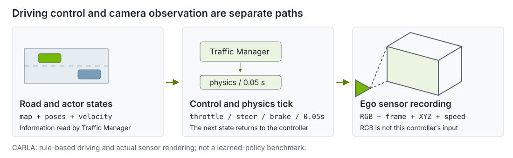

# Drive through four environments from the ego camera

[한국어](../../ko/labs/carla-ego.md) · [Source code](../../../labs/carla-ego/)

## What is moving, and what does the camera measure?

Explore city streets, a rainy junction, a sunset suburb and a foggy highway through **CARLA RGB cameras**. The four-view recording makes the different scenes easy to compare.



### The driver and the camera have different jobs

CARLA **Traffic Manager** controls the vehicle using the simulated road network and traffic states. The RGB camera records the view from the car; it is not the controller’s input. [Traffic Manager documentation](https://carla.readthedocs.io/en/0.9.16/adv_traffic_manager/)

One simulation tick advances time by `0.05 s`. Two attached cameras capture that same tick: ego at `(0.3, 0, 1.45) m` relative to the vehicle, and chase at `(-6, 0, 3) m`. The original RGB sensor buffer has shape `[540, 960, 4]`, with `uint8` BGRA channels. `capture.py` removes alpha and reverses BGR to RGB before writing video. A frame ID pairs an image with the vehicle's measured position and speed.

```text
Road network + current actor states → Traffic Manager → vehicle controls
                                                     ↓
                              CARLA physics → next actor states
                                                     ↓
                          RGB camera + vehicle pose → recorded sample
```

### Read the four cases

| Grid position | Environment | What to compare |
|---|---|---|
| Top left | Town10HD / clear noon | Road markings, traffic, buildings and the driver's view |
| Top right | Town03 / heavy rain | Wet surfaces and visibility at a junction |
| Bottom left | Town02 / wet sunset | Residential streets and changing lighting |
| Bottom right | Town04 / fog | How quickly distant objects disappear |

Watch road markings, lighting and visibility across the four routes.

## Run your own ego-camera recording

### 1. Start a dedicated server

Use Linux with an NVIDIA graphics driver, Docker and NVIDIA Container Toolkit. Run `nvidia-smi` first. Stop here if it cannot see your GPU; the [environment guide](../onboarding/nvidia-linux.md) explains that check. The server and Python client must both be **0.9.16**. We use this packaged release; the repository's default development branch targets a different Unreal version.

Open terminal A in the repository and run:

```bash
docker pull carlasim/carla:0.9.16
docker run --rm --name physical-ai-carla --gpus all --shm-size=2g \
  -e NVIDIA_DRIVER_CAPABILITIES=all \
  -p 127.0.0.1:24000-24002:24000-24002 \
  carlasim/carla:0.9.16 /bin/bash CarlaUE4.sh \
  -RenderOffScreen -nosound -carla-rpc-port=24000 -quality-level=Epic
```

Keep terminal A open. `-RenderOffScreen` still renders real cameras; it does not open a simulator window. The ports listen only on your machine. Run on a free GPU, independently of other simulator sessions.

### 2. Attach cameras and record

In terminal B, from the same repository:

```bash
python3 -m venv .venv-carla
source .venv-carla/bin/activate
python -m pip install carla==0.9.16 numpy pillow imageio imageio-ffmpeg
python labs/carla-ego/capture.py --output runs/carla-ego
```

Wait for each `synchronized frames` message. `capture.py` loads each map, creates its own vehicles and cameras, advances a synchronous simulation, saves ego/chase MP4s, and destroys only those actors afterward. `result.json` records every frame's position in meters and speed in m/s. If a route barely moves, the script reports it so you can inspect a red light, traffic, or spawn location before presenting a driving clip.

### 3. Make the web comparison

With FFmpeg available:

```bash
python labs/carla-ego/package.py --input runs/carla-ego --output runs/carla-web
python3 labs/carla-ego/check.py
```

The packaging step adds platform/map labels, reduces video size, and makes the four-view grid. When finished, stop your server with `docker stop physical-ai-carla` in another terminal.

## Check the result and choose the next experiment

Watch the videos or run `check.py` without a GPU to validate the saved frames and vehicle positions. [Run details](../../../labs/carla-ego/recorded.json).

Use [CARLA → fVDB reconstruction](spatial-reconstruction.md) to turn known camera views into an actual 3DGS scene. Use [Alpamayo inference](world-driving.md) to inspect a learned model's outputs, then the [AlpaSim guide](../workflows/alpasim-closed-loop.md) for policy evaluation with the required scene access. These are separate execution paths.

**Credits:** [CARLA](https://github.com/carla-simulator/carla/tree/0.9.16) · [Asset and media terms](../../../site/public/showcase/SPATIAL-CREDITS.md).