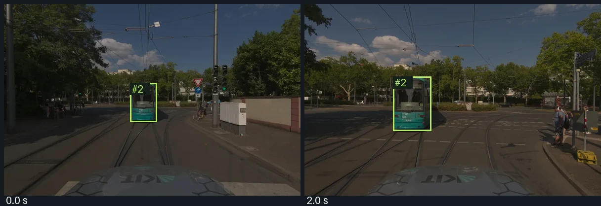

# Build the Frankfurt RGB Reality View

[한국어](../../ko/labs/frankfurt-reality.md)

## Start in the browser

1. Open the [Frankfurt 3D demo](nurec-rgb-reality.md#frankfurt-3d), choose **Tram and intersections**, then press **Start 3D**. The small **RGB tracking inset** shows what the selected camera actually saw while the Volvo follows the recorded route.
2. Select **Camera RGB → Front**. Compare **0.0 s** and **2.0 s**. The tram moves left and grows in the image while its ID stays **#2**.
3. At the same time, switch to **Rear**, then **3D cameras**. The camera changes and the timeline stays put. In **Free orbit**, drag to see the reconstructed lane from a new angle.



The source footage is sampled every 0.5 seconds in this route. In 3D, the camera interpolates between recorded poses as you scrub or play. Check the [28-second walkthrough](nurec-rgb-reality.md#reality-kitscenes-surround) for all three routes.

## How the demo works

**Cameras and poses.** Each time has six synchronized RGB images. The supplied intrinsics `K` describe the focal lengths and optical center. Mask2Former labels pixels so moving objects, sky, and the visible recording vehicle can be screened out of feature matches. LoMa-B matches stable details across images. COLMAP estimates a camera pose and sparse 3D points, then bundle adjustment refines them by reducing the distance between observed and reprojected points in pixels.

**Three layers make one road.** The road mask and recovered cameras let us project color from several photos onto a shared surface. Blending those observations yields `ground.webp`, which keeps lane paint readable. Observed sky pixels form the directional `sky.webp` panorama. gsplat fits the static surroundings, such as facades and trees. We convert the Gaussians to `scene.spz` for the browser. The avenue uses denser input sampling and a pass that removes floating Gaussians above the driven lane.

**Real traffic and the Volvo.** RT-DETR predicts a box, class, and confidence for each sampled RGB image. The tracker compares box motion and crop color across frames in each camera. It groups overlapping bus and train detections of the tram so it has one ID. The browser draws the boxes over the matching recorded image. A long occlusion or a different camera can give a vehicle a new ID. Separately, the added Volvo reference mesh follows the recorded ego route. Its four tire contact points are computed from mesh vertices and aligned to the rendered road height.

| Route | Samples × cameras | Duration |
| --- | ---: | ---: |
| Downtown bridge | 25 × 6 = 150 | 7.2 s |
| Tram and intersections | 40 × 6 = 240 | 19.5 s |
| Tree-lined avenue | 91 × 6 = 546 | 27.0 s |

The inputs are RGB and camera intrinsics. The route consists of estimated poses with a scene-relative scale. The three routes use [KITScenes Multimodal](https://kitscenes.org/multimodal/) RGB from the [Voxel51 public sample](https://huggingface.co/datasets/Voxel51/kitscenes-multimodal), under CC BY-NC 4.0 and KITScenes terms. [Data and Volvo credits](https://james-joobs.github.io/awesome-nvidia-physical-ai/showcase/reality-kitscenes/ATTRIBUTION.txt).

## Inspect the saved data without a GPU

Use Python 3 and curl in a terminal. This example downloads a small JSON file and reads the same two boxes you saw on screen. The index for `times` also indexes the frames under each camera in `cameras`.

```bash
python3 - <<'PYTHON'
import json
from subprocess import check_output

url = ("https://james-joobs.github.io/awesome-nvidia-physical-ai/"
       "showcase/reality-kitscenes/tram/road/tracks.json")
tracks = json.loads(check_output(
    ["curl", "-fsSL", "--max-time", "30", url]
))

for t in (0.0, 2.0):
    index = tracks["times"].index(t)
    row = next(item for item in tracks["cameras"]["front"][index] if item[0] == 2)
    track_id, category, box, score = row
    pixels = [round(v * size) for v, size in zip(box, (768, 498, 768, 498))]
    print(f"{t:.1f} s | ID {track_id} | {category} | {pixels} | {score:.2f}")
PYTHON
```

The first row should show ID `2`, class `transit`, box `[327, 204, 395, 307]` in pixels, and confidence `0.57`. In the JSON the four numbers are fractions of the frame width or height, in the order **left, top, right, bottom**. For example, `0.4253 × 768 ≈ 327` places the left edge 327 pixels from the left side. The score is a detector confidence. Compare the two rows to see the box move while the ID stays fixed.

## Prepare an RTX machine

Open a Bash or Zsh terminal on a Linux machine with an NVIDIA GPU. The reproduction was exercised with one RTX 5090, Python 3.12, PyTorch 2.9.1 with CUDA 12.8, a CUDA 12.9 toolkit, and Node.js 24. The CUDA toolkit supplies `nvcc` for the first gsplat build. `nvidia-smi` checks the GPU and driver. Use the [NVIDIA Linux setup guide](../onboarding/nvidia-linux.md) if the GPU is missing there.

```bash
nvidia-smi
python3.12 --version
node --version
c++ --version
git clone --depth 1 https://github.com/james-joobs/awesome-nvidia-physical-ai.git
cd awesome-nvidia-physical-ai
python3.12 -m venv .venv-frankfurt
source .venv-frankfurt/bin/activate

export CUDA_HOME=/usr/local/cuda
export PATH="$CUDA_HOME/bin:$PATH"
nvcc --version
python -m pip install 'torch==2.9.1' 'torchvision==0.24.1' \
  --index-url https://download.pytorch.org/whl/cu128
python -m pip install 'transformers==5.24.1' 'huggingface-hub==2.4.0' \
  'opencv-python==5.1.0.95' 'numpy==2.5.4' 'scipy==1.18.1' 'Pillow==13.0.0' \
  'pycolmap==4.2.1' 'gsplat==1.5.3' 'ninja==1.13.2' \
  'git+https://github.com/davnords/LoMa@ecc947d44ddc9d50387e887bbedc743d65ffac00'
python -c 'import torch; print(torch.cuda.is_available(), torch.version.cuda)'
```

Run the remaining blocks in the same terminal, from the repository directory. If you already cloned it, enter that checkout and start at the environment setup. If the CUDA check prints `False`, fix the driver or PyTorch installation first. Set `CUDA_HOME` to the toolkit directory shown on your machine if it differs.

## Rebuild the 7.2-second bridge

**1. Download RGB and recover the cameras.** The pinned dataset revision keeps the example aligned with the published sample. The default picks 25 timestamps across six cameras and downloads those images and their intrinsics. COLMAP should report 150 registered views.

```bash
export FRANKFURT_CODE=labs/nurec-rgb-reality/road/highres
export FRANKFURT_WORK="$(mktemp -d)"
printf '%s\n' "$FRANKFURT_WORK"

python "$FRANKFURT_CODE/fetch_kit.py" --out "$FRANKFURT_WORK/data" \
  --revision e6cdac8eb56b2a8ee329cd31b16800cda53ef3e0
python "$FRANKFURT_CODE/reconstruct.py" --input "$FRANKFURT_WORK/data" \
  --output "$FRANKFURT_WORK/sfm"
```

**2. Fit the static scene.** The recovered poses tell gsplat the viewpoint of every training photo. This stage writes `fit/scene.ply`, `fit/sky.webp`, and the quality report `fit/fit.json`. The first run may spend time compiling the CUDA extension before training output appears.

```bash
python "$FRANKFURT_CODE/train.py" --input "$FRANKFURT_WORK/data" \
  --sfm "$FRANKFURT_WORK/sfm" --output "$FRANKFURT_WORK/fit"
```

**3. Assemble the road and track the recorded traffic.** Convert the Gaussians to SPZ for the viewer. Export the road texture and six synchronized camera streams, run RT-DETR and link the boxes, then fill small texture gaps beneath the Volvo on this bridge.

```bash
export FRANKFURT_ROAD="$FRANKFURT_WORK/browser/road"
npm exec --yes --package=@playcanvas/splat-transform@3.12.0 -- splat-transform \
  "$FRANKFURT_WORK/fit/scene.ply" "$FRANKFURT_WORK/fit/scene.spz" --spz-version 3
python "$FRANKFURT_CODE/package.py" --input "$FRANKFURT_WORK/data" \
  --sfm "$FRANKFURT_WORK/sfm" --fit "$FRANKFURT_WORK/fit" --output "$FRANKFURT_ROAD"
python "$FRANKFURT_CODE/surround.py" --input "$FRANKFURT_WORK/data" \
  --sfm "$FRANKFURT_WORK/sfm" --fit "$FRANKFURT_WORK/fit" --output "$FRANKFURT_ROAD"
python "$FRANKFURT_CODE/track_rgb.py" "$FRANKFURT_ROAD"
python "$FRANKFURT_CODE/fill_contact_gaps.py" "$FRANKFURT_ROAD"
```

## Check your result and open it locally

```bash
python "$FRANKFURT_CODE/check.py" --package "$FRANKFURT_ROAD" --route bridge
```

Look for `KITSCENES_NOVEL_VIEW_OK: bridge, 150 registered camera views, 7.2 seconds`. The check covers asset hashes, camera and RGB alignment, box bounds, and repeated track IDs. The published bridge fit registered 150 views with roughly 1 px of mean reprojection error. That figure is measured on the fit's feature matches.

Build the static site, then run a local preview. This serves your new package for the bridge while using the existing viewer and controls.

```bash
npm --prefix site ci
npm --prefix site run build
python "$FRANKFURT_CODE/preview.py" --package "$FRANKFURT_ROAD"
```

Open one of the printed localhost links, choose **Downtown bridge**, and press **Start 3D**. Play part of the route, switch to **Camera RGB**, and check that rear and side photos change with the timeline. Use **Free orbit** to see the Volvo tires on the road. Stop the preview with **Ctrl+C**.

If the preview runs over SSH, forward port 8128 in a second local terminal before opening the printed address. Replace `user@gpu-host` with your SSH login.

```bash
ssh -N -L 8128:127.0.0.1:8128 user@gpu-host
```

[Other route settings and cleanup commands](../../../labs/nurec-rgb-reality/road/highres/README.en.md#reproduce) · [Pipeline code](../../../labs/nurec-rgb-reality/road/highres/) · [LoMa](https://github.com/davnords/LoMa) · [COLMAP](https://colmap.github.io/) · [gsplat](https://docs.gsplat.studio/) · [RT-DETR](https://huggingface.co/PekingU/rtdetr_r50vd)
