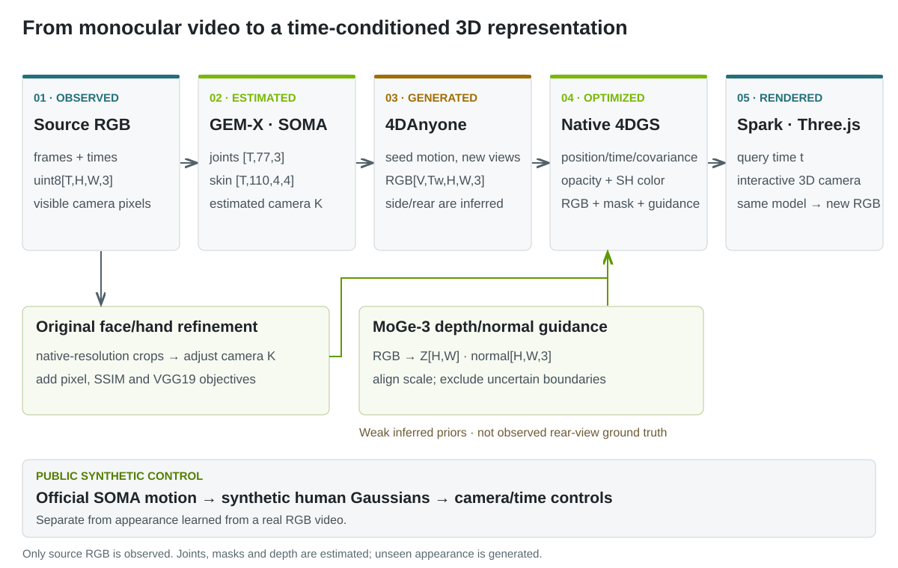
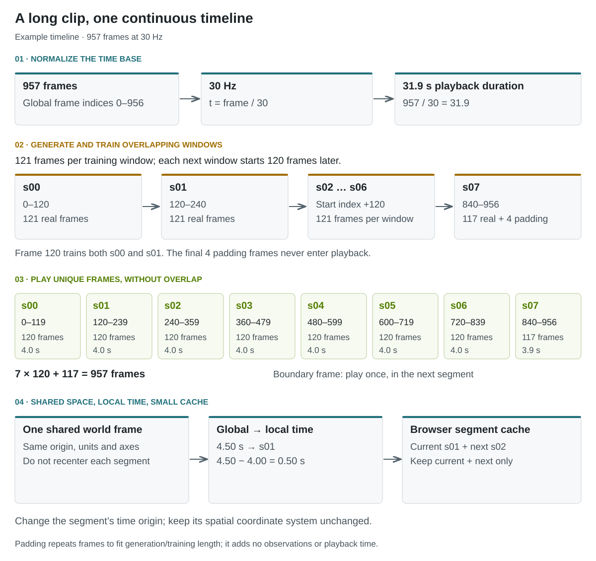

# Human 4D Gaussian Reconstruction from Monocular Video

[한국어](../../ko/labs/human-4d-gaussian.md) · [Lab source](../../../labs/human-4d-gaussian/) · [NVIDIA GPU setup](../onboarding/nvidia-linux.md)

Turn a single-camera motion video into an animated 3D representation. Explore the **31.9-second dance reconstruction** above, then follow **RGB → motion estimation → multiview generation → 4D Gaussian training → browser playback** with your own video.

Source: **지숭이_Jisoong — [체포하겠어🚨🚨](https://www.youtube.com/shorts/rWS8uli1-m0)**. The original plays through YouTube; the 3D viewer has its own playback controls.

## How it works



### 1. From video pixels to human motion

Each RGB frame is a `uint8[H,W,3]` array of red, green and blue values. A frame index and time keep the image aligned with the estimated pose.

**NVIDIA GEM-X** estimates body and hand motion. **SOMA** expresses that motion as human geometry and skin deformation. The main outputs are:

```text
rgb:          uint8[T, H, W, 3]    source color
joints:       float[T, 77, 3]      estimated joint XYZ
deformations: float[T, 110, 4, 4]  SOMA skin-deformation matrices
K:            float[T, 3, 3]       camera intrinsics
```

`T` counts video frames. The 77 joints locate body parts; the 110 skinning bones control how the surface deforms. These are different arrays serving different tasks.

### 2. Generate other viewpoints

Project the estimated motion into virtual cameras to make skeleton conditioning videos. **4DAnyone** combines those conditions with the source RGB to generate side and rear views. A foreground mask isolates the person in each view.

```text
source RGB + estimated motion
  → virtual-camera skeleton videos
  → 4DAnyone
  → multiview RGB + foreground masks
```

The original camera keeps its observed RGB training target. Side and rear appearance is generated; inspect clothing, hands and view direction before fitting the views together. The [source README](../../../labs/human-4d-gaussian/README.md) records the generation presets.

### 3. Make the Gaussians move

A Gaussian stores position, volume, opacity and color. A 4D Gaussian also stores time, so one model can render the moving person at a chosen moment.

```text
position + time + space/time covariance + opacity + color
  → evaluate at time t
  → project from the selected camera
  → composite particles into RGB
```

The archive contains `xyz[N,3]`, `time[N,1]` and `color_coefficients[N,16,3]`. Here `N` is the number of particles. Pause time to inspect one pose from different angles; keep the camera fixed to watch the motion.

### 4. Connect the full timeline



A 957-frame clip at 30Hz lasts 31.9 seconds. The pipeline trains 121-frame windows starting 120 frames apart, then removes overlap and final padding from playback. Every interval shares the same world coordinates. At global time 4.50 seconds, the second interval is evaluated at local time 0.50 seconds.

`extend` generates fresh views for each later interval and fits its 4D model. The browser loads the current interval and prepares the next one.

### 5. Refine detail and geometry

Face and hand refinement uses crops from the **original-resolution RGB**. Moving the crop's origin also changes the camera principal point `(cx,cy)`; the pixel-to-ray mapping must follow that crop.

**MoGe-3** estimates Z-depth `[H,W]` and normals `[H,W,3]`. Z-depth is distance along the camera's forward axis. A normal is a unit vector describing the direction a surface faces.

```text
RGB → MoGe-3 → depth + normals
                    ↓ align scale and cameras
4D model → rendered depth/normals → geometry loss
                    ↓
combine with RGB losses → update Gaussian parameters
```

Generated-view guidance receives less weight than the observed camera. Rendering uses gsplat; the interactive browser uses Spark/Three.js.

## Run the lab

### 1. Explore without a CUDA GPU

Choose **Start 3D** in the model panel above. Pause the dance, drag to inspect the sides or back, then play it from the new angle. The original YouTube player is controlled separately. The optional **synthetic SOMA rig example** provides another motion sample.

Inspect your trained result in the comparison video produced by `render`. The `package` stage creates model, motion and timeline data for a web viewer:

```text
my-result/
  manifest.json
  source.mp4
  browser/
    s00/meta.json + Gaussian data
    s01/meta.json + Gaussian data
```

### 2. Prepare an NVIDIA GPU machine

Use Linux x86_64 with an NVIDIA driver/CUDA toolchain, Git, Python and uv. The tested GPU is one **RTX 5090 32GB**. Start with [Linux GPU onboarding](../onboarding/nvidia-linux.md), then run these commands from the repository root:

```bash
nvidia-smi
export HUMAN_4D_ROOT="$HOME/physical-ai-labs/human-4d"
python3 labs/human-4d-gaussian/pipeline.py --root "$HUMAN_4D_ROOT" setup
```

On its first run, `setup` creates `runtime.json` and asks you to configure the runtime. Follow the [runtime setup guide](../../../labs/human-4d-gaussian/README.md) to install the model environments and weights, enter their paths, then rerun `setup`. Continue when its module, version and asset checks pass.

### 3. Prepare a video

Start with a static-camera 9:16 portrait video showing one person from head to feet. Use even image dimensions and at least 121 frames at 30Hz, about 4.03 seconds. Replace the path below with your own file:

```bash
python3 labs/human-4d-gaussian/pipeline.py --root "$HUMAN_4D_ROOT" \
  prepare --video "$HOME/Videos/my-motion.mp4"
```

`prepare` reads the video and creates a normalized 30Hz input. Check its beginning, middle and end to confirm that the person stays in frame.

### 4. Estimate motion and inspect the generated views

```bash
python3 labs/human-4d-gaussian/pipeline.py --root "$HUMAN_4D_ROOT" rig
```

Inspect the joint overlay first: wrists and ankles should follow the correct body parts. Set `RECON_PY` to the reconstruction Python path in `runtime.json`, then check foreground masks and generate views:

```bash
RECON_PY="$HUMAN_4D_ROOT/envs/reconstruction/bin/python"
"$RECON_PY" labs/human-4d-gaussian/inspect_masks.py --root "$HUMAN_4D_ROOT"
python3 labs/human-4d-gaussian/pipeline.py --root "$HUMAN_4D_ROOT" multiview
"$RECON_PY" labs/human-4d-gaussian/inspect_teachers.py --root "$HUMAN_4D_ROOT" \
  --name pilot --out "$HUMAN_4D_ROOT/diagnostics/pilot-views.jpg"
"$RECON_PY" labs/human-4d-gaussian/inspect_teachers.py --root "$HUMAN_4D_ROOT" \
  --name offset --out "$HUMAN_4D_ROOT/diagnostics/offset-views.jpg"
```

Review front, side and rear contact sheets. A visible face missing from its mask becomes a background target during training; a front-facing face in a rear-view image gives contradictory geometry. Fix these inputs before continuing.

### 5. Train and refine a short interval

```bash
python3 labs/human-4d-gaussian/pipeline.py --root "$HUMAN_4D_ROOT" train
python3 labs/human-4d-gaussian/pipeline.py --root "$HUMAN_4D_ROOT" refine --seed-only
```

`train` fits observed and generated views. `refine` adds original face/hand pixels and MoGe-3 guidance. Start with the first 121-frame interval so you can inspect the result before extending the clip.

### 6. Render and open the result

```bash
python3 labs/human-4d-gaussian/pipeline.py --root "$HUMAN_4D_ROOT" render
python3 labs/human-4d-gaussian/pipeline.py --root "$HUMAN_4D_ROOT" package
python3 labs/human-4d-gaussian/pipeline.py --root "$HUMAN_4D_ROOT" --deep check
```

`render` creates fixed-camera and orbit videos. `package` creates web-viewer data. After `check` passes, open the MP4 files under `$HUMAN_4D_ROOT/renders` to inspect motion and appearance.

### 7. Extend to the full motion

Once the short result looks coherent, generate and fit the remaining intervals:

```bash
python3 labs/human-4d-gaussian/pipeline.py --root "$HUMAN_4D_ROOT" extend
python3 labs/human-4d-gaussian/pipeline.py --root "$HUMAN_4D_ROOT" render
python3 labs/human-4d-gaussian/pipeline.py --root "$HUMAN_4D_ROOT" \
  --package-dir "$HUMAN_4D_ROOT/package-full" package
python3 labs/human-4d-gaussian/pipeline.py --root "$HUMAN_4D_ROOT" \
  --package-dir "$HUMAN_4D_ROOT/package-full" --deep check
```

Longer clips can take hours on one GPU. Rerun the same command to resume verified stages; use a fresh output root when changing settings. Open `package-full` to review the complete motion.

## Check the result

### Watch and compare

| Result | What to look for |
| --- | --- |
| [Full 31.9-second 4DGS orbit](../../../site/public/showcase/human-4d-dance/orbit.mp4) | Motion and appearance while the camera moves around the person |
| [Earlier four-view 3DGS](../../../site/public/showcase/human-4d-dance/rigged-3dgs.mp4) | The same motion shown from four directions |
| Interactive 4DGS above | Pause any time, orbit a pose, then resume playback |

For a quick preview, start with the video. The interactive model loads in segments. When checking your own result, compare the pose at the beginning, middle and end, inspect interval transitions, and look closely at fast hands and hair.

The [package checker](../../../labs/human-4d-gaussian/check_published.py) validates files, numeric arrays and timeline coverage. [Detailed experiment measurements](../../../labs/human-4d-gaussian/reconstruction-evaluation.json) remain available with the source.

### Continue learning

- [GEM-X](https://github.com/NVlabs/GEM-X) · [SOMA-X](https://github.com/NVlabs/SOMA-X): human motion and deformation.
- [4DAnyone](https://github.com/ant-research/4DAnyone) · [MoGe-3](https://github.com/microsoft/MoGe): view generation and geometry guidance.
- [RGB scene reconstruction](rgb-reality-view.md) · [fVDB Reality Capture](spatial-reconstruction.md): reconstruct static environments.

[Model and data sources](../../../labs/human-4d-gaussian/SOURCES.md) · [SOMA example construction](../../../labs/human-4d-gaussian/CONTROL-SOURCES.md).
