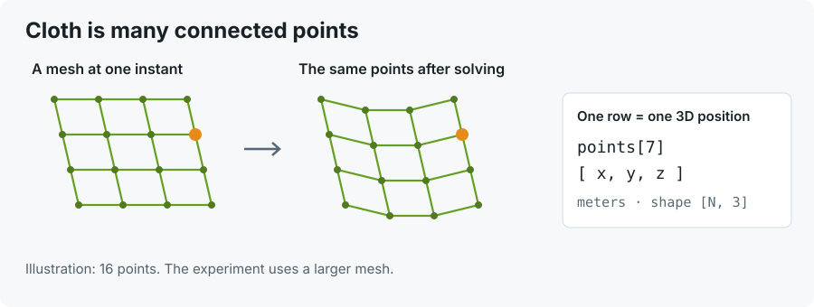

# Cloth and cables in Newton

## How it works

### A flexible object needs more than one pose

A rigid box can be described by a position and rotation. Cloth needs the positions of many connected vertices. Newton advances those positions under forces and solves constraints such as stretching, bending and contact. XPBD and VBD use different solving methods; the official examples also configure different materials and substeps, so these runs illustrate behavior rather than rank solver quality. [Official cloth example](https://github.com/newton-physics/newton/blob/main/newton/examples/cloth/example_cloth_hanging.py) · [Cable twist example](https://github.com/newton-physics/newton/blob/main/newton/examples/cable/example_cable_twist.py)



| Data | Example from this experiment | Meaning |
| --- | --- | --- |
| Cloth grid | `--width 64 --height 32` | Resolution arguments for the official example. |
| Render mesh positions | `points.shape = [2145, 3]` | One XYZ position in meters per rendered vertex. |
| Moving particle positions | `positions.shape = [2112, 3]` | The exported moving-particle array; it does not have the same count as the complete render mesh. |
| Animation | `240` stored samples over `4` seconds | Recorded solver states that the GUI can revisit. |
| Cable center positions | `[192, 3]` | Center-of-mass positions for cable bodies in the exported scene. |

For example, a row `[0.2, 1.3, 0.8]` means a point is 0.2 m along X, 1.3 m along Y and 0.8 m above the Z origin. Changing the next row of animation time moves that point; it is not a color value or a robot action. This row is an explanatory example, while the full run measurements are in [recorded.json](../../../labs/newton-materials/recorded.json).

### What does the video show?

Newton computes the motion on the GPU and writes time-sampled OpenUSD. Isaac Sim opens that file and displays the recorded states. The capture is the actual Isaac Sim viewport, cropped from the application window. **The solver is Newton; this GUI recording is a replay**, with a playback speed of 0.65× and a short hold at the end. Shots appear in the order XPBD cloth, VBD cloth and cable twist. The three cable variants use the official example’s different stiffness values.

## Run it

### Prepare the Python environment

Use Linux with an NVIDIA GPU and a Newton environment that includes its examples, NumPy and `usd-core`. These runs used Newton `1.9.0.dev0` and Warp `1.17.0`. The API of a different Newton version can change; check `python -m newton.examples cloth_hanging --help` first. [Newton examples](https://newton-physics.github.io/newton/latest/guide/examples.html)

Open a terminal in this repository. Replace the Python path below with the Python inside your Newton environment. The first command checks the environment; the second computes all three cases and saves them to a new folder.

```sh
python3 labs/cli.py --json doctor newton-materials --python /path/to/newton-env/bin/python
python3 labs/cli.py --json run newton-materials \
  --python /path/to/newton-env/bin/python --output ./runs/newton-materials-001
python3 labs/cli.py --json verify ./runs/newton-materials-001
```

### Watch the motion in Isaac Sim

In **File → Open**, open a `*-review.usda` file from your output folder and choose **FilmCamera** in the viewport. Keep the referenced `.usd` next to it. Drag the timeline to inspect the deformation. Use the script below to record the actual application window on an X11 desktop. Here `python` must belong to your Isaac Lab environment; it can be a different environment from Newton.

```sh
python labs/physics/capture_gui.py ./runs/newton-materials-001 ./runs/newton-gui-001 \
  /path/to/ffmpeg --plan ./runs/newton-materials-001/takes.json --viz kit
```

The recorded GUI environment was Isaac Sim `6.1.0.0`, launched through Isaac Lab. [GUI setup](../onboarding/isaac-sim-tools.md) · [CLI reference](../../../labs/cli/README.md)

## Check the result

The run fails if an official `--test` command fails, point arrays contain NaN/Inf, or no animated points are found. `result.json` includes the official example source hashes, array shapes, displacement and time range. The maximum stored-vertex displacements were about 5.06 m for XPBD cloth and 4.28 m for VBD cloth in this setup. They show deformation, not accuracy scores.

`run.json` stores command and artifact hashes. `verify` checks these again. `capture.json` separately records the GUI version and captured takes. Keep solver success and successful GUI capture as separate checks: one does not guarantee the other. [Physics and contact experiments](physics.md) · [Newton principles](../newton.md)
