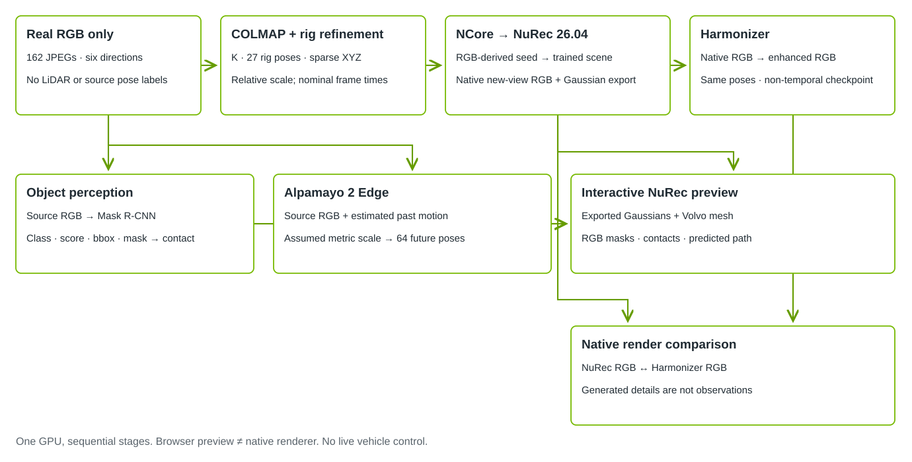
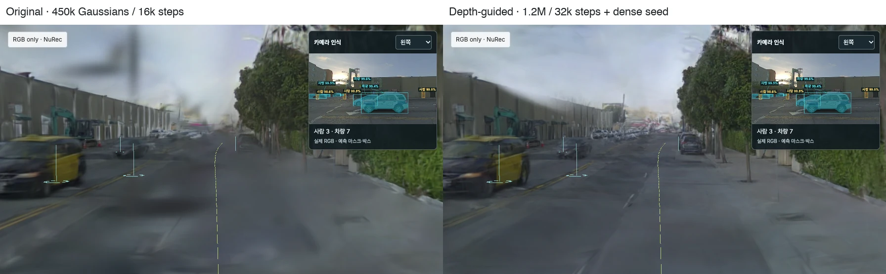

# RGB-only NuRec, Harmonizer and Alpamayo

[All labs](../../../labs/README.md) · [한국어](../../ko/labs/nurec-rgb-reality.md)

Reconstruct a real road in **NuRec**, compare **Harmonizer** on the same new camera views, and inspect **Alpamayo 2 Edge** predictions together with actual camera detections. The reconstruction uses RGB pixels only. Start with the saved viewer and videos, then reproduce the stages on one RTX 5090.

**Temporal Reality View:** compare native/V1/V5 outputs and try the optional mouse-controlled GPU enhancer below. Source-RGB perception and Alpamayo stay separate from generation.

**Depth-guided reconstruction:** switch models in the 3D viewer without moving the camera. Read [how RGB depth and normals guide training](#how-it-works) and inspect the [matched comparison](#check-the-result).

## How it works



### 1. Which tools actually ran?

| Stage | Actual input → output | Its role |
| --- | --- | --- |
| COLMAP | 162 RGB images → camera intrinsics, poses and sparse XYZ/RGB | Recover geometry from image matches, with no supplied calibration or pose labels. |
| Rig bundle adjustment | Free-camera estimates → one six-camera rig over 27 nominal times | Fit the fixed camera layout required by this NuRec input profile. |
| NCore | Estimated cameras, RGB and SfM points → NuRec sequence + Gaussian seed | Package data; NCore is a format and API, not a model. |
| NuRec 26.04 | NCore + RGB-derived seed → trained artifact, native new-view RGB and exported Gaussians | Run the actual NuRec runtime using its 3DGUT COLMAP preset. |
| Harmonizer | Native NuRec RGB → enhanced RGB at the same camera poses | Earlier non-temporal baseline plus the new V1/V5 temporal comparison below; neither changes the 3D model. |
| Alpamayo 2 Edge | Original RGB views + estimated past motion + navigation → 64 future poses per keyframe | Run the actual VLA checkpoint; display its prediction without applying controls. |
| Mask R-CNN | Original RGB → classes, scores, boxes and instance masks | Recognize road users independently of Alpamayo and enhancement. |

The [standalone 3DGUT lab](rgb-reality-view.md) is a comparison implementation. NuRec itself also uses a 3DGUT preset here, but this lab calls **NuRec's data, training, native rendering and export entry points**, rather than substituting the standalone trainer.

### 2. What does RGB-only mean here?

The pinned public example fetches only camera JPEGs and the original data terms. COLMAP estimates `K[3,3]`, camera-to-world matrices `[4,4]` and sparse points `XYZ[N,3]` from overlapping images. No LiDAR, supplied depth, GPS, IMU, sensor poses, intrinsics, sensor timestamps or object annotations enter reconstruction.

Six folders and matching frame numbers define a **nominal** camera grouping. Rig bundle adjustment jointly refines camera extrinsics, rig poses and points while keeping the estimated undistorted intrinsics fixed. The free-camera fit had 0.875 px mean reprojection error; the fixed-rig fit has about 1.150 px. The stronger physical layout constraint does not make the image residual smaller, and nominal grouping does not establish precise sensor synchronization.

NuRec receives 162 RGB observations and about 28,600 triangulated points. The point cloud is **derived from RGB**, not measured by a range sensor. NCore stores a dynamic rig trajectory, static camera-to-rig transforms, intrinsics and RGB frames. The dataset contains no LiDAR component or ground-truth object tracks.

Global scale remains ambiguous. The estimated camera-to-road height is normalized to one display unit. The road plane is fitted from RGB feature tracks. This is a relative coordinate system, not a surveyed road map. All images inform SfM, so the saved run is not an independent novel-view benchmark.

### 3. What changes in NuRec and Harmonizer?

NuRec optimizes Gaussian positions, orientation, size, opacity and view-dependent appearance. Its native renderer evaluates those Gaussians from a new camera. The saved run trains 16,000 steps; exact timing, artifact identity and Gaussian count are in [recorded.json](../../../labs/nurec-rgb-reality/recorded.json).

Harmonizer receives an actual native NuRec frame as `float[1,3,1,576,1024]` in `[-1,1]` and returns enhanced RGB. The side-by-side recording pairs the **same camera pose and frame index**. Its released non-temporal checkpoint treats frames independently, so details may change or flicker. Filling a road-shaped gap is an appearance prediction, not evidence that the hidden surface was observed. **Built on NVIDIA Cosmos.**

The browser viewer uses the official NuRec `export-gaussian-plys` result, converted to a compressed SPZ. It retains the Gaussians with degree-1 view-dependent color, then renders them with Spark/Three.js. This is a **NuRec-trained browser preview**; rasterization and compression can differ from native NuRec output. Public Pages shows recorded Harmonizer results. The optional local service below additionally processes actual captured mouse-controlled views; it does not run in static Pages.

### 4. Where does Alpamayo's route come from?

Alpamayo uses original camera pixels, not Harmonizer-generated details. Four physical RGB streams supply six virtual model slots: left, front and right views, two rotated rear subviews from the back camera, and a telephoto crop from the front. Crop rays stay inside the recorded images. This is an explicit **camera-layout adaptation**, with narrower fields of view than the model's native profile; it is not native NVIDIA AV calibration.

```text
22 selected RGB views:     uint8[22,1,3,576,1024]
Camera IDs / nominal times: int64[22]
Past positions:            float[1,20,3], -1.9 s through 0 s
Past orientations:         float[1,20,3,3]
Navigation:                “Continue straight on the road and yield to pedestrians.”
Output positions:          float[1,1,1,64,3]
Output rotations:          float[1,1,1,64,3,3]
```

Twenty past poses come from RGB-estimated, ground-projected motion: planar yaw orientation, position smoothing and interpolation to 10 Hz. Image selection uses the latest available frame **at or before** each requested time. There are no future trajectory labels. Camera poses are reconstructed offline from the whole image set, so this is not a strictly causal online perception or driving system.

The model expects meter-based history. The example explicitly assumes a **1.8 m camera height** to convert relative SfM units. That scale is not measured from RGB. Changing it can change the prediction. The CLI exposes `--assumed-camera-height-m` so this prior is visible and replaceable.

Four actual inferences are anchored at 2.1, 3.9, 5.7 and 7.8 seconds. A dashed green line displays the latest available prediction, with its input time and scale assumption. Before 2.1 seconds, no future keyframe is shown. The line receives a small display-height offset; raw coordinates remain in the saved model output. Generated explanations may be wrong and are preserved as model output, not treated as verified scene facts. This is **open-loop inference**, not a closed-loop drive or driving-quality test.

### 5. How are cars and people shown?

Mask R-CNN predicts classes, boxes and binary instance masks on the original RGB. A score threshold of 0.8 keeps six road-user classes. Cyan marks vehicles, amber marks people and purple marks cycles. The camera panel shows the actual photos with their predictions; recognition can be switched off for comparison.

A mask-bottom pixel, estimated camera geometry and the RGB-derived road plane produce an approximate 3D contact marker. Edge-truncated, horizon and far intersections remain 2D-only. Markers are not measured 3D boxes or occlusion-correct physical actors. Temporary associations can change IDs; detection observations across frames are not unique-person or unique-car counts. [Detailed mask and coordinate explanation](rgb-reality-view.md).

The credited Volvo S90 is an added 3D foreground reference, not the original collection vehicle or a dynamics model. Native reconstruction, appearance enhancement, object perception and behavior prediction remain separately inspectable.

### 6. Reduce smearing with RGB-predicted depth


An RGB-only objective can fit similar photographs with different 3D geometry. This ambiguity can produce uneven roads and colors floating in space. A **depth prior** estimates where the surface behind a pixel should lie. We run **DA3-BASE** from [Depth Anything 3](https://github.com/ByteDance-Seed/Depth-Anything-3) on training RGB and RGB-estimated cameras. Both this checkpoint and its code are Apache-2.0; other DA3 checkpoints have different terms.

We align the predicted depth to RGB-triangulated **training** points using a robust positive scale and shift. Road-user detection boxes, low-confidence pixels and depth discontinuities are excluded from geometric guidance. The original images remain in the RGB objective.


**Z-depth** measures distance along the camera's forward axis. **Ray distance** measures along the pixel's viewing ray; away from the optical axis they differ. NuRec receives ray distance. A **normal** is a unit vector describing a surface's orientation. Here normals come from neighboring 3D points reconstructed from the same predicted depth, not an independent normal-estimation model.

An actual road pixel `(512, 450)` in training image `front_camera/39.jpg` produced:

```json
{
  "rgb_shape": [569, 1024, 3],
  "pixel_uv": [512, 450],
  "z_depth": 5.08896,
  "ray_distance": 5.15104,
  "world_normal": [-0.00348, -0.04803, 0.99884]
}
```

The third normal component is near 1: the road faces mostly upward in this world frame. Distances use **relative units, not measured meters**. Native NuRec labels have shapes `float[1,569,1024,1]` for distance and `float[1,569,1024,3]` for normals, with invalid regions masked. Native differentiable renderings are compared with these targets and backpropagation adjusts Gaussian geometry. The adapter checks that both distance and normal rendering remain differentiable and finite. [Actual numeric example](../../../labs/nurec-rgb-reality/evidence/guidance/input-output-sample.json) · [Loss adapter](../../../labs/nurec-rgb-reality/guidance/train.py).

This is an independent implementation informed by depth/normal regularization research such as [DN-Splatter](https://arxiv.org/abs/2403.17822), not a run of DN-Splatter itself. Predicted geometry can be wrong. Static Gaussians still cannot resolve moving-vehicle ghosting.

### 7. Why does a temporal decoder help a Reality View?


A single-frame enhancer can repaint the same tree differently after a small camera movement. We keep the **persistent NuRec scene as the geometric anchor** and give the enhancer its four previous outputs. The latest render supplies the new camera view; history helps maintain appearance. This is the implemented improvement over our earlier frame-independent demo.

| Question | Previous implementation | Updated implementation |
| --- | --- | --- |
| Where is the scene? | RGB-only NuRec Gaussians | Depth-guided NuRec Gaussians; same camera across comparisons |
| How is the image improved? | Independent non-temporal checkpoint | Released Harmonizer temporal checkpoint, compared in V1 and V5 modes with identical weights |
| What happens when I move the mouse? | Browser rasterization; saved enhancement video | Optional local GPU service enhances the actual captured viewpoint, with no queued obsolete views |
| How are abrupt changes handled? | No temporal history | Clear history on cuts, large camera changes, timeline jumps, projection or model changes |
| Where do detections and paths come from? | Original RGB and estimated motion | Same original inputs; overlays are added **after** enhancement |
| Which regions have RGB support? | No diagnostic | Switch to a depth-agreement diagnostic while retaining Gaussian geometry |

**Data example.** The current camera render becomes `float[1,3,1,576,1024]`, normalized to `[-1,1]`. Once four previous enhanced frames exist, it becomes:

```text
x[:, :, 0] = current 3D camera render
x[:, :, 1] = previous enhanced output, t−1
x[:, :, 2] = previous enhanced output, t−2
x[:, :, 3] = previous enhanced output, t−3
x[:, :, 4] = previous enhanced output, t−4
x.shape    = [1, 3, 5, 576, 1024]
Original y.shape  = [1, 3, 5, 576, 1024] → display first
Optimized y.shape = [1, 3, 1, 576, 1024] → decode that first RGB only
```

The first four frames use V1. A reset repeats that startup. These are **previous generated outputs**, not future camera observations or an eight-frame future prediction. The model performs single-step diffusion-based appearance enhancement; it does not rebuild the 3D scene or prove the correctness of a filled surface. See the [official source](https://github.com/NVIDIA/harmonizer) and [model card](https://huggingface.co/nvidia/Harmonizer).

The supplied Tesla commentary proposes a shared visual encoder feeding separate policy and diffusion/mean-flow branches. That is a useful architectural hypothesis, but its model sizes, 36 fps and eight-frame claims are **not verified facts here**. The linked [original X post](https://x.com/elonmusk/status/2124458557525397780) could not be directly retrieved during our check. Our implementation has no Tesla weights or shared UVE: source RGB feeds reconstruction, perception and Alpamayo separately; the visualization branch uses actual NuRec renders and public Harmonizer weights.

**Inspect support, not “truth.”** Select **Inspect RGB depth support** in the viewer. Red means zero, amber one and teal two or more distinct named cameras with a depth-consistent Gaussian-center projection. Six camera names are counted; repeated frames from one camera do not become independent cameras. This compares RGB-estimated poses with RGB-predicted depth using a 10% + 0.1-relative-unit tolerance. Occlusion, excluded moving objects and depth errors can lower the count. It is not measured visibility, a per-pixel confidence map or a hallucination detector.

[Watch the same 160 camera poses in native, V1 and V5 modes](../../../labs/nurec-rgb-reality/evidence/temporal/comparison.en.mp4) · [Watch actual mouse-controlled GPU enhancement](../../../labs/nurec-rgb-reality/evidence/temporal/interaction.en.mp4)

### 8. Keep the picture, remove unused decoding


The original wrapper decodes five RGB frames and displays only the first. The optimized path keeps **all five inputs and the complete temporal encoder/DiT**, then decodes only the normalized first latent. This causal VAE's first output does not need later decoded outputs. Full video normalization is retained before slicing; silently switching to image normalization would not be equivalent for every configuration.

```text
Input:             [1, 3, 5, 576, 1024] — current + four previous outputs
Encoder → DiT:     [1, 16, 2, 72, 128]  — full temporal context
Original decoder:  [1, 3, 5, 576, 1024] — display first RGB only
Optimized decoder: [1, 3, 1, 576, 1024] — decode the same first RGB
```

**All RGB pixels match across all 160 frames.** A separate eight-frame HTTP test also verifies GPU history caching and lossless transport. Resolution, BF16 precision, weights, four-output context and diffusion step count remain unchanged.

Capture is asynchronous, history tensors stay on the GPU and returned images paint directly to canvas. A bounded background writer records optional debug images. Responses from obsolete large viewpoint changes are skipped. Transport uses **lossless WebP**, with lossless PNG fallback. For lossless WebP, `quality=0` controls compression effort rather than pixel quality. [Official Pillow documentation](https://pillow.readthedocs.io/en/stable/handbook/image-file-formats.html#webp).

[Actual mouse-controlled latency comparison](../../../labs/nurec-rgb-reality/evidence/speed/interaction.en.mp4) · [Matched-view quality and detail comparison](../../../labs/nurec-rgb-reality/evidence/speed/quality.en.mp4)

### 9. Move quickly, then refine at rest


A mouse-controlled view has two different jobs: respond promptly while the camera moves, then resolve detail once the view settles. The local viewer now offers two optional progressive modes:

| Mode | While moving | After the camera stops |
| --- | --- | --- |
| **Fast AI preview → HQ at rest** | Run the same checkpoint at 512×288, using a separate low-resolution history bank | Capture a **fresh 1024×576 render** and run full-quality temporal enhancement |
| **Browser 3D preview → HQ at rest** | Copy the actual browser 3D viewport at its render cadence; **no AI generation** | Run the same full-quality refinement |

The camera must stay below the significant-motion threshold for **180ms**. New movement invalidates an in-flight refinement; stale HQ results are discarded. Once a current-view HQ result is painted, the GPU waits until the view changes again. Low-resolution generated pixels never enter the HQ input or history. Original-RGB perception and Alpamayo remain separate from generation.

For an empty HQ history, the pinned deterministic V1 model produces the same quantized RGB for an identical frozen input. We run it **once**, reuse that RGB in four reference slots, then run **one actual V5 forward**. This returns one HQ image in about 394ms of model time, versus about 767ms for five actual reference forwards. Reused slots are neither four independent camera observations nor four displayed AI frames. Existing valid HQ history instead uses one V5 call.

**512×288 is our experimental research-model adapter**, not an advertised official NIM mode. The [official NIM documentation](https://docs.nvidia.com/nim/harmonizer/introduction) describes fixed 1024×576 enhancement; [upstream inference guidance](https://github.com/NVIDIA/harmonizer/blob/main/skills/harmonizer/references/inference.md) explains temporal context. The preview is softer, and waiting for stationary HQ adds delay. Inspect both tradeoffs below.

[Actual AI-preview comparison](../../../labs/nurec-rgb-reality/evidence/adaptive/interaction.en.mp4) · [Smooth browser preview comparison](../../../labs/nurec-rgb-reality/evidence/adaptive/browser.en.mp4) · [Matched quality inspection](../../../labs/nurec-rgb-reality/evidence/adaptive/quality.en.mp4)

## Run the lab

### 1. Explore without a CUDA GPU

Use the viewer on this page and the native NuRec/Harmonizer comparison. The source-RGB recognition panel, camera selector, predicted path and mouse controls are interactive. Browser playback reuses saved inference outputs.

```bash
python3 labs/nurec-rgb-reality/check.py
python3 labs/rgb-reality-view/serve.py --root site/public/showcase/nurec-rgb-reality --port 8092
```

Open **http://127.0.0.1:8092/**. An internet connection supplies pinned viewer JavaScript modules. Video and evidence checks also work without an NVIDIA GPU.

### 2. Prepare one GPU machine

The tested host uses Linux x86_64, one RTX 5090 32 GB and about 32 GB system RAM. Install a compatible NVIDIA driver, Docker with NVIDIA Container Toolkit, Python, Git, uv and Node.js/npm. Check [NVIDIA Linux onboarding](../onboarding/nvidia-linux.md).

```bash
nvidia-smi
export NUREC_RGB_ROOT="$HOME/physical-ai-labs/nurec-rgb-road"
python3 labs/nurec-rgb-reality/pipeline.py --root "$NUREC_RGB_ROOT" setup
```

Read [SOURCES.md](../../../labs/nurec-rgb-reality/SOURCES.md) first: the NuRec runtime, model weights, dataset and vehicle have separate terms. Setup pulls the pinned runtime, installs isolated environments and downloads public model checkpoints plus the NuRec metric dependency. These downloads and initial compilation take longer than the warmed-up sample run. Model weights, raw logs and input caches stay outside Git.

### 3. Follow each stage

Run from the repository folder. Each command must finish successfully before the next:

```bash
python3 labs/nurec-rgb-reality/pipeline.py --root "$NUREC_RGB_ROOT" rgb
python3 labs/nurec-rgb-reality/pipeline.py --root "$NUREC_RGB_ROOT" rig
python3 labs/nurec-rgb-reality/pipeline.py --root "$NUREC_RGB_ROOT" prepare
python3 labs/nurec-rgb-reality/pipeline.py --root "$NUREC_RGB_ROOT" train
python3 labs/nurec-rgb-reality/pipeline.py --root "$NUREC_RGB_ROOT" render
python3 labs/nurec-rgb-reality/pipeline.py --root "$NUREC_RGB_ROOT" enhance
python3 labs/nurec-rgb-reality/pipeline.py --root "$NUREC_RGB_ROOT" --assumed-camera-height-m 1.8 policy
python3 labs/nurec-rgb-reality/pipeline.py --root "$NUREC_RGB_ROOT" perceive
python3 labs/nurec-rgb-reality/pipeline.py --root "$NUREC_RGB_ROOT" export
python3 labs/nurec-rgb-reality/pipeline.py --root "$NUREC_RGB_ROOT" serve
```

`rgb` recovers cameras; `rig` enforces the fixed layout; `prepare` writes NCore; `train` runs NuRec and exports its Gaussians. `render` produces native front, quarter and orbit views; `enhance` processes the orbit frames with Harmonizer. `policy` and `perceive` run their own models on source RGB, and `export` packages the viewer.

For a fresh output folder, `pipeline.py --root "$NUREC_RGB_ROOT" all` runs the full sequence. GPU stages use the same lock and one visible device. The demo preset expects six camera folders with the documented PandaSet-style names; a single forward camera cannot observe the rear context needed by this example. Custom camera layouts need an explicit adapter, not relabeling unseen views.

### 4. Compare depth and normal guidance

Complete the parent pipeline through `prepare` and `perceive` first. Use a **separate output folder** for the comparison. Run these lines one at a time from the repository root. Setup creates a dedicated DA3 environment without changing the parent lab's environment.

```bash
export RGB_BASE="$HOME/physical-ai-labs/nurec-rgb-road"
export RGB_GUIDED="$HOME/physical-ai-labs/nurec-guidance-test"
python3 labs/nurec-rgb-reality/guidance/pipeline.py --base "$RGB_BASE" --root "$RGB_GUIDED" setup
python3 labs/nurec-rgb-reality/guidance/pipeline.py --base "$RGB_BASE" --root "$RGB_GUIDED" inputs
python3 labs/nurec-rgb-reality/guidance/pipeline.py --base "$RGB_BASE" --root "$RGB_GUIDED" prepare
python3 labs/nurec-rgb-reality/guidance/pipeline.py --base "$RGB_BASE" --root "$RGB_GUIDED" priors
python3 labs/nurec-rgb-reality/guidance/pipeline.py --base "$RGB_BASE" --root "$RGB_GUIDED" train
python3 labs/nurec-rgb-reality/guidance/pipeline.py --base "$RGB_BASE" --root "$RGB_GUIDED" evaluate
```

`inputs` holds out 24 images and re-triangulates/recolors the seed using only the remaining 138 images. `priors` uses **training images only**. `train` runs RGB baseline, depth, and depth+normal variants with the same initialization, seed 42, 16,000 steps and 450,000-Gaussian limit. `evaluate` compares all 24 held-out images at matching native resolution and writes `comparison.json`, without Harmonizer or image enhancement.

To test weaker normal regularization, add `--variant depth-normal-soft` to `train` and run `evaluate` again. This setting was adjusted after inspecting the first comparison; it is a follow-up experiment, not an independent test set result.

For the higher-detail viewer model, use a **fresh output folder** and add `--production --variant depth` to each command. This mode uses all 162 images. After `priors`, run `dense`, then `train` and `export`. Depth, normal and RGB agreement with neighboring training views select a denser seed; training uses 32,000 steps and a 1.2-million Gaussian limit. This all-image display model is separate from the held-out loss comparison below. Run `package` to include the parent lab's cameras, perception and policy, then `serve` to open **http://127.0.0.1:8093/**. Complete the parent pipeline's `export` stage first. Export uses NuRec's official PLY command, followed by SPZ compression. Without the optional service, mouse interaction uses only Spark's browser rasterizer. [Stage runner](../../../labs/nurec-rgb-reality/guidance/pipeline.py) · [Official-model export adapter](../../../labs/nurec-rgb-reality/guidance/export_model.py).

### 5. Run temporal enhancement on the GPU

First complete the preceding reconstruction and rendering stages. This extension builds an isolated official Harmonizer environment; it does not alter the NuRec container. Use **Python 3.12+, Linux x86_64, Docker with NVIDIA Container Toolkit and uv**. The published checkpoint is about 5 GB. Its terms are the NVIDIA Open Model License, separately from the Apache-2.0 upstream code and our MIT adapter.

```bash
export RV_TEMPORAL_ROOT="$HOME/physical-ai-labs/reality-temporal"
export RV_INPUT="$NUREC_RGB_ROOT/renders/orbit/front_camera"
python3 labs/nurec-rgb-reality/temporal/pipeline.py --root "$RV_TEMPORAL_ROOT" setup
python3 labs/nurec-rgb-reality/temporal/pipeline.py --root "$RV_TEMPORAL_ROOT" --input "$RV_INPUT" compare
python3 labs/nurec-rgb-reality/temporal/pipeline.py --root "$RV_TEMPORAL_ROOT" --input "$RV_INPUT" evaluate
python3 labs/nurec-rgb-reality/temporal/pipeline.py --root "$RV_TEMPORAL_ROOT" check
```

`setup` verifies the pinned source and public checkpoint. `compare` runs the same ordered RGB frames with V1 and V5, writing separate outputs; select a fresh runtime folder to preserve earlier experiments. `evaluate` measures image stability and edge sharpness. `check` verifies the saved output hashes and actual four-frame context. The published 160-frame comparison used the improved model's native render path; [reproduce that path and optional live viewer](../../../labs/nurec-rgb-reality/temporal/README.md).

To **inspect the published receipts without a GPU or model download**, run:

```bash
python3 labs/nurec-rgb-reality/temporal/check.py
```

The persistent GPU service is opt-in. It receives the clean 16:9 crop of the actual mouse-controlled render. Source-RGB detection markers and Alpamayo's path are then added to both display panels. Public static Pages shows the browser scene and recorded results; it never tries to connect to your computer. [Local GPU service and SSH tunnel instructions](../../../labs/nurec-rgb-reality/temporal/README.md#use-the-live-viewer).

### 6. Reproduce the optimization comparison

Use the existing `RV_TEMPORAL_ROOT` and `RV_INPUT`. **Stop the serving terminal with Ctrl+C first.** The shared GPU lock prevents serving and benchmarking from competing on the same GPU.

```bash
python3 labs/nurec-rgb-reality/temporal/pipeline.py --root "$RV_TEMPORAL_ROOT" --input "$RV_INPUT" benchmark
python3 labs/nurec-rgb-reality/temporal/check_speed.py
```

`benchmark` runs three profiles sequentially and saves model latency/FPS, RGB hashes, SSIM and PSNR in `comparison/speed-benchmark/benchmark.json`. Select a fresh `--comparison-dir` to preserve previous comparisons. Add `--max-frames 12` for a shorter smoke run. The second command checks the published receipts and video hashes without a GPU.

The local viewer offers **Exact pixels · default**, **Original baseline** and **Tuned**. Tuned changes convolution memory layout and kernel selection; it is faster with small numerical differences. Keep the default for pixel equality. [Optimization source](../../../labs/nurec-rgb-reality/temporal/fast.py) · [Record actual one-GPU mouse passes](../../../labs/nurec-rgb-reality/temporal/record_speed.mjs).

### 7. Try motion-aware preview and refinement

Start the existing GPU service and local viewer as described in the [temporal setup](../../../labs/nurec-rgb-reality/temporal/README.md#use-the-live-viewer). On your laptop open **http://127.0.0.1:8092/?lang=en&execution=adaptive** for fast AI preview, or change `execution=adaptive` to **`execution=native`** for browser 3D preview. Load the scene, select **Update continuously**, drag, then release. The right caption identifies **512×288 AI preview**, **browser 3D · not AI generation**, or **1024×576 HQ**. After HQ is ready, it stays put until you move again. The unchanged **Exact · continuous high quality** profile remains available.

To reproduce GPU quality checks, first stop the serving terminal. Set `RV_INPUT` to the improved model's ordered render path and `RGB_GUIDED_PROD` to its private production folder, as in the temporal README:

```bash
python3 labs/nurec-rgb-reality/temporal/pipeline.py --root "$RV_TEMPORAL_ROOT" --comparison-dir "$RV_TEMPORAL_ROOT/adaptive-check" --input "$RV_INPUT" --rig "$RGB_GUIDED_PROD/rig-orbit.json" --max-frames 12 adaptive-benchmark
python3 labs/nurec-rgb-reality/temporal/check_adaptive.py
```

The first command performs actual full-resolution reference, low-resolution preview and stationary HQ passes on one GPU. It refuses an existing result folder. Remove `--max-frames 12` to run all 160 rendered poses; these are camera samples, not 160 new observations. The second command checks published receipts and videos without a GPU. [GPU runner](../../../labs/nurec-rgb-reality/temporal/benchmark_adaptive.py) · [Motion policy](../../../labs/rgb-reality-view/motion-policy.mjs) · [Record the actual move/rest passes](../../../labs/nurec-rgb-reality/temporal/record_adaptive.mjs).

## Check the result

### Motion-aware results: moving FPS, stationary HQ and quality

Three real **6s mouse drags + 4s rest** cycles per mode, recorded in English and Korean in separate sequential passes. GPU: one RTX 5090; browser: Mac Chrome over the local SSH-forwarded service. The baseline here is the already optimized **continuous 1024×576 exact** profile, not the older full decoder. Numbers below use the Korean recording; English moving AI rates were 1.82 → 3.75FPS, and browser preview was 59.49FPS.

| Actual browser measurement | Continuous HQ | Fast AI preview → HQ | Browser 3D preview → HQ |
| --- | --- | --- | --- |
| **AI outputs actually painted while moving** | 1.60FPS | **3.52FPS** | 0 · no AI calls while moving |
| Browser preview while moving | Separate 3D viewport | Brief fallback before AI preview | **59.41FPS** |
| Moving capture → paint median / p95 | 568 / 727ms | **250 / 333ms** | Not an AI latency measure |
| Moving V5 model median | 270ms | **69ms** | No moving model call |
| Last significant camera change → current-view HQ, median | 838ms | 1476ms | 1317ms |
| Pointer release → current-view HQ, median | 1465ms | 2054ms | 1964ms |

Orbit damping continues after pointer release, so the last two rows use different starting clocks. The progressive modes trade a softer or unenhanced moving image and **longer final HQ wait** for more responsive movement. Network, capture and paint overhead explain why a roughly 67ms offline preview model call does not deliver 15AI FPS to this browser. Native/browser frames are never counted as generated AI frames. After a valid HQ paint, both progressive modes sent **zero redundant requests** during the remaining rest intervals.

Across 160 matched rendered inputs, the upscaled 512 preview had mean **PSNR 24.61dB / SSIM 0.8761** against continuous full-resolution generated outputs, excluding the first four context-initialization frames. This is fidelity to a generated reference, not measured scene truth. On **20 stationary poses**, the restored 1024 output was **raw-RGB identical in 20/20 cases** to five actual full-resolution forwards of the same frozen input with fresh history. This does **not** claim equality to the continuously moving HQ history; the contexts differ. Cold HQ used two actual forwards totaling a 394ms median, with no preview pixels in HQ history. A fresh 12-frame portable run also passed.

[160 preview / 20 stationary measurements](../../../labs/nurec-rgb-reality/evidence/adaptive/validation.json) · [Six actual move/rest traces](../../../labs/nurec-rgb-reality/evidence/adaptive/interaction.json) · [12-frame portable check](../../../labs/nurec-rgb-reality/evidence/adaptive/portable-smoke.json)


### Optimization: FPS, latency and fidelity

The same 160 source renders, public weights, 1024×576 BF16 inputs and four prior outputs are used throughout. Separate **model-forward performance** from **actual capture-to-paint delivery**.

| GPU execution profile | Median / p95 model latency | Model throughput | Peak allocated VRAM | Fidelity to original RGB output |
| --- | --- | --- | --- | --- |
| Original full decode | 483.6 / 485.2ms | 2.06FPS | 6.99GiB | Reference |
| Exact-pixel optimization · default | 271.3 / 271.4ms | 3.69FPS | 5.67GiB | 160/160 frames pixel-identical · SSIM 1.0000 |
| Tuned · optional | 238.0 / 238.3ms | 4.12FPS | 6.41GiB | Mean PSNR 52.76dB · SSIM 0.99736 |

PSNR/SSIM measure **fidelity to the original generated output**, not unseen-surface accuracy. Tuned has mean absolute error 0.291/255 and maximum error 28/255, so rare larger differences remain. The default reduces model latency about 44% without that difference. CUDA Graph replay was tested; its additional gain was too small to select as the default.

The following are roughly 30-second **sequential one-GPU** browser runs on a Mac with the same scripted mouse gesture. The two passes do not contend for the GPU, and the recording is not sped up. Network and browser work contribute to delivery latency.

| Actual displayed result | Original | Exact-pixel optimization |
| --- | --- | --- |
| Delivered AI updates | 0.89FPS | 1.79FPS |
| Capture → paint median · four-output context | 1089ms | 547ms |
| Capture → paint p95 · full interval | 1163ms | 671ms |
| Separate native 3D viewer | 59.8FPS | 60.0FPS |

Native 3D exploration stays near 60Hz while enhanced views arrive more frequently. The optimized pass skipped 1 stale responses at large view changes. Network conditions affect delivery; this is not 60FPS diffusion. The quality clip is inspection playback, and raw RGB equality is checked before MP4 encoding.

[160-frame measurements](../../../labs/nurec-rgb-reality/evidence/speed/benchmark.json) · [Actual request/response/paint traces](../../../labs/nurec-rgb-reality/evidence/speed/interaction.json) · [HTTP/GPU-cache pixel parity](../../../labs/nurec-rgb-reality/evidence/speed/service-parity.json)


### What did temporal enhancement change?

RTX 5090, 1024×576, BF16, identical public temporal checkpoint and 160 ordered native NuRec frames. V1 and V5 here share weights; this is separate from the older TorchScript non-temporal demo. Latency excludes the first four frames and measures synchronized model forward only.

| Mode | Median / p95 | Peak allocated VRAM | Shared-flow warp L1 ↓ | Edge magnitude |
| --- | --- | --- | --- | --- |
| Native render | — | — | 0.02898 | 0.02609 |
| V1: independent | 124 / 124 ms | 3.61 GiB | 0.02550 | 0.02240 |
| V5: four prior outputs | 484 / 485 ms | 7.01 GiB | 0.01722 | 0.01973 |

V5 reduces this stability proxy about **32% relative to V1**, while edge magnitude is about **12% lower**. Smoothing can reduce the metric: these are not accuracy gains against unseen-view ground truth. Model-only throughput is roughly 8.1 / 2.1 images per second, excluding capture, encoding and transport. The video plays faster for inspection; browser rasterization near 60Hz does not mean diffusion runs at 60fps. Cold initialization/compilation adds time.

Large interactive camera jumps initially produced doubled foreground objects. The live service now resets history above 12° rotation or 0.75 relative units of translation, on projection/model changes and on timeline jumps. These are conservative demo heuristics, not learned guarantees. Our browser checks include small mouse motion retaining V5, a driver-view jump resetting history, mode switching and 390px layouts in both languages.

[Per-frame timings and hashes](../../../labs/nurec-rgb-reality/evidence/temporal/temporal.json) · [Matched evaluation and method](../../../labs/nurec-rgb-reality/evidence/temporal/evaluation.json) · [Actual browser interactions](../../../labs/nurec-rgb-reality/evidence/temporal/browser.json)

The scene is still reconstructed offline, with static traffic and ambiguous scale. Unseen surfaces remain predictions, and no vehicle is controlled. See the source RGB, native geometry, generated view, detection estimates and policy overlay separately before interpreting the demo.


### Do depth and normal losses help?



[Compare original and production models at identical novel cameras](../../../labs/nurec-rgb-reality/evidence/guidance/native-comparison.en.mp4). This visual comparison also changes initialization and training budget. The default browser chase view is lower, closer to capture height; every comparison model shares that viewpoint.


Means over **six cameras × four held-out timestamps = 24 images**. Higher PSNR and SSIM indicate closer RGB reconstruction.

| Matched experiment | PSNR (dB) | SSIM | Depth / normal / flatten weights |
| --- | ---: | ---: | --- |
| RGB baseline | 21.974 | 0.7113 | 0 / 0 / 0 |
| Depth | 22.249 | 0.7171 | 0.1 / 0 / 0 |
| Depth + normal | 21.924 | 0.7168 | 0.1 / 0.03 / 0.0005 |
| Weaker normals · follow-up tuning | 22.249 | 0.7175 | 0.1 / 0.005 / 0.00005 |

Depth guidance improves this comparison; strong normal regularization lowers PSNR. Weaker normal regularization is almost tied with depth alone. The viewer production model uses depth loss; normals support dense-seed orientation and consistency checks. Adding more losses does not guarantee better images. All camera poses were estimated offline using the full RGB set: this is **not a benchmark that independently holds out camera estimation**. Per-image metrics/hashes, training times and native differentiable-loss checks are in the [comparison](../../../labs/nurec-rgb-reality/evidence/guidance/comparison.json) and [run summaries](../../../labs/nurec-rgb-reality/evidence/guidance/matched-runs.json).

The display model trained on one RTX 5090 in **723.07 seconds**, excluding DA3 inference, camera recovery and export. The 1.2M-Gaussian viewer maintained approximately **60 FPS** for static, orbit and path playback in Chrome on an M2 Max, at 896×504 and 1344×756 drawing buffers. This measures the browser’s roughly 60 Hz render-loop cadence, not maximum GPU throughput or an end-to-end real-time pipeline. [Client measurements](../../../labs/nurec-rgb-reality/evidence/guidance/browser-fps.json) · [Production training/seed/export receipt](../../../labs/nurec-rgb-reality/evidence/guidance/production-model.json).

```bash
python3 labs/nurec-rgb-reality/check.py --decode-video
python3 labs/nurec-rgb-reality/guidance/check.py
python3 -m unittest discover -s labs/nurec-rgb-reality/guidance -p 'test_*.py'
python3 -m unittest discover -s labs/rgb-reality-view -p 'test_*.py'
```

The checker validates data provenance, camera/rig geometry, actual NuRec completion, native/Harmonizer frame pairing, policy tensor shapes and finite rotations, source-RGB detection outputs, compressed model count, artifact hashes and recorded controls. Full-video decoding needs FFmpeg. It verifies implementation and integrity, **not driving safety, detector accuracy or hidden-surface truth**.

Compare this run with [standalone 3DGUT](rgb-reality-view.md), [the earlier RGB + LiDAR NuRec baseline](pandaset-nurec.md), and [the self-authored synthetic-road interface test](reality-view.md). Their data assumptions and execution paths are labeled separately. The interactive view is ego-centered, but no Tesla proprietary model or live Reality View system is being reproduced.
