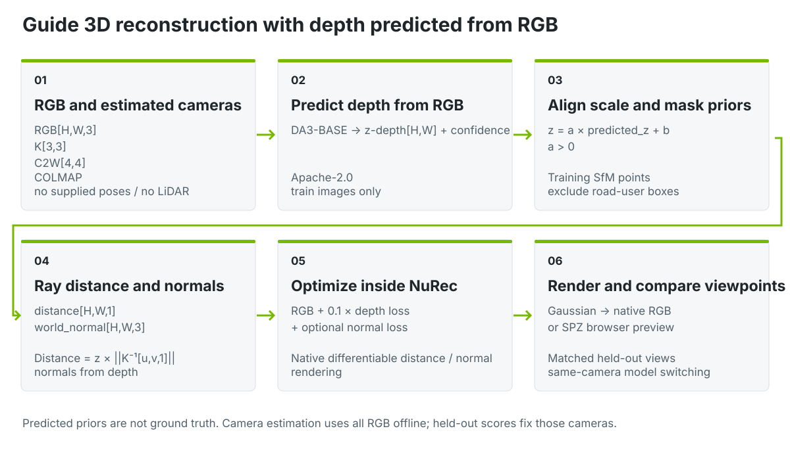
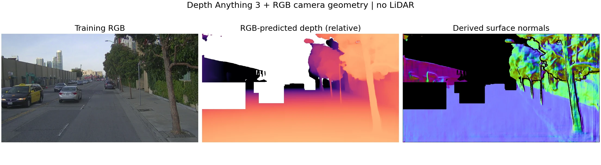
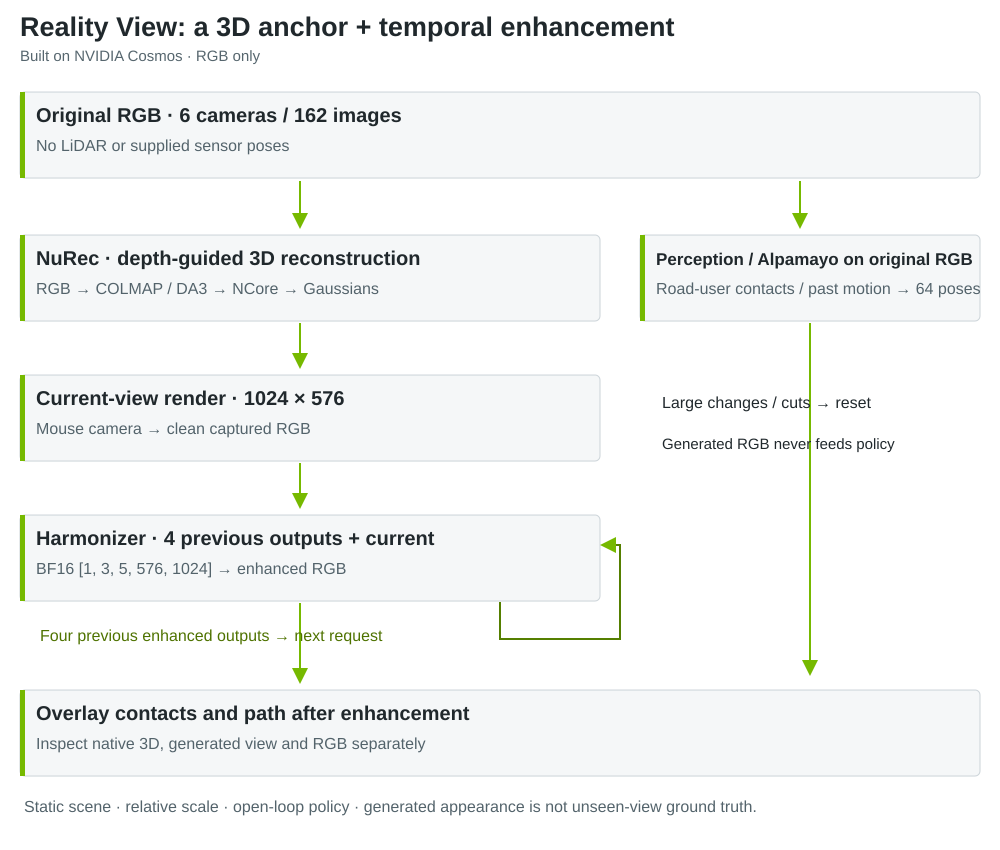
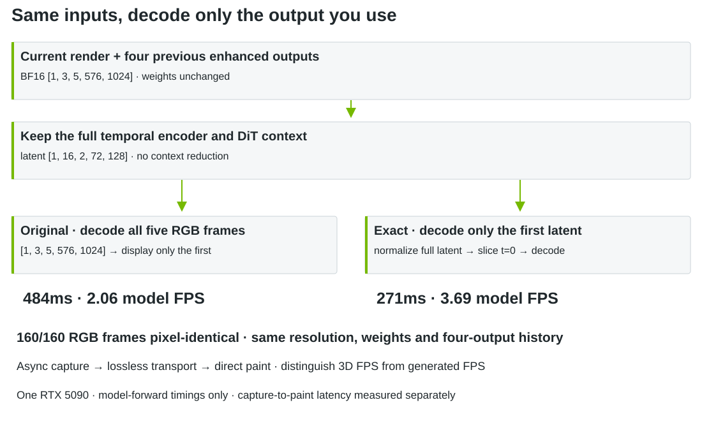
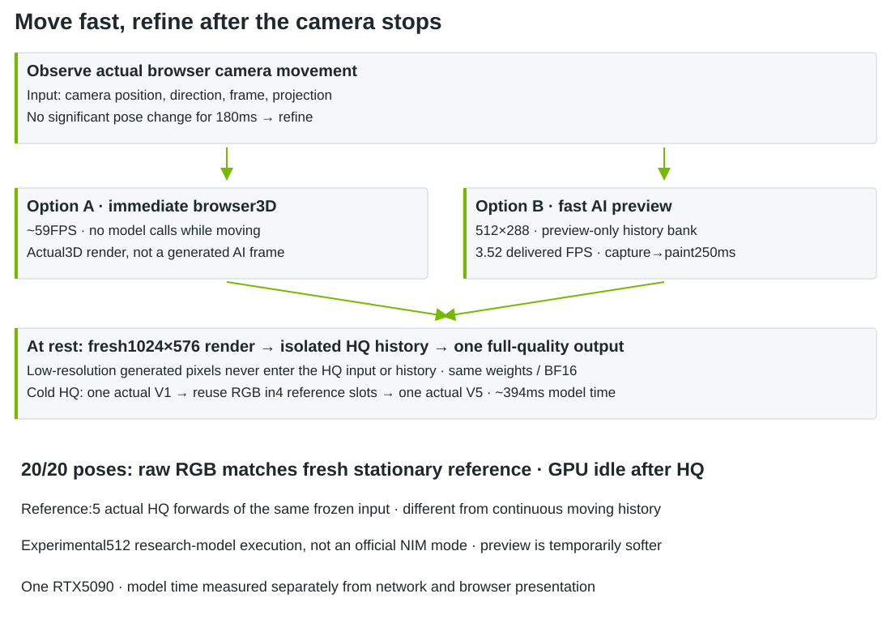
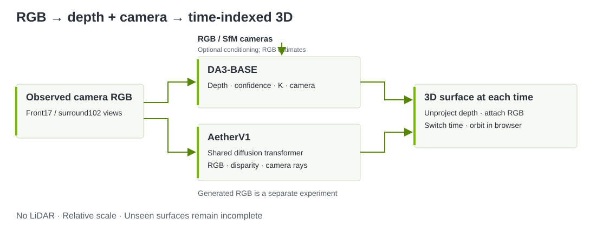
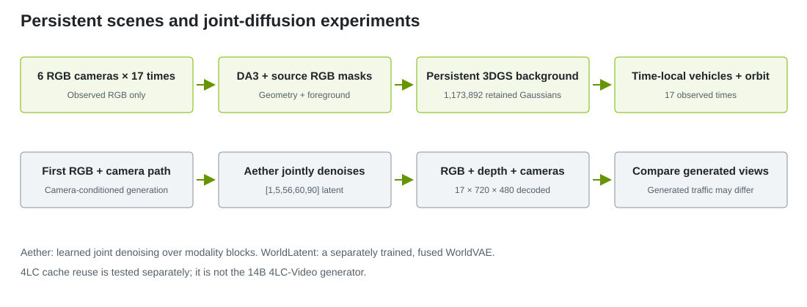
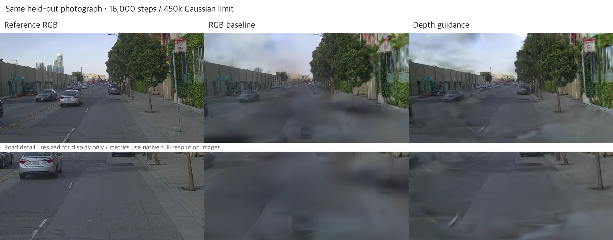

# RGB-only NuRec, Harmonizer and Alpamayo

[All labs](../../../labs/README.md) · [한국어](../../ko/labs/nurec-rgb-reality.md)

Reconstruct a road from camera RGB, explore it in 3D, and connect appearance enhancement, road-user detection and predicted driving paths.

[Previous 3DGS and perception](#explore) · [Compare Reality View](#joint-geometry) · [Run the lab](#run-the-lab)

## How it works


### 1. From RGB to a 3D road

A pixel gives color, not distance. COLMAP matches features across overlapping photos to estimate camera intrinsics `K[3,3]`, camera poses `[4,4]` and sparse points `XYZ[N,3]`. Rig adjustment fits the six-camera layout, and NCore packages these estimates for NuRec.

NuRec learns Gaussian positions, sizes, orientations, opacity and view-dependent color so rendered images match the photographs. Moving the browser camera then reveals a different view of the same scene.

| Tool | Input → output |
| --- | --- |
| COLMAP + rig adjustment | RGB photos → cameras and sparse 3D points |
| NCore | RGB and estimated geometry → a NuRec sequence |
| NuRec | Sequence → trained Gaussians and new-view renders |
| Harmonizer | Rendered RGB → enhanced RGB |
| Mask R-CNN | Original RGB → classes, boxes and masks |
| Alpamayo 2 Edge | Original RGB, past motion and instruction → future poses |

The example uses camera pixels only; geometry and scale are estimated from RGB. The viewer uses relative coordinates. [Standalone 3DGUT implementation](rgb-reality-view.md).

### 2. Add recognition and a predicted path

Mask R-CNN detects road users in the original RGB. Cyan marks vehicles, amber people and purple cycles. A ray through the mask's bottom pixel meets the estimated road plane to place an approximate 3D contact marker. [Boxes, masks and coordinate example](rgb-reality-view.md).

Alpamayo receives RGB views, recent motion and a navigation instruction. Its dashed green line shows the latest predicted path. The adapter creates six model views from four physical RGB streams and converts the relative motion scale using the configurable camera-height assumption.

```text
Camera RGB:       uint8[22,1,3,576,1024]
Past positions:   float[1,20,3]
Past rotations:   float[1,20,3,3]
Instruction:      “Continue straight on the road and yield to pedestrians.”
Predicted poses:  float[1,1,1,64,3] + float[1,1,1,64,3,3]
```

Recognition and policy use observed RGB, while Harmonizer generates appearance. The path is an open-loop prediction, not a vehicle-control command. The Volvo mesh marks the ego position.

### 3. Guide Gaussian geometry with depth and normals



Different 3D arrangements can explain similar photographs. A **depth prior** constrains where a pixel's surface should lie. DA3-BASE predicts depth from training RGB; scale and offset align it with RGB-triangulated points. Low-confidence regions and road-user boxes are excluded from this geometric loss.



**Z-depth** measures distance along the camera's forward axis. **Ray distance** measures along the pixel ray and is what NuRec receives. A **normal** is a unit vector pointing away from the surface; here it is derived from neighboring depth points.

An actual road pixel at `(512,450)` gives:

```json
{
  "rgb_shape": [569, 1024, 3],
  "z_depth": 5.08896,
  "ray_distance": 5.15104,
  "world_normal": [-0.00348, -0.04803, 0.99884]
}
```

The normal's Z component is near 1 because the road faces upward. Distances remain relative. NuRec compares rendered distance `float[1,569,1024,1]` and normals `float[1,569,1024,3]` with these targets, then backpropagates the error to Gaussian geometry. [Input/output example](../../../labs/nurec-rgb-reality/evidence/guidance/input-output-sample.json) · [Loss adapter](../../../labs/nurec-rgb-reality/guidance/train.py).

### 4. Keep appearance stable as the camera moves



Harmonizer receives the current NuRec render and four previous enhanced outputs. Those earlier images help retain appearance during small camera movements. A large camera or timeline jump clears history.

```text
Input:             [1,3,5,576,1024] — current render + four previous outputs
Temporal latent:   [1,16,2,72,128]
Displayed output:  [1,3,1,576,1024]
```

The optimized decoder reconstructs only the first displayed RGB frame while retaining the full temporal input. [Official Harmonizer implementation](https://github.com/NVIDIA/harmonizer).



For interaction, choose a fast 512×288 AI preview or a native browser 3D preview while moving. When the camera stops, a fresh 1024×576 render receives high-quality enhancement.



[Temporal comparison](../../../labs/nurec-rgb-reality/evidence/temporal/comparison.en.mp4) · [Preview and refinement recording](../../../labs/nurec-rgb-reality/evidence/adaptive/browser.en.mp4).

### 5. Reconstruct RGB, depth and cameras together



[Open the comparison](#joint-geometry). **DA3-BASE** predicts depth, confidence and cameras. **AetherV1** jointly decodes RGB, disparity and camera rays, with a separate RGB-generation experiment. The surround mode displays six current-time RGB-D surfaces; the front-camera modes compare the same 17 observations.

For the six-camera example:

```text
Input RGB:        uint8[102,420,756,3] — 17 times × 6 cameras
Depth/confidence: float[102,420,756]
Intrinsics K:     float[102,3,3]
Camera-to-world:  float[102,4,4]
```

A real front-camera pixel `(378,350)` has RGB `[70,73,80]` and relative Z-depth `3.82502`. Calculate `X=(u-cx)Z/fx`, `Y=(v-cy)Z/fy`, then apply the camera rotation and position. Its scene coordinate is `[-4.29220,0.03739,0.22340]`. Click an RGB pixel in the viewer to see this mapping.

The DA3 and Aether reconstruction modes display frame-local RGB-D meshes. Generated RGB is shown separately from observed evidence.

[3D interaction recording](../../../labs/nurec-rgb-reality/evidence/unified/interaction.en.mp4) · [Observed/generated RGB](../../../labs/nurec-rgb-reality/evidence/unified/generation.en.mp4) · [Full setup and model terms](../../../labs/nurec-rgb-reality/unified/README.md).

### 6. Keep the background while changing vehicles, cameras and time



The **3DGS background + time-local vehicles** mode in the [comparison](#joint-geometry) reuses the earlier high-quality NuRec fit. Source-RGB foreground masks and DA3 depth support the removal of 26,108 Gaussians in at least two views; the remaining 1,173,892 retain their learned parameters. Selected-time RGB-D meshes provide the vehicle surfaces. Keeping the background avoids per-frame holes, although estimated masks/depth and remaining ghosts limit the separation.

The **diffusion experiments** condition Aether on the first RGB frame and left/right camera paths. Its actual final jointly denoised state is `float16[1,5,56,60,90]`: 17 frames compress to five temporal slots, with 16 RGB, 16 disparity and 24 camera channels. Decoding produces 17 RGB/depth/camera frames, available as separate viewer modes. Generated traffic and road structure may differ from the observations.

[WorldLatent](https://worldlatent.github.io/) instead trains a WorldVAE that fuses RGB, depth and camera rays into **one learned bottleneck**. Neither the Aether state nor an RGB-D array is that WorldVAE. A temporal latent also does not directly provide a complete Gaussian scene: generated geometry still needs multiview validation and persistent scene storage. No public inference weights were located when checked on 2026-11-25; the runnable experiments use public Aether and, separately, the 4LC cache library.

[Actual 3D comparison recording](../../../site/public/showcase/reality-dense.en.mp4) · [Implementation, reproduction and measurement scope](../../../labs/nurec-rgb-reality/dense/README.md).


### 7. Texture a fixed road surface from camera RGB

**Reprojected RGB road + 3D scene** maps observed pixels to one persistent road surface. Mask2Former separates road and sky, LoMa and bundle adjustment refine the cameras, and DA3 and Depth Pro 2 help estimate road height. A texel needs road support in at least two source views. The default view also textures supported vertical facades and maps observed sky by direction.

Use the [comparison viewer](#joint-geometry) to switch at the same viewpoint, or choose **Reprojected RGB road only** to see lane markings and texture coverage. [Inputs, reproduction and measurements](../../../labs/nurec-rgb-reality/road/README.md).

On the same 1,887 validation projections, a second LoMa and BA pass lowered the overall p90 error from 6.39 to 5.97 px. Facade projection and road texture retain the better-performing first-pass outputs.

### 8. Render novel views in Frankfurt

Choose a Frankfurt route and play it in the Volvo chase view. At an intersection, pause and switch to **3D cameras** or **Camera RGB** to compare the side and rear views at the same time. In **Free orbit**, drag the scene or adjust lateral position and height. [Reproduction, dataset shortlist and terms](../../../labs/nurec-rgb-reality/road/highres/README.en.md).

## Run the lab

### 1. Explore without a CUDA GPU

Press **Start 3D**, then drag to orbit the road. Play or scrub the timeline to inspect vehicles at a selected time. Use **Compare** to switch depth-reconstruction and generated-view modes. Expand **Inspect RGB and depth data**, then click an RGB pixel to inspect its coordinates. Explore detections and Alpamayo paths in the **Previous 3DGS** demo below.

The browser uses saved results. If you cloned the repository, verify the packaged data without a GPU:

```bash
python3 labs/nurec-rgb-reality/check.py
python3 labs/nurec-rgb-reality/dense/check.py
```

### 2. Prepare one GPU machine

The tested host uses Linux x86_64, one RTX 5090 32 GB and about 32 GB system RAM. Install a compatible NVIDIA driver, Docker with NVIDIA Container Toolkit, Python, Git, uv and Node.js/npm. Check [NVIDIA Linux onboarding](../onboarding/nvidia-linux.md).

```bash
nvidia-smi
export NUREC_RGB_ROOT="$HOME/physical-ai-labs/nurec-rgb-road"
python3 labs/nurec-rgb-reality/pipeline.py --root "$NUREC_RGB_ROOT" setup
```

Setup downloads the pinned runtime and model checkpoints into isolated environments. Keep large runtime files outside Git. [Sources and terms](../../../labs/nurec-rgb-reality/SOURCES.md).

### 3. Follow each stage

Run from the repository folder. Each command must finish successfully before the next:

```bash
python3 labs/nurec-rgb-reality/pipeline.py --root "$NUREC_RGB_ROOT" rgb
python3 labs/nurec-rgb-reality/pipeline.py --root "$NUREC_RGB_ROOT" rig
python3 labs/nurec-rgb-reality/pipeline.py --root "$NUREC_RGB_ROOT" prepare
python3 labs/nurec-rgb-reality/pipeline.py --root "$NUREC_RGB_ROOT" train
python3 labs/nurec-rgb-reality/pipeline.py --root "$NUREC_RGB_ROOT" render
python3 labs/nurec-rgb-reality/pipeline.py --root "$NUREC_RGB_ROOT" enhance
python3 labs/nurec-rgb-reality/pipeline.py --root "$NUREC_RGB_ROOT" --assumed-camera-height-m 1.8 policy
python3 labs/nurec-rgb-reality/pipeline.py --root "$NUREC_RGB_ROOT" perceive
python3 labs/nurec-rgb-reality/pipeline.py --root "$NUREC_RGB_ROOT" export
python3 labs/nurec-rgb-reality/pipeline.py --root "$NUREC_RGB_ROOT" serve
```

`rgb` recovers cameras; `rig` enforces the fixed layout; `prepare` writes NCore; `train` runs NuRec and exports its Gaussians. `render` produces native front, quarter and orbit views; `enhance` processes the orbit frames with Harmonizer. `policy` and `perceive` run their own models on source RGB, and `export` packages the viewer.

### 4. Compare depth and normal guidance

Complete the parent pipeline through `prepare` and `perceive` first. Use a **separate output folder** for the comparison. Run these lines one at a time from the repository root. Setup creates a dedicated DA3 environment without changing the parent lab's environment.

```bash
export RGB_BASE="$HOME/physical-ai-labs/nurec-rgb-road"
export RGB_GUIDED="$HOME/physical-ai-labs/nurec-guidance-test"
python3 labs/nurec-rgb-reality/guidance/pipeline.py --base "$RGB_BASE" --root "$RGB_GUIDED" setup
python3 labs/nurec-rgb-reality/guidance/pipeline.py --base "$RGB_BASE" --root "$RGB_GUIDED" inputs
python3 labs/nurec-rgb-reality/guidance/pipeline.py --base "$RGB_BASE" --root "$RGB_GUIDED" prepare
python3 labs/nurec-rgb-reality/guidance/pipeline.py --base "$RGB_BASE" --root "$RGB_GUIDED" priors
python3 labs/nurec-rgb-reality/guidance/pipeline.py --base "$RGB_BASE" --root "$RGB_GUIDED" train
python3 labs/nurec-rgb-reality/guidance/pipeline.py --base "$RGB_BASE" --root "$RGB_GUIDED" evaluate
```

`inputs` creates the training/check split; `priors` predicts training depth. For a higher-detail viewer, use a fresh folder with `--production --variant depth`, then run `dense`, `train`, `export`, `package` and `serve`. [Advanced guidance workflow](../../../labs/nurec-rgb-reality/guidance/README.md).

### 5. Run temporal enhancement on the GPU

Complete reconstruction and rendering first. Use **Linux x86_64, Python 3.12+, Docker with NVIDIA Container Toolkit and uv**. Setup creates a separate Harmonizer environment.

```bash
export RV_TEMPORAL_ROOT="$HOME/physical-ai-labs/reality-temporal"
export RV_INPUT="$NUREC_RGB_ROOT/renders/orbit/front_camera"
python3 labs/nurec-rgb-reality/temporal/pipeline.py --root "$RV_TEMPORAL_ROOT" setup
python3 labs/nurec-rgb-reality/temporal/pipeline.py --root "$RV_TEMPORAL_ROOT" --input "$RV_INPUT" compare
python3 labs/nurec-rgb-reality/temporal/pipeline.py --root "$RV_TEMPORAL_ROOT" --input "$RV_INPUT" evaluate
python3 labs/nurec-rgb-reality/temporal/pipeline.py --root "$RV_TEMPORAL_ROOT" check
```

`compare` processes the ordered renders with V1 and V5. `evaluate` measures stability and edge sharpness; `check` validates saved outputs. [Detailed setup and local GPU viewer](../../../labs/nurec-rgb-reality/temporal/README.md).

To **inspect the published receipts without a GPU or model download**, run:

```bash
python3 labs/nurec-rgb-reality/temporal/check.py
```

### 6. Reproduce the optimization comparison

Use the existing `RV_TEMPORAL_ROOT` and `RV_INPUT`. **Stop the serving terminal with Ctrl+C first.** The shared GPU lock prevents serving and benchmarking from competing on the same GPU.

```bash
python3 labs/nurec-rgb-reality/temporal/pipeline.py --root "$RV_TEMPORAL_ROOT" --input "$RV_INPUT" benchmark
python3 labs/nurec-rgb-reality/temporal/check_speed.py
```

`benchmark` runs three profiles sequentially and saves model latency/FPS, RGB hashes, SSIM and PSNR in `comparison/speed-benchmark/benchmark.json`. Select a fresh `--comparison-dir` to preserve previous comparisons. Add `--max-frames 12` for a shorter smoke run. The second command checks the published receipts and video hashes without a GPU.

Choose **Exact pixels** for unchanged output or **Tuned** for additional speed. [Optimization adapter](../../../labs/nurec-rgb-reality/temporal/fast.py).

### 7. Try motion-aware preview and refinement

Start the GPU service and viewer using the [temporal setup](../../../labs/nurec-rgb-reality/temporal/README.md#use-the-live-viewer). Open **http://127.0.0.1:8092/?lang=en&execution=adaptive** for AI preview, or use **`execution=native`** for browser 3D preview. Load the scene, enable **Update continuously**, drag and release to see high-quality refinement.

To reproduce GPU quality checks, first stop the serving terminal. Set `RV_INPUT` to the improved model's ordered render path and `RGB_GUIDED_PROD` to its private production folder, as in the temporal README:

```bash
python3 labs/nurec-rgb-reality/temporal/pipeline.py --root "$RV_TEMPORAL_ROOT" --comparison-dir "$RV_TEMPORAL_ROOT/adaptive-check" --input "$RV_INPUT" --rig "$RGB_GUIDED_PROD/rig-orbit.json" --max-frames 12 adaptive-benchmark
python3 labs/nurec-rgb-reality/temporal/check_adaptive.py
```

## Check the result

Compare the same viewpoint with different reconstruction models, then try time playback and source-camera selection. Inspect road shape, object edges and changing appearance.




Use these checks without training a model:

```bash
python3 labs/nurec-rgb-reality/check.py --decode-video
python3 labs/nurec-rgb-reality/guidance/check.py
python3 labs/nurec-rgb-reality/unified/check.py
python3 -m unittest discover -s labs/nurec-rgb-reality/guidance -p 'test_*.py'
python3 -m unittest discover -s labs/rgb-reality-view -p 'test_*.py'
```

[Depth-guidance measurements](../../../labs/nurec-rgb-reality/evidence/guidance/comparison.json) · [Temporal evaluation](../../../labs/nurec-rgb-reality/evidence/temporal/evaluation.json) · [Latency measurements](../../../labs/nurec-rgb-reality/evidence/speed/benchmark.json) · [Preview quality](../../../labs/nurec-rgb-reality/evidence/adaptive/validation.json) · [Sources and terms](../../../labs/nurec-rgb-reality/SOURCES.md).

Continue with [standalone 3DGUT](rgb-reality-view.md), [NuRec from PandaSet](pandaset-nurec.md), or the [synthetic-road lab](reality-view.md).
