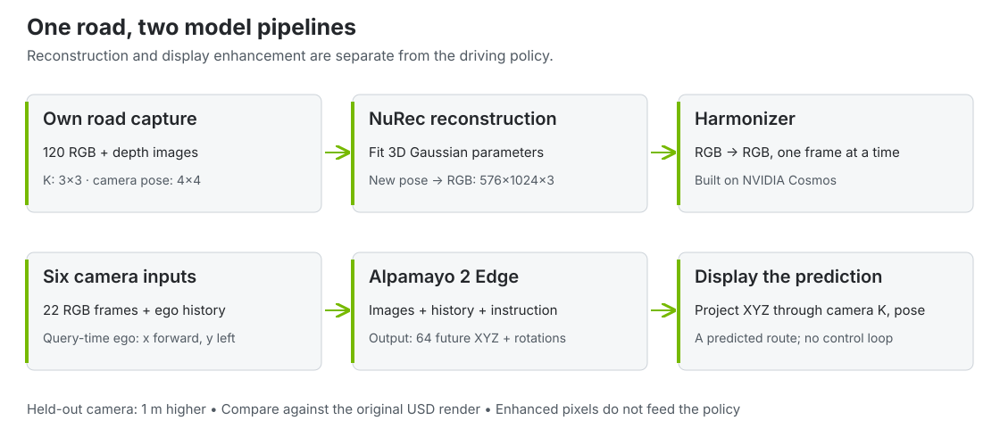

# Synthetic road test with NuRec, Harmonizer and Alpamayo

[All labs](../../../labs/README.md) · [한국어](../../ko/labs/reality-view.md)

Move a camera above a road we built, reconstruct that view with NuRec, compare Harmonizer’s output, and draw Alpamayo 2 Edge’s predicted route. Start with the saved results on a CPU; the GPU steps regenerate them. This is a static-scene rendering experiment plus one driving-model prediction.

## How it works



### 1. Why capture images, depth and camera poses?

An image stores colors, but does not by itself tell us where the camera or road is in 3D. Our primitive-only [USD road](../../../labs/world-driving/evidence/synthetic-intersection/synthetic-intersection.usda) gives us known geometry. Isaac Sim captures **120 RGB images and z-depth maps** along three parallel camera tracks. Each RGB image has shape `576 × 1024 × 3`, with `uint8` values from 0 to 255. Depth is a `576 × 1024` floating-point array in meters measured along the optical axis.

The camera matrix is:

```text
K = [[512,   0, 512],
     [  0, 512, 288],
     [  0,   0,   1]]
```

`512` is the focal length in pixels; `(512, 288)` is the principal point. A `4 × 4` camera-to-world matrix places the camera in the scene. OpenCV/NCore camera coordinates point right, down and forward; USD cameras point along `-Z` with `+Y` up. The capture script explicitly changes that basis.

To turn a depth pixel into a point, compute `X = (u-cx)·Z/fx` and `Y = (v-cy)·Z/fy`, then transform `(X,Y,Z)` into world coordinates. We use **only training-view depth** to seed 90,028 Gaussians. This uses simulator ground truth; it does not test recovery of geometry from ordinary monocular video. The adapter packages RGB, intrinsics, transforms, timestamps and empty static-scene tracks as **NCore V4**. [NCore conventions](https://nvidia.github.io/ncore/data/conventions.html)

### 2. What does NuRec learn, and what makes a view new?

NuRec fits Gaussian positions, scale, rotation, opacity and color so the rendered training views match the captured images. A requested camera pose and calibration then produce a new RGB image. This run uses **NuRec 26.04, 2,400 training steps and the gsplat renderer**. A separate 40-pose path moves the camera **1 m higher**, between the training tracks. Its RGB and depth do not enter fitting or initialization. We render the original USD from the same 40 poses to obtain a reference.

A Gaussian scene describes appearance. It does not supply vehicle dynamics, colliders or a controller. [NuRec source and distribution](https://github.com/NVIDIA/NuRec#source-containers-and-models)

### 3. What does Harmonizer change?

The published `harmonizer_nontemporal.pt` checkpoint takes `float[1,3,1,576,1024]` RGB normalized to `[-1,1]` and produces an image of the same shape. It runs a learned, single-step enhancement based on Cosmos. Our runner converts the output back to RGB PNG without an extra color-transfer pass.

This example uses **non-temporal inference**, which processes each image independently. [Harmonizer model card](https://huggingface.co/nvidia/Harmonizer) · [Official integration](https://docs.nvidia.com/nurec/nurec/harmonizer.html)

**Built on NVIDIA Cosmos.** Pixel changes can smooth an artifact or alter a lane edge. We compare against the original USD rather than treating every change as an improvement.

### 4. Where does the green route come from?

Alpamayo receives **raw Isaac Sim images** from six cameras, not the Harmonizer output. There are 22 images with camera IDs and timestamps, 20 past ego positions and rotations, and the instruction `Continue straight through the intersection.` The policy branch and display branch share the same road scene.

```text
image_frames:    uint8[22,1,3,360,640]
ego_history_xyz: float[1,20,3]
ego_history_rot: float[1,20,3,3]
          ↓ Alpamayo 2 Edge
pred_xyz:        float[1,1,1,64,3]
pred_rot:        float[1,1,1,64,3,3]
```

The 64 future poses cover 6.4 seconds at 0.1-second intervals. The actual first predicted point is approximately `[0.5010, 0.000064, 0.0]` m; the last is `[30.2868, -0.08339, 0.0]` m. These are relative to the ego vehicle at query time: `x` forward, `y` left, `z` up. The compositor places that origin at `[0,-1.8,0]` in our USD world, applies the display camera’s inverse pose, and projects with `K`. BEV shows the complete route even where points fall outside the camera image.

The animation displays **one saved prediction**, rather than closed-loop vehicle control. [Alpamayo 2 Edge](https://github.com/NVlabs/alpamayo2-edge)

## Run the lab

### 1. Inspect the saved example without a GPU

Open the [English comparison video](../../../labs/reality-view/evidence/reality-view.en.mp4), or inspect [NuRec alone](../../../labs/reality-view/evidence/nurec-novel.mp4), [Harmonizer alone](../../../labs/reality-view/evidence/harmonizer-novel.mp4) and the [route overlay](../../../labs/reality-view/evidence/alpamayo-overlay.mp4). The three lossless image triplets and trajectory JSON are in [evidence](../../../labs/reality-view/evidence).

For numerical checks, open a terminal in the repository folder. A small Python environment keeps these CPU dependencies separate from GPU frameworks:

```bash
python3 -m venv .venv-reality-check
source .venv-reality-check/bin/activate
python -m pip install numpy Pillow
python labs/reality-view/check.py
```

The checker verifies file hashes, 64 finite poses, rotation matrices and the PSNR of the saved image triplets. Add `--decode-video` after installing FFmpeg to decode every MP4 and detect damaged frames.

### 2. Prepare the GPU machine and model environment

Use an NVIDIA Linux machine with Docker GPU access, an Isaac Lab Python environment and at least 40 GB of free disk space. This small preset ran on **RTX 5090 32 GB, host RAM about 32 GB**, Isaac Sim **6.1.0.0 / Isaac Lab 17.0.2**. NuRec recommends more host RAM for general reconstruction workloads; this preset reduces data-loader workers and uses a small static scene. Preserve the tested runtime rather than upgrading it in place. [Linux GPU onboarding](../onboarding/nvidia-linux.md) · [Isaac Sim onboarding](../onboarding/isaac-sim-tools.md) · [NuRec hardware requirements](https://docs.nvidia.com/nurec/basics/hardware.html)

Run these commands in the repository’s terminal on that machine. Replace the Python path with the executable from **your** Isaac Lab installation:

```bash
export REALITY_VIEW_ROOT="$HOME/physical-ai-labs/road-view"
export ALPAMAYO_ROOT="$HOME/physical-ai-labs/road-models"
export ISAAC_PYTHON="/absolute/path/to/isaaclab/.venv/bin/python"
mkdir -p "$REALITY_VIEW_ROOT" "$ALPAMAYO_ROOT"
nvidia-smi
```

The variables select the output and model folders. Install `uv`, sign in to Hugging Face if needed, and download the pinned models:

```bash
bash labs/reality-view/setup_models.sh
docker pull nvcr.io/nvidia/nre/nre-ga:26.04
```

The container and model versions are fixed in [run.sh](../../../labs/reality-view/run.sh). [Model versions and terms](../../../labs/reality-view/model-pins.json)

### 3. Capture the road and convert its data

After reviewing the [Omniverse license](https://docs.omniverse.nvidia.com/platform/latest/common/NVIDIA_Omniverse_License_Agreement.html), set its acceptance variable for the simulator. `capture` opens our USD and writes the images/calibration; `prepare` creates NCore and the Gaussian seed.

```bash
export OMNI_KIT_ACCEPT_EULA=YES
bash labs/reality-view/run.sh capture
bash labs/reality-view/run.sh prepare
```

Expect `CAPTURE complete: 120 training, 40 held-out, 22 policy frames`, followed by `prepared.json` and `ncore/own-road.json`. Use a fresh output folder for each attempt. The camera uses a 90° pinhole projection.

### 4. Fit NuRec, render the elevated camera, then run Harmonizer

```bash
bash labs/reality-view/run.sh train
bash labs/reality-view/run.sh render
bash labs/reality-view/run.sh enhance
```

Training creates `train/<run-id>/artifacts/last.usdz`. The renderer uses `novel-rig.json` and saves **40 PNGs in `novel/`**. Enhancement adds **40 PNGs in `enhanced/`** and `harmonizer-result.json`.

### 5. Run the driving model and make your own videos

```bash
bash labs/reality-view/run.sh policy
```

Wait for `alpamayo/output.safetensors` and `alpamayo/receipt.json`. The wrapper verifies both model shards against the pinned SHA-256 digests. It uses the repository’s existing [Alpamayo runner](../../../labs/world-driving/run_alpamayo_synthetic.py).

On a CPU environment with NumPy, Pillow and FFmpeg, run the compositor with a font that contains Korean glyphs:

```bash
python labs/reality-view/package.py \
  --input "$REALITY_VIEW_ROOT" \
  --output "$REALITY_VIEW_ROOT/published" \
  --font /absolute/path/to/NotoSansKR.ttf
```

This writes English/Korean comparison videos, separate NuRec/Harmonizer/route clips and sample frames.

## Verify the result

Compare lane edges and object boundaries across the original USD render, NuRec and Harmonizer. In this example, the held-out PSNR was **29.21 dB for NuRec and 27.09 dB after Harmonizer**: a smoother image does not always preserve the reference more closely.

The saved trajectory contains 64 predicted poses. Inspect their direction and ego-frame coordinates, then use the [checker](../../../labs/reality-view/check.py) to validate the files. [Run details](../../../labs/reality-view/recorded.json).

Continue with [NuRec principles](../nurec.md), [Alpamayo principles](../alpamayo.md), or [AlpaSim closed-loop evaluation](../workflows/alpasim-closed-loop.md).
