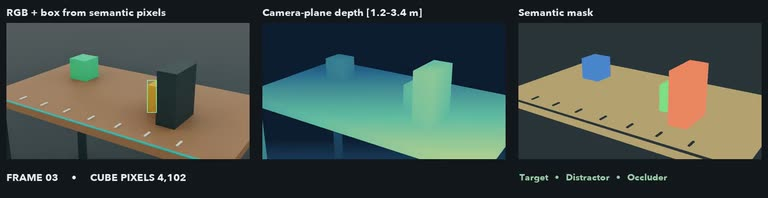

# Advanced Replicator lab · RGB, depth, and masks in 12 frames

**Optional advanced lab.** Use Isaac Sim 6.1 and Isaac Lab with this example’s own USD and checker to generate 960 × 540 data. If you are new to camera capture, start with the [Isaac Sim 6.2 workbench capstone](workbench-capstone.md).

## How it works

### Read color, depth, and labels from the same view

A Replicator **render product** pairs a USD camera with its capture resolution. The script attaches three **annotators** to read color, camera-plane depth, and semantic labels. The lab varies cube position, lighting, camera settings, and occlusion, then reads all three outputs from the same render. Semantic IDs come from class labels authored on the USD prims. [Isaac Sim capture examples](https://docs.isaacsim.omniverse.nvidia.com/latest/replicator_tutorials/tutorial_replicator_isaac_snippets.html) · [Lab capture code](../../../labs/replicator-outputs/capture.py)

### Look up the same pixel in the frame directory

| File | Shape and type in this lab | Meaning |
| --- | --- | --- |
| `rgb.png` | `[540, 960, 3]` when decoded as `uint8` | Red, green, and blue in the range 0–255. |
| `depth_m.npy` | `[540, 960]`, `float32` | Depth in meters along the camera’s forward axis. A pixel’s straight-line distance to the camera can differ. |
| `semantic_ids.npy` | `[540, 960]`, `uint32` | A class ID for each pixel. |
| `semantic_labels.json` | ID → label | Look up the IDs named `target` to select the visible cube pixels. |

Image coordinates `(u, v)` increase right and down from the top-left corner. NumPy indexes the row first, so read the same point with `rgb[v, u]`, `depth[v, u]`, and `ids[v, u]`. Multiple objects can share one semantic class. To distinguish them as individual objects, use instance segmentation.

### How does a mask turn into a box?

Select all pixels labeled `target` and take their left, top, right, and bottom extremes. In the [recorded frame 0](../../../labs/replicator-outputs/recorded.json), the box is `[264, 159, 401, 292]` with `15121` target pixels. The extrema are inclusive, so the rectangle is 138 × 134 pixels. It also contains background pixels, so use the mask count for visible area.

The occluded example at frame 3 has `4102` target pixels. The cube also moved between these frames, so that difference alone does not isolate occlusion. To test occlusion independently, fix the camera and cube and change only the blocker.



The box encloses the visible cube pixels in frame 3. The rest of the cube is behind the blocker. [Preview script](../../../labs/replicator-outputs/preview_dataset.py)

## Run it

**Before you start** · Activate the Isaac Lab Python environment paired with Isaac Sim 6.1 on your RTX machine. See the [Isaac Sim setup guide](../onboarding/isaac-sim-tools.md) for the available installation types. This script uses Isaac Lab’s app launcher, which a generic Python environment with NumPy does not provide.

### 1. Open the stage and capture the frames

From this repository in a terminal on the simulator machine, run the block below. The first path is the USD scene to open. The second is where the script saves the capture. `--viz kit` opens the window. Use a fresh output directory on a second run.

```sh
python labs/replicator-outputs/capture.py \
  labs/replicator-outputs/replicator-live.usda ./runs/replicator --viz kit
```

### 2. Read the first frame’s files

After the run, use the same terminal for the commands below. Open `rgb.png` in an image viewer and `semantic_labels.json` in a text editor. The two `.npy` files contain numeric arrays, which the checker can read. It checks that the three channels share the same dimensions and that the cube’s depth pixels are valid.

```sh
ls ./runs/replicator/frames/00
python labs/replicator-outputs/check_capture.py ./runs/replicator
```

With FFmpeg installed, run `python labs/replicator-outputs/preview_dataset.py ./runs/replicator` for a side-by-side preview. [NVIDIA Replicator tutorial](https://docs.isaacsim.omniverse.nvidia.com/6.1.0/replicator_tutorials/tutorial_replicator_getting_started.html)

## Check the result

Look for 12 distinct 960 × 540 triplets. The checker reads the arrays, compares the RGB hashes and semantic pixel counts to the manifest, and checks that cube pixels have finite, positive depth. Occluded frames 03, 07 and 11 contain fewer visible cube pixels. [Recorded manifest](../../../labs/replicator-outputs/recorded.json)
