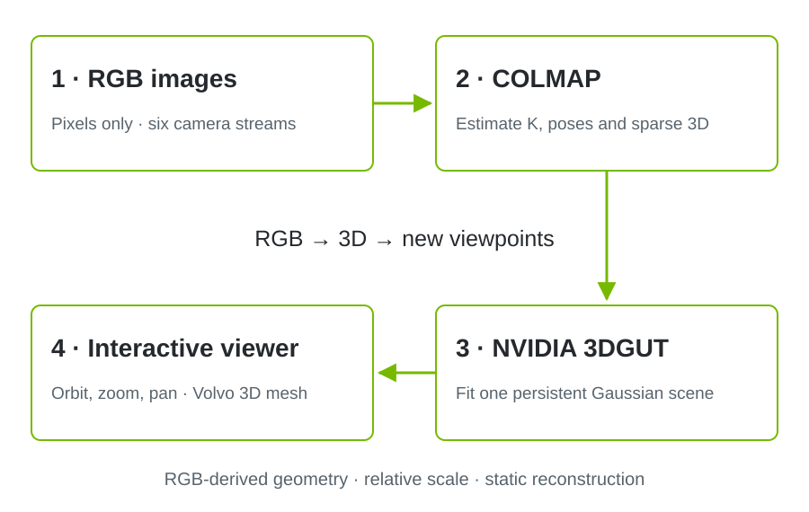
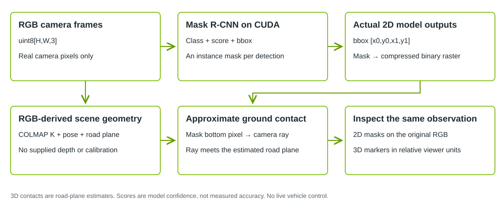

# Reconstruct a road from RGB on one RTX 5090

[All labs](../../../labs/README.md) · [한국어](../../ko/labs/rgb-reality-view.md)

Turn camera RGB into a 3D road scene with NVIDIA 3DGUT. Orbit around the Volvo reference, inspect road-user detections, then reproduce the workflow on one RTX 5090.

## How it works



### 1. How can images describe a 3D road?

One pixel gives color, not distance. COLMAP finds distinctive image patches, matches the same features in overlapping photos, and estimates camera locations and 3D points that explain those matches. Bundle adjustment refines the estimates to reduce the distance between observed image features and their projected 3D points.

The example uses 162 RGB photographs from six camera directions. COLMAP estimates camera geometry from the images.

```text
RGB:                       uint8[height,width,3]
Matched feature locations: pixel pairs across overlapping images
Estimated camera K:        float[3,3]
Estimated camera pose:     float[4,4]
Triangulated sparse points: float[N,3] + RGB
```

`K` contains pixel focal lengths and the image's optical center. A pose places a camera in the reconstructed world. Camera axes are right/down/forward; the viewer aligns the estimated road to a Z-up display. The full values are in [cameras.json](../../../labs/rgb-reality-view/evidence/cameras.json).

The example connects 162 images and recovers about 29,000 sparse points.

An estimated front-camera frame: `K` is in pixels and `camera_position` uses relative viewer units.

```json
{
  "image": "front_camera/39.jpg",
  "time_seconds": 3.9,
  "K": [[1055.495, 0.0, 512.0], [0.0, 1056.31, 284.5], [0.0, 0.0, 1.0]],
  "image_size": [1024, 569],
  "camera_position": [-0.0, 0.0, 0.9482]
}
```

### 2. What does NVIDIA 3DGUT learn?

NVIDIA's open-source [3DGRUT](https://github.com/nv-tlabs/3dgrut) provides the 3DGUT renderer and training workflow. It initializes from the RGB-derived COLMAP points and optimizes many small colored 3D ellipsoids: **Gaussians**. Their positions, scales, rotations, opacity and view-dependent color are adjusted so rendered views resemble the input photos.

The preset trains 16,000 iterations with 400,000 Gaussians. The compressed SPZ is a persistent 3D scene that Spark can render from any browser camera.

Moving traffic can leave ghosts in a static Gaussian scene, and unseen surfaces can remain incomplete.

### 3. What happens when I drag or replay the path?

[Spark](https://github.com/sparkjsdev/spark) projects and blends the same Gaussians for the current browser camera. Dragging changes that camera in 3D; zooming changes its distance, and panning shifts its target. A different view therefore reveals actual parallax, gaps and occlusion artifacts in the reconstruction.

The [Volvo S90 mesh by lazercar](https://sketchfab.com/3d-models/volvo-s90-recharge-free-9462b07c10244fd4a28d86846dc9e3a9) marks the ego position. The path slider follows the COLMAP camera trajectory; Driver view uses the estimated front-camera pose.

The viewer normalizes camera-to-road height to one display unit. Coordinates are relative, not measured meters.

### 4. Recognize cars and pedestrians in the actual RGB



The new perception stage runs **TorchVision Mask R-CNN ResNet50 FPN v2, COCO_V1**, on the undistorted camera photos. Its backbone extracts image features, region proposals select candidate objects, and separate heads predict a class, confidence score, bounding box and instance mask. No dataset object annotations are read.

```text
RGB uint8[H,W,3] → float32[3,H,W] in [0,1] → CUDA inference
boxes:  float[N,4] in original undistorted-image pixels
labels: int64[N]                    e.g. person, car, truck
scores: float[N]                    model confidence, not calibrated accuracy
masks:  float[N,1,H,W] → mask > 0.5 → cropped binary raster → RLE
```

The demo keeps scores ≥ **0.8** and six road-user classes: person, car, truck, bus, bicycle and motorcycle. Here is a real pedestrian prediction from the left camera:

```json
{
  "image": "left_camera/39.jpg",
  "class": "person",
  "score": 0.9982,
  "bbox_xyxy": [274.1, 316.64, 294.92, 364.5],
  "cropped_mask_size": [21, 49],
  "contact_pixel": [280.0, 363.0],
  "estimated_ground_xyz": [-5.95426, 11.1151, 0.0]
}
```

The box is about 21×48 pixels. Its cropped 21×49 binary mask is compressed with alternating zero/one run lengths (RLE).

**How does that become a 3D marker?** Cast a ray through a bottom-mask pixel using the estimated `K` and camera pose. Its intersection with the estimated road plane supplies an approximate contact point. This is useful for placing a marker without a 3D detector.

Use **Recognition on/off** and switch cameras to compare predictions with their source RGB. Cyan marks vehicles, amber people and purple cycles. Source images and 3D markers follow the same selected time.

## Run the lab

### 1. Explore the saved result without a CUDA GPU

Use the interactive viewer on this page or open the [English mouse-control recording](../../../labs/rgb-reality-view/evidence/rgb-reality-view.en.mp4). The same scene supports rotation, zoom, pan, driver view and path replay. Your browser needs WebGL2 for 3D; viewing the MP4 and checking evidence do not require NVIDIA hardware.

```bash
python3 labs/rgb-reality-view/check.py
```

The checker verifies the RGB-only provenance, compressed model count, transforms, interaction trace and file hashes. Add `--decode-video` with FFmpeg installed to decode both complete recordings.

To open the bundled 3D scene locally without training, run this from the repository and visit **http://127.0.0.1:8090/**. The viewer uses pinned public JavaScript modules, so it needs an internet connection:

```bash
python3 labs/rgb-reality-view/serve.py --root site/public/showcase/rgb-reality-view
```

### 2. Prepare the GPU machine

The tested reconstruction machine runs **Linux x86_64 with one RTX 5090 32 GB and about 32 GB system RAM**. Install a working NVIDIA driver, CUDA **12.8 or 12.9** development toolkit, Python, a C++ compiler, `uv`, Git and Node.js/npm. The setup creates isolated Python environments and compiles only for compute capability 12.0. It does not replace system CUDA or other services.

Start with [Linux GPU onboarding](../onboarding/nvidia-linux.md) and the [official uv installer](https://docs.astral.sh/uv/getting-started/installation/) if needed. In the repository terminal:

```bash
nvidia-smi
export RGB_VIEW_ROOT="$HOME/physical-ai-labs/rgb-road"
python3 labs/rgb-reality-view/pipeline.py --root "$RGB_VIEW_ROOT" setup
```

The first setup downloads several GB of dependencies and builds native extensions. Source commits and core package versions are pinned. If several toolkits are installed, the runner selects a compatible 12.8/12.9 directory; you can pass `--cuda-home /path/to/cuda-12.9`. The `nvcc` found first in your shell can be older than the toolkit actually needed for RTX 5090.

### 3. Reconstruct the public RGB example

The example uses PandaSet scene 001. [Data and vehicle sources](../../../labs/rgb-reality-view/SOURCES.md).

For the complete workflow:

```bash
python3 labs/rgb-reality-view/pipeline.py --root "$RGB_VIEW_ROOT" all
```

Or run each stage so you can inspect its output:

```bash
python3 labs/rgb-reality-view/pipeline.py --root "$RGB_VIEW_ROOT" example
python3 labs/rgb-reality-view/pipeline.py --root "$RGB_VIEW_ROOT" sfm
python3 labs/rgb-reality-view/pipeline.py --root "$RGB_VIEW_ROOT" train
python3 labs/rgb-reality-view/pipeline.py --root "$RGB_VIEW_ROOT" export
python3 labs/rgb-reality-view/pipeline.py --root "$RGB_VIEW_ROOT" perceive
python3 labs/rgb-reality-view/pipeline.py --root "$RGB_VIEW_ROOT" serve
```

Open **http://127.0.0.1:8090/** on that machine. When using a remote GPU host, forward the local viewer port from your own computer with `ssh -L 8090:127.0.0.1:8090 your-gpu-host`, then open the same local address. Replace `your-gpu-host` with your own SSH alias.

| Stage | Output | What to inspect |
| --- | --- | --- |
| RGB example / ingest | `work/images/`, `input-manifest.json` | JPEG files only; no supplied calibration or sensor data |
| COLMAP | `sfm-result.json`, `sfm-selected/`, `undistorted/sparse/0/` | Registered-image counts match the selected and undistorted models |
| 3DGUT | `training-result.json`, `train/.../export_last.ply` | Completed iterations, observed runtime, sampled GPU memory |
| Viewer export | `viewer/road.spz`, `cameras.json`, `volvo-s90.glb` | A single 3D model, RGB-derived camera path and separate car mesh |

Use a fresh output folder for a different capture.

### 4. Bring your own camera footage

For one RGB video, FFmpeg extracts frames and the same RGB-only stages recover its cameras. Start with overlapping, translated views of a mostly static road; spinning in place or filming textureless surfaces gives weak geometry.

```bash
python3 labs/rgb-reality-view/pipeline.py \
  --root "$HOME/physical-ai-labs/my-road" \
  --video "/absolute/path/to/road.mp4" --sample-fps 3 all
```

For synchronized surrounding camera streams, extract images into separate camera folders, then use `--input /path/to/rgb-folders --front-folder front_camera all`. The folder names group images by lens; no external calibration is required by this preset. A single forward-facing camera supports the surfaces it actually sees; rear or hidden regions need additional observations.

## Check the result

The saved example reconstructs 162 RGB images with one RTX 5090. [Run details](../../../labs/rgb-reality-view/recorded.json).

```bash
python3 labs/rgb-reality-view/check.py --decode-video
```

Check that orbit changes the viewing camera and path playback advances time. Reconstruction runs on the NVIDIA GPU; interactive rendering runs in the browser.

Continue with the [RGB-only NuRec, Harmonizer and Alpamayo lab](nurec-rgb-reality.md).