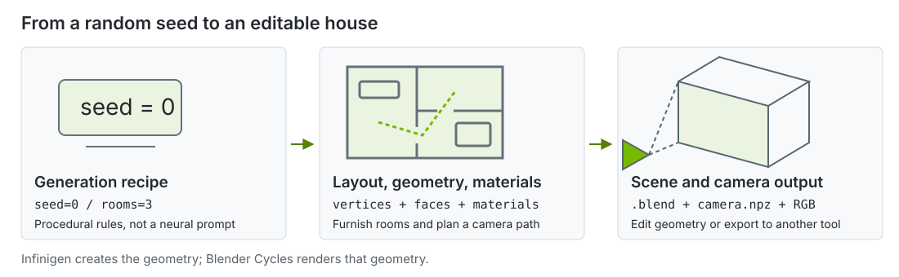

# Generate a furnished house and a camera tour

[한국어](../../ko/labs/scene-generation.md) · [Source code](../../../labs/scene-generation/)

## What does a scene generator create?

This example uses **Infinigen**, outside Isaac Sim, to create a house with rooms, furniture, materials and lighting. A seed chooses parameters and placement rules; Blender stores actual geometry. This is **procedural scene generation**, not a neural model inventing a world from a prompt. It complements the [generative 3D worlds comparison](../spatial-worlds.md) and the [measured 3DGS reconstruction](spatial-reconstruction.md).



### Follow the data through the generator

`seed=0` and `room_count=3` produce a connected layout, then furnishing generators place sofas, storage and small objects. The official house-tour example plans an RRT camera path through selected rooms. This is a camera-navigation example, not a trained robot controller. [Infinigen house-tour source](https://github.com/princeton-vl/infinigen/blob/53033dd55c7191cbc436be6ffbb63c026935a509/examples/house_tour/render.py)

```text
Seed + room rules
    → floor plan and meshes
    → furniture + materials + lights
    → collision-aware RRT camera path
    → .blend + camera transforms
    → Cycles RGB frames
```

A mesh consists of vertex coordinates and indexed faces. Materials tell the renderer how the surface reflects light. Camera matrices define the viewpoint for each frame. The saved `.blend` keeps these editable components, unlike a flattened MP4. `camera.npz` records camera information for checking or downstream reconstruction. It is not a control-policy checkpoint.

### How to read the recording

The video follows a camera through the generated rooms. The house is static, and the saved `.blend` lets you change furniture, materials and camera paths.

## Generate, save and render your own house

### 1. Install a separate environment

Use the [official installation instructions](https://github.com/princeton-vl/infinigen/blob/53033dd55c7191cbc436be6ffbb63c026935a509/docs/source/Installation.md). The source used here requires Python **3.11** and Blender's `bpy==4.2.0`. Do not install it into Isaac Sim's Python environment. With `uv` available:

```bash
git clone https://github.com/princeton-vl/infinigen.git runs/infinigen-source
git -C runs/infinigen-source checkout 53033dd55c7191cbc436be6ffbb63c026935a509
cd runs/infinigen-source
uv venv --python 3.11
INFINIGEN_MINIMAL_INSTALL=True uv pip install -e .
cd ../..
```

On Linux, install the project’s system build dependencies as needed. This helper uses the fixed Infinigen 2 API and CPU rendering with 12 Cycles threads.

### 2. Generate the house and save the scene

From this repository, use the Python interpreter of the new Infinigen environment:

```bash
runs/infinigen-source/.venv/bin/python labs/scene-generation/run.py \
  --source runs/infinigen-source --seed 0 --frames 1 48 \
  --room_count 3 --resolution 640 360 --samples 16 \
  --save_blend runs/house.blend --output runs/house-build
```

Wait for `Saved ...house.blend`. The official example's `--save_blend` **saves and exits**; it does not render video. Change the seed to generate another layout. A rejected layout is possible: inspect the message and try another seed rather than assuming every random house supports a camera tour.

### 3. Render the saved geometry

```bash
runs/infinigen-source/.venv/bin/python labs/scene-generation/run.py \
  --source runs/infinigen-source --seed 0 --frames 1 48 \
  --resolution 640 360 --samples 16 \
  --load_blend runs/house.blend --output runs/house-render
ffmpeg -framerate 8 -start_number 1 -i runs/house-render/Camera/%04d.png \
  -c:v libx264 -crf 23 -pix_fmt yuv420p -movflags +faststart runs/house-tour.mp4
```

Each frame is ray-traced from the saved camera path. Our helper changes the RGB pass to the denoised pass; it does not alter the generation or path-planning logic. Rendering takes longer than video playback. For a sharper result, increase sample count and render resolution after checking a few frames.

## Inspect the saved result

No GPU is needed to watch the recording or check the bundled hashes and camera-path summary:

```bash
python3 labs/scene-generation/check.py
```

Inspect room connections, furniture placement and the camera path. For robot simulation, check scale and colliders using the [official export guide](https://github.com/princeton-vl/infinigen/blob/53033dd55c7191cbc436be6ffbb63c026935a509/docs/source/ExportingToSimulators.md). [Run details](../../../labs/scene-generation/recorded.json) · [Media credits](../../../site/public/showcase/SPATIAL-CREDITS.md) · [3DGS plaza](spatial-reconstruction.md).