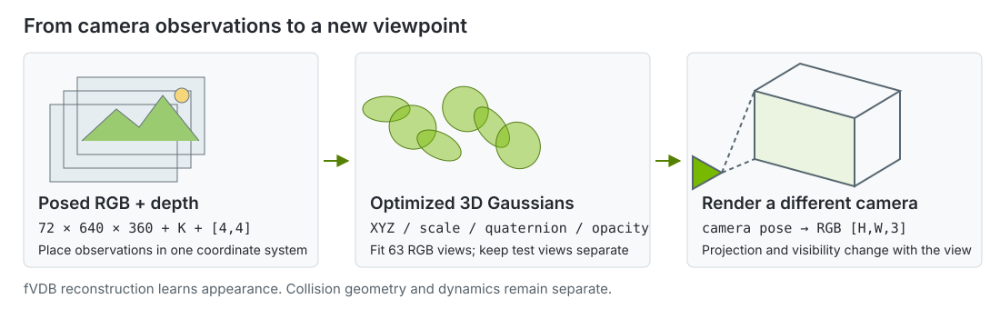
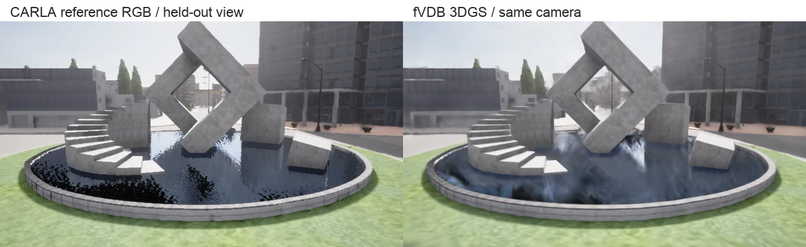

# Reconstruct an explorable 3DGS plaza

[한국어](../../ko/labs/spatial-reconstruction.md) · [Source code](../../../labs/spatial-reconstruction/)

## How do camera images become a space you can explore?

The interactive scene below is a **real fVDB Gaussian Splatting reconstruction** of a CARLA fountain plaza. It is not a panorama on a sphere or a video playing behind a camera. The renderer projects 3D Gaussians from your current viewpoint. Use the 3D button to orbit, pan and move closer; use the video if your browser does not support the viewer.



### Images, calibration and depth have different roles

We captured 72 RGB images at `640 × 360`, along with camera intrinsics `K`, world-to-camera matrices, and simulated depth in meters. The camera's horizontal FOV is 80°, giving `fx = fy ≈ 381.36 px`. A pixel ray is derived from `(u-cx)/fx`, `(v-cy)/fy`, and its depth. Transforming that point by the camera-to-world matrix places it in the shared 3D scene. This example uses **known simulator cameras**, so it does not need COLMAP to estimate poses.

```json
{
  "image_path": "view_000.png",
  "width": 640,
  "height": 360,
  "camera_intrinsics": [[381.361, 0, 320], [0, 381.361, 180], [0, 0, 1]],
  "world_to_camera": "4 x 4 matrix; see evidence/cameras.json"
}
```

The matrix values above are rounded for reading. The [saved cameras](../../../labs/spatial-reconstruction/evidence/cameras.json) contain full values. CARLA uses a left-handed world; our exporter reflects world Y and converts camera axes to OpenCV's right/down/forward convention. A wrong sign here would mirror the reconstructed scene.

For a concrete point, pixel `(320,180)` in `view_000.png` has depth **21.237 m**. Its camera-space point is approximately `[0,0,21.237] m`; applying the saved camera pose gives world position `[0.958,0,2.131] m`. The [actual sample](../../../labs/spatial-reconstruction/evidence/point-sample.json) includes full precision, and `check.py` recomputes the transformation.

### What is a Gaussian?

Each Gaussian stores a center `[x,y,z]`, three scales, a rotation quaternion, an opacity and color coefficients. It is a soft ellipsoid in space. fVDB projects and blends these ellipsoids, compares the result with a training image, and adjusts them to reduce rendering error. It also splits or removes Gaussians during refinement. The final model has **345,318 Gaussians**. [fVDB Reality Capture](https://github.com/openvdb/fvdb-reality-capture)

The 6.15 MB browser SPZ keeps all 345,318 Gaussians with quantized parameters and degree-1 color coefficients. The full recording uses the original degree-3 spherical-harmonic model. Appearance can therefore differ slightly between the interactive preview and the video. A radiance field describes appearance; collision surfaces, mass and a robot's control loop require separate data.

### How is this different from a generated world?

This experiment **reconstructs a supplied scene**. It does not invent unseen streets from a text prompt. World Labs Marble and NVIDIA Lyra address generative 3D worlds; Infinigen constructs geometry from procedural rules. The [3D worlds comparison](../spatial-worlds.md) separates those outputs and their execution requirements.

Two additional clips below use **Apple SHARP** on a single CARLA camera image. We supply the known 90° intrinsics instead of relying on missing EXIF. SHARP predicts 1,179,648 Gaussians per image; fVDB then renders a small nearby camera movement. It does not reconstruct the back of every object or produce a complete 360° world. Its weights are for noncommercial research, unlike its separately licensed code.

## Capture and reconstruct a new scene

### 1. Capture known camera views

Follow [CARLA setup](carla-ego.md) to start the pinned 0.9.16 server in terminal A. In the CARLA Python environment, from the repository in terminal B:

```bash
python labs/spatial-reconstruction/capture.py --output runs/plaza-input
```

The command moves RGB and depth sensors around a static Town03 plaza. Wait for `Saved view 72/72`. `images/` stores color PNGs, `depth/` stores meter-valued NumPy arrays, and `cameras.json` records the exact camera poses. `prepare_seed.py` builds the initial point cloud **without using held-out images or their depth**. Index `0,8,16,…` is reserved for evaluation.

Stop your CARLA container before starting the next GPU job. The Python environments are separate: a CARLA wheel is not an fVDB installation.

### 2. Optimize the 3D Gaussians

Install fVDB and fVDB Reality Capture using their [official installation guide](https://fvdb-reality-capture.readthedocs.io/stable/installation.html), matching PyTorch/CUDA to your GPU. Activate that environment and install `plyfile`, Pillow and SciPy if missing. Our verified run used fVDB 0.6.0 and PyTorch 2.13.0+cu130 on an RTX 5090; see the runtime in `recorded.json`. Run:

```bash
python labs/spatial-reconstruction/reconstruct.py \
  --input runs/plaza-input --output runs/plaza-3dgs --ffmpeg ffmpeg
```

The script uses 63 RGB training views for 40 epochs. It leaves camera poses fixed, exports the full PLY and the lighter `.splat`, renders a new camera path, and writes evaluation metrics. On OMEN, cuDNN library versions conflicted, so this script disables cuDNN and uses native PyTorch CUDA convolutions; fVDB training and rendering still run on the GPU. That workaround is explicit in the source and record.

For the web preview, keep every Gaussian and compress the full PLY with a pinned PlayCanvas CLI:

```bash
python3 labs/spatial-reconstruction/compress_web.py runs/plaza-3dgs/town03.ply runs/plaza-3dgs/town03.spz
```

### 3. Optional single-image comparison

Install [SHARP](https://github.com/apple-aiml-research/ml-sharp) and its dependencies in an environment where fVDB also imports. Review the model's research-only license before downloading the [official checkpoint](https://ml-site.cdn-apple.com/models/sharp/sharp_2572gikvuh.pt). Put the ego JPEGs from the CARLA exercise in `runs/sharp-input/`, then run:

```bash
python labs/spatial-reconstruction/reconstruct_single.py \
  --input runs/sharp-input --output runs/sharp-output \
  --checkpoint /path/to/sharp_2572gikvuh.pt --ffmpeg ffmpeg
```

This helper assumes those inputs are our 90° CARLA cameras. Change the focal length for other images. It uses a ±0.35 m lateral camera movement; large translations would reveal unsupported regions.

## Inspect the result without a GPU



```bash
python3 labs/spatial-reconstruction/check.py
```

The bundled checker verifies the split, camera rotations, finite model parameters, preview size and recorded video hashes. The [recorded run](../../../labs/spatial-reconstruction/recorded.json) has 9 held-out RGB views with a mean **23.434 dB PSNR**. The photometric fit excludes those RGBs, and the seed excludes their depth and colors. This is a small synthetic scene measurement, not a cross-dataset benchmark. Water reflections, distant backgrounds, holes and views outside the captured region remain imperfect.

The complete original captures and full PLYs stay in the OMEN run folder; the repository includes camera metadata, code, metrics, compressed recordings and the browser preview. [Media provenance and license scope](../../../site/public/showcase/SPATIAL-CREDITS.md) · [Generate an indoor scene](scene-generation.md) · [fVDB theory](../fvdb-reality-capture.md).
