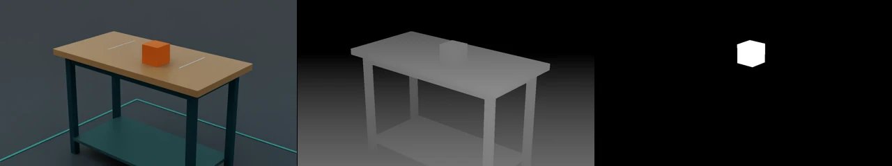
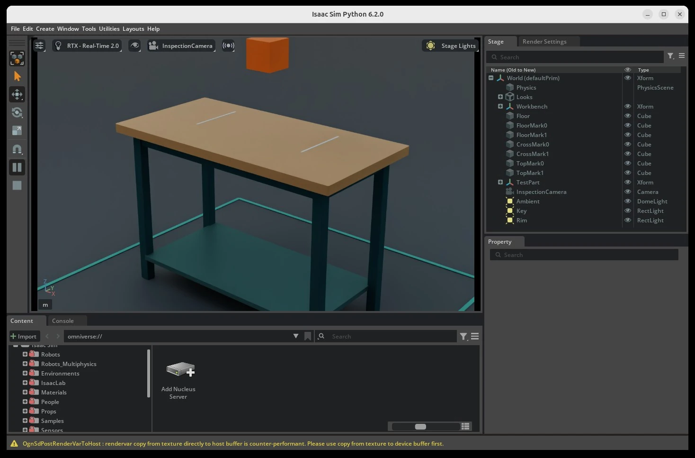

# Build and verify a workbench camera dataset

Turn a STEP workbench into an OpenUSD scene, drop a test cube onto it in Isaac Sim, and capture four RGB, depth, and semantic-mask frames with Replicator. Finish by checking the scene dimensions, the cube's resting height, and how far it moved between captures.

## Check the bundled recording without a GPU

Look at the bundled captures first so you know what you will make. You can do this part on your own computer. Open a terminal and run the first two lines to get the files and enter the folder. If you already cloned the repo, just enter its folder. Install missing Ubuntu 24.04 prerequisites with `sudo apt install git python3.12-venv`.

```sh
git clone https://github.com/james-joobs/awesome-nvidia-physical-ai.git
cd awesome-nvidia-physical-ai
```

In the same terminal, create a Python 3.12 environment. `source` activates it so the libraries stay inside this project’s environment.

```sh
python3.12 -m venv .venv-workbench
source .venv-workbench/bin/activate
python -m pip install -r labs/scene-to-data/requirements-check.txt
```

Run the checker. `--recorded` selects the bundled frames. The path before that flag is where the program extracts the frames and writes results.

```sh
python labs/scene-to-data/check_workbench.py runs/workbench-replay --recorded
```

Open `runs/workbench-replay/check/frame-00.png` in an image viewer. It shows the photo, depth, and the cube mask from left to right. The white region on the right includes only cube pixels. Read the original `.npy` depth array for numeric measurements.



**Same pixel, different information.** At column 715, row 231 in the original frame, RGB `[155, 66, 14]` is orange. The depth at that pixel is about **3.15 m**, and its class ID is **2**. The JSON label map says ID 2 means `part`, the cube. Together, the files tell you which pixel belongs to the cube and how far away it is. [Recorded frame archive](../../../labs/scene-to-data/replicator-data.zip)

Two `PASS` lines mean the saved-data check is complete. If you have an RTX machine, [generate new data in Isaac Sim 6.2](#generate-the-cad-and-usd-scene). You will use the same checker on your own captures.

## Generate the CAD and USD scene

Now make your own workbench. STEP is the design file a CAD tool reads. The mesh JSON is a list of triangles for the simulator. [Check the Linux GPU](../onboarding/nvidia-linux.md) and set up [Isaac Sim 6.2](../onboarding/isaac-sim-tools.md). Open a terminal on the RTX machine and enter this repository. Use a separate Python environment for CadQuery.

```sh
python3.12 -m venv .venv-workbench-cad
.venv-workbench-cad/bin/python -m pip install 'cadquery==2.8.0'
.venv-workbench-cad/bin/python labs/scene-to-data/make_step.py runs/workbench-live
```

The script exports `workbench.step`, opens it again, and checks for 10 solids and a **1,200 × 600 × 40 mm** tabletop. It then writes `cad_meshes.json` in meters. The next step uses that mesh to create `workbench_scene.usda`. This keeps the generated USD tied to the CAD geometry you just built. [CadQuery script](../../../labs/scene-to-data/make_step.py)

## Capture RGB, depth, and masks in Isaac Sim

Bring the mesh you just made into Isaac Sim. If you installed the Workstation package, change the first path to your installation folder. Run the block in the same terminal. `python.sh` loads the modules Isaac Sim needs. For a pip-based install, activate its environment and use `python` in place of `"$ISAAC_SIM_DIR/python.sh"`.

```sh
ISAAC_SIM_DIR="$HOME/isaacsim-6.2.0"
"$ISAAC_SIM_DIR/python.sh" labs/scene-to-data/workbench_final_take.py \
  runs/workbench-live/cad_meshes.json runs/workbench-live
```

The viewport opens on `/World/InspectionCamera`. PhysX drops the cube from above the tabletop, and Replicator then changes the cube's X position and light intensity four times. Each capture comes from one render product and writes `rgb_####.png`, `distance_to_image_plane_####.npy`, `semantic_segmentation_####.npy`, and a JSON label map. After the capture, use **File → Open** to reopen `runs/workbench-live/workbench_scene.usda`; choose **InspectionCamera** in the viewport to inspect the saved stage. [Capture script](../../../labs/scene-to-data/workbench_final_take.py) · [NVIDIA Replicator examples](https://docs.isaacsim.omniverse.nvidia.com/6.2.0/replicator_tutorials/tutorial_replicator_getting_started.html)



With the collider in place, the cube stops on the tabletop. [Isaac Sim viewport after the capture](../../../assets/lessons/workbench/workbench-viewport.webp)

For a machine without a desktop, append `--headless` to the same command in a supported Isaac Sim GPU environment. The render still requires the RTX device. Use a new run directory when changing the configuration.

## Verify your run and save the deliverables

When Isaac Sim closes and the terminal prompt returns, run the command below from the same folder. If your CPU check environment is on a different computer, either create it here using the first step or copy the capture folder to that computer. Leave out `--recorded` to check your own files.

```sh
.venv-workbench/bin/python labs/scene-to-data/check_workbench.py runs/workbench-live
```

| Check | Passing result |
| --- | --- |
| Stage | The tabletop measures 1,200 × 600 × 40 mm, uses meters in USD, and has a collider. |
| Settling | The run log shows the cube starting above the table and settling within 2 cm of the expected center at 0.8615 m. |
| Camera | Each of four frames has matching 1,280 × 720 RGB, depth and mask shapes. At least 1,000 pixels have the `part` label, with finite positive camera-plane depth. |
| Relative motion | Relative X displacement recovered from the visible cube surface differs from the authored motion by at most 10 mm. |

Keep `workbench.step`, `workbench_scene.usda`, the `replicator/` folder, and `check/report.json`. The checker also writes the three-channel preview and downsampled point-cloud arrays. The projection uses a centered camera and square pixels, and measures changes from frame 0. [Browse the lab source](scene-to-data.md#code) · [Checker on GitHub](../../../labs/scene-to-data/check_workbench.py) · [Recorded measurements](../../../labs/scene-to-data/recorded.json)

**Compare with the filmed run.** The four frames had a **5.27 mm** maximum relative X-displacement error. The saved-frame path does not run physics again, so its report says `checked_physics_log: false`.

For a second run, change the light intensities while keeping the camera and cube positions. Compare the images and rerun the checks.

**Optional advanced lab.** The [12-frame Replicator capture](replicator-outputs.md) uses Isaac Sim 6.1 and Isaac Lab, with its own USD scene and checker, to explore camera changes, lighting, and occlusion.
