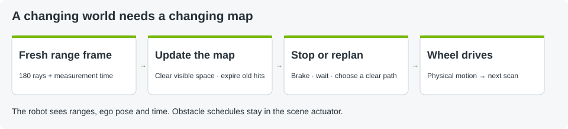
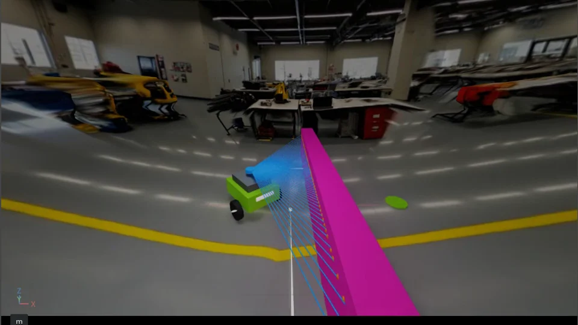
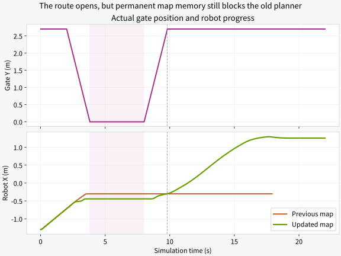
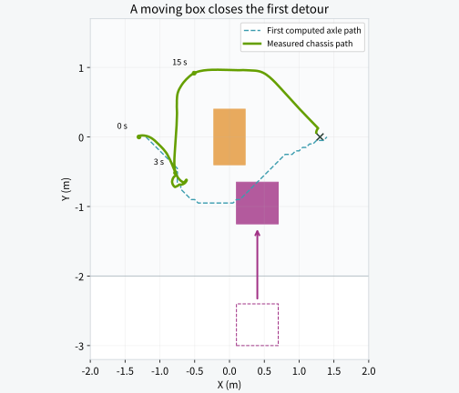

# Stop, clear the map and navigate around moving obstacles

[한국어](../../ko/labs/worldgen-dynamic-navigation.md) · [Start with static obstacles](worldgen-navigation.md) · [Code](../../../labs/worldgen-dynamic-navigation/)

## Why a live sensor also needs an up-to-date map

The previous controller could add new range hits to its obstacle map, but **never removed them**. A moving barrier can leave a wall of old observations behind it. Even after the physical route opens, A* may still see an impassable wall.

This lab keeps the actual Isaac Sim 6.2 Physics Raycast Sensor and wheel-driven AMR. It updates map cells from fresh observations, stops when necessary, and replans when a passage changes. The robot receives no obstacle position or motion schedule.



### 1. Distinguish a current hit from an old memory

The input is still **180 horizontal ranges**, measured to 2.5 m, read at 10 Hz. A stored cell now has a location and a time:

```text
ranges:       float[180]       current distances in metres
hit_positions: float[180,3]   world-space endpoints for rays that hit
sensor_time:  float           simulation time of that measurement
observed[(i,j)] = (x, y, last_seen_time)
```

For each old surface point, the controller finds its direction from the sensor and the nearest current beam. If the new beam extends **at least 10 cm farther** than the old point, the old surface is no longer blocking that ray and its cell can be cleared. Fresh hits from the current frame take precedence.

A miss returns range `2.5`, but the SDK's corresponding `hit_position` is `[0,0,0]`. That zero vector is not a measured obstacle at the world origin. Clearing compares the old point with the measured range in the correct direction, rather than using this placeholder as an endpoint.

Observations not refreshed for **2 seconds** also expire when a new valid frame is processed. Expiry is a bounded-memory choice for this small experiment; it does not prove an occluded area is free. Unknown cells inside the known test floor remain optimistically traversable. The robot stops if measurements themselves become stale.

### 2. Separate planning, braking and waiting

A fresh map is inflated and passed to A*. The planner adds a small continuity cost for leaving the **previous sensor-generated route**, avoiding unnecessary left/right flips from grid changes. This prior route is calculated during the run, not supplied beforehand. A newly blocked passage still forces a different route.

The supervisor then decides what motion is permitted:

| Condition | Command |
|---|---|
| Measurement age exceeds 0.25 s | Stop both wheels |
| Nearest measured surface is below 0.39 m | Stop both wheels |
| A front obstacle crosses the 0.75 m threshold | Brake for 0.6 s |
| No traversable route exists | Wait with zero forward and angular commands |
| A route exists but front range is below 0.58 m | Turn without forward motion |
| A fresh, clear route exists | Follow the new route |

The front sector spans ±25°. The braking trigger rearms after front clearance exceeds 0.95 m. These are chosen settings for this robot and controlled scene, not certified stopping-distance guarantees.

### 3. Account for the robot's actual rotation center

The driven wheel axle is **0.10 m ahead of the chassis center**. Turning in place around that axle moves the chassis center slightly. The new controller therefore follows the axle midpoint, with a **0.52 m inflated radius** covering its approximately 0.425 m axle-centered footprint and tracking margin. The older controller uses its original chassis reference and 0.43 m inflation.

The physical destination is still chassis XY `[1.3,0]`. The new controller approaches axle XY `[1.4,0]`, then aligns the heading with +X. It uses an 8 cm terminal axle tolerance and a 0.08 rad heading tolerance. A single current start cell may be cleared from an inflated margin to permit leaving a quantized boundary; actual measured occupied cells remain blocked.

```text
range frame + measured ego pose + measurement time
  → clear/refresh/expire observed cells
  → inflate footprint → A* with route continuity
  → stop / wait / turn / follow / align
  → wheel angular drives → actual PhysX pose → next scan
```

### 4. How are the obstacles moved?

The magenta body is a **kinematic PhysX rigid body**. `actors.py` supplies continuous targets through `set_kinematic_targets()` every physics step. The range sensor sees the resulting collider, and recorded poses confirm the actual body follows those targets. Robot motion comes from its wheel drives, not direct chassis pose edits. Orange dots visualize the controller's remembered cells; cyan is the current planned axle path.

The displayed obstacle mesh is synchronized from the **measured PhysX pose after every step**, using a separate non-colliding visual prim for the 6.2 compatibility renderer. It does not follow a prerecorded animation or merely draw the requested target. `render_position_xyz` is compared with the actual collider pose in the checker. An empty plan is hidden so an old cyan line cannot remain visible while the robot waits.



The scene actuator knows its schedule; `navigation.py` does not import it or receive actor transforms. [NVIDIA physics tensor API](https://docs.omniverse.nvidia.com/kit/docs/omni_physics/109.0/extensions/runtime/source/omni.physics.tensors/docs/api/python.html) · [Physics Raycast Sensor](https://docs.isaacsim.omniverse.nvidia.com/6.2.0/sensors/isaacsim_sensors_physics_raycast.html)

## Run a closing gate and a moving route blocker

### 1. Prepare the same laboratory

Use a compatible NVIDIA Linux workstation with Docker GPU support. Start with [Linux onboarding](../onboarding/nvidia-linux.md) and the [WorldGen import checks](worldgen-isaac.md) if needed. In the repository root:

```bash
nvidia-smi
mkdir -p runs/worldgen-dynamic
cp -R labs/worldgen-isaac/assets runs/worldgen-dynamic/assets
export WORLDGEN_DATA_ROOT="$PWD/runs/worldgen-dynamic"
```

The prepared room needs no new FLUX download. Accept the [NVIDIA Omniverse agreement](https://docs.omniverse.nvidia.com/isaacsim/latest/common/NVIDIA_Omniverse_License_Agreement.html) before declaring your own acceptance:

```bash
export ACCEPT_EULA=Y
bash labs/worldgen-dynamic-navigation/run.sh gate --controller dynamic
```

The gate slides into the passage from **2–3.8 s**, remains closed, then withdraws from **8–9.8 s**. Its programmed maximum speed is 1.5 m/s. Watch the robot brake, wait and resume as sensor observations clear the map. Outputs appear in `runs/worldgen-dynamic/gate/`.

### 2. Repeat with the previous permanent-map controller

```bash
bash labs/worldgen-dynamic-navigation/run.sh gate --controller static \
  --output /work/gate-static --max-seconds 18
```

`static_navigation.py` preserves the previous controller. The start, physical goal, sensor, robot, moving obstacle, motion schedule and 0.32 m/s maximum speed are shared. Its map keeps observations permanently; its control reference and margin retain their old settings. Compare the map dots and the robot after the gate opens.

`/work` maps to `WORLDGEN_DATA_ROOT` inside the container. Use separate output folders to keep each attempt.

### 3. Put a moving box into the route already being followed

```bash
bash labs/worldgen-dynamic-navigation/run.sh cart --controller dynamic \
  --output /work/cart-dynamic --max-seconds 38
```

A central static crate first creates a detour. A second 0.6 m box moves from Y=-2.7 to Y=-0.95 between **2 and 4 s**, then remains in the lower passage. Its speed is 0.875 m/s. Check that the first plan used the lower side, and that a later scan changes the plan when this side becomes obstructed. No detour coordinates are supplied to the robot.

### 4. Interrupt the range stream while driving

```bash
bash labs/worldgen-dynamic-navigation/run.sh gate --controller dynamic \
  --dropout-start 1 --dropout-seconds 1 \
  --output /work/sensor-gap
```

This test harness withholds range frames for one simulation second. The controller only sees the age of its last measurement. It should stop, receive fresh data and continue. Clearing old map cells is never a reason to continue without fresh sensor input.

### 5. Record the actual simulator window

On an X11 desktop with `xwininfo` and ffmpeg's `x11grab` input:

```bash
mkdir -p runs/worldgen-dynamic-film
cp -R labs/worldgen-isaac/assets runs/worldgen-dynamic-film/assets
python3 labs/worldgen-dynamic-navigation/record_gui.py \
  --work "$PWD/runs/worldgen-dynamic-film" --scenario gate \
  --controller dynamic --max-seconds 32 --ffmpeg /path/to/ffmpeg
```

Use a fresh folder for each recording. The helper waits for the real viewport before starting control. Raw native-window video, `scans.json`, `result.json`, logs and an initial `scene.usdc` remain together. Opening the USD lets you inspect the setup; the Python script runs both the robot controller and moving-body actuator.

## Check measured stops, replanning and video evidence



The new controller maintained a measured stationary hold in the 4.0–7.5 s check interval. It generated a new path at 8.6 s as the lower part of the passage reopened. The previous controller still had no path after the gate fully withdrew at 9.8 s. Replaying its final scan into a fresh copy of that same planner does find a route: accumulated memory is the blocker.

| Run | Goal | Time to goal (simulation s) | Obstacle contact reports |
|---|---|---|---|
| Previous permanent map, gate | No | — (18 s test) | 0 |
| Updated map, gate | Yes | 20.07 | 0 |
| Updated map, entering box | Yes | 25.32 | 0 |
| Updated map, 1 s sensor gap | Yes | 20.65 | 0 |

These are individual recorded runs. Goal times exclude the following 2 s hold. All checks also compare actual collider and display coordinates; the recorded difference was zero.



The dashed line is the first sensor-generated axle plan. The solid line is measured chassis motion. The first upper-side plan appeared at 3.1 s, after the box began entering at 2 s. Braking occurred at 4.3 s; a later route took the robot around the other side.

The gate scan below cleared one cell but still had no route. A later frame found a route and permitted combined forward and turning commands. Clearing a cell alone does not release the robot.

```json
[
  {
    "scan_time_s": 8.1,
    "cleared_cells": 1,
    "path_points": 0,
    "phase": "wait-for-path",
    "command_v_omega": [
      0.0,
      0.0
    ]
  },
  {
    "scan_time_s": 8.6,
    "cleared_cells": 2,
    "path_points": 66,
    "phase": "follow-scan-path",
    "command_v_omega": [
      0.2811,
      -1.1
    ]
  }
]
```

[Recorded observation example](../../../labs/worldgen-dynamic-navigation/evidence/clearing-example.json) · [Initial USD scenes](https://james-joobs.github.io/awesome-nvidia-physical-ai/showcase/worldgen-dynamic-navigation-scenes.zip)


```bash
python3 labs/worldgen-dynamic-navigation/test_navigation.py
python3 labs/worldgen-dynamic-navigation/check.py
```

The CPU-only checker verifies actual actor movement, range timestamps, physical standstill, map clearing, route changes, target arrival, obstacle contacts and published media hashes. To inspect your own run:

```bash
python3 labs/worldgen-dynamic-navigation/check.py --run runs/worldgen-dynamic/cart-dynamic
```

The comparison uses native Isaac Sim GUI recordings at 1× speed. The previous-method excerpt and new-method run are labeled separately. Full individual takes remain below the guide.

The ego pose and 5×4 m test-floor boundary are known. Sensing is an ideal horizontal plane, and the generated furniture still has no validated collision coverage. This controller does not estimate obstacle velocity, predict arbitrary human motion, perform SLAM or establish real-robot safety. [Nav2 obstacle-layer marking and clearing](https://docs.nav2.org/rolling/configuration_and_development/configuration_guide/core_servers/costmap_2d/costmap_plugins/obstacle/) is useful further reading; Nav2 is not the runtime used here.

[Previous sensor lab](worldgen-navigation.md) · [Scale and colliders](worldgen-isaac.md) · [Media provenance](../../../site/public/showcase/SPATIAL-CREDITS.md)
