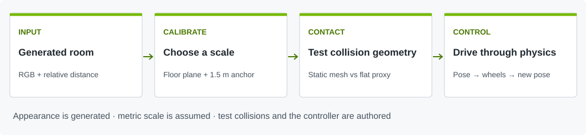
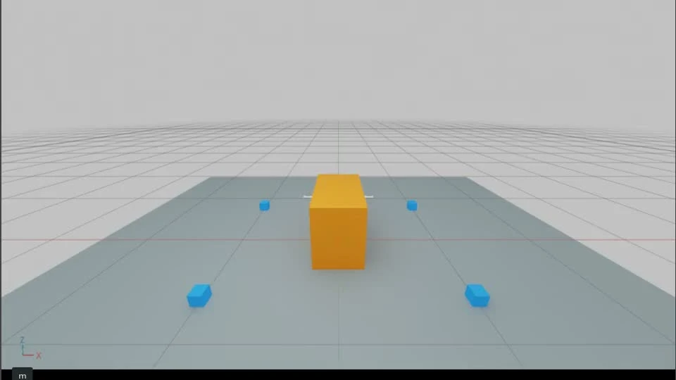
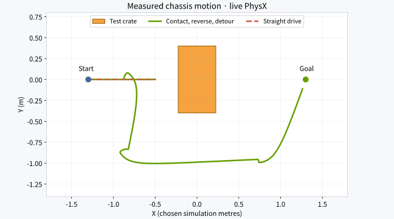
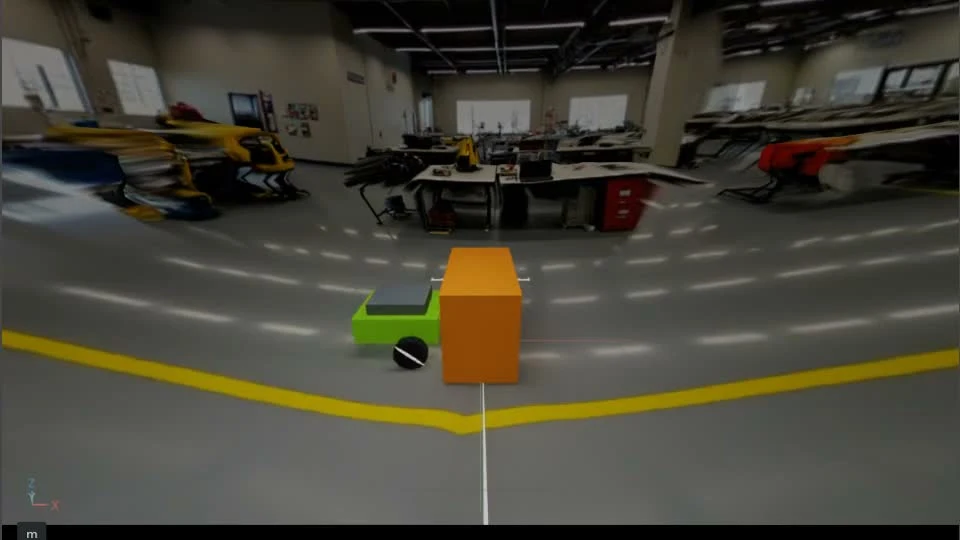

# Drive a robot inside the WorldGen laboratory

[한국어](../../ko/labs/worldgen-isaac.md) · [Generate the source world](worldgen-scenes.md) · [Code and assets](../../../labs/worldgen-isaac/)

## What must change before a generated room becomes a simulation?

The laboratory in the previous lesson is a generated RGB-distance surface. This lesson imports that surface into **Isaac Sim 6.2**, establishes an explicit scale, checks collisions and drives an articulated mobile robot through a small test area. The room supplies appearance; authored collision geometry supplies predictable contacts.



### 1. Establish coordinates and an assumed scale

WorldGen's maximum distance of 20 is a normalization, not 20 measured meters. `prepare.py` selects a visible near-camera floor patch, repeatedly fits a plane and rejects points more than 0.025 source units away. The fitted upward normal is approximately `[0.00942, -0.99985, -0.01474]` in WorldGen coordinates. A rotation aligns it with Isaac Sim's +Z axis, and a translation places the plane at Z=0.

We then **assume the source camera is 1.5 m above the floor**. Its fitted distance from the plane is 0.789658 source units, giving **1.899556 meters per source unit**. Every room vertex receives that same transform. The stage uses `metersPerUnit=1` and Z up. A 1 m bar and the 0.55 m robot chassis provide references in this chosen simulation scale. They do not establish the real size of the invented room.

```text
source points [x, y, z]
  → subtract the fitted floor origin
  → rotate the fitted up direction to +Z
  → multiply by 1.899556
  → Isaac Sim points in the chosen meter scale
```

The selected floor points have **16.0 mm RMS residual** after this transformation. This is agreement with the fitted plane, not ground-truth scene accuracy. The full transformed room spans roughly 44 m across X; remote surfaces remain distorted and uncalibrated. The robot exercise only validates an authored **5 × 4 m** test floor near the original viewpoint.

The prepared arrays are `points: float32[80000,3]`, `indices: int32[158802,3]` and `uv: float32[80000,2]`. Points are positions in the chosen meter scale; each index row selects the three corners of one triangle; UV coordinates locate its colors in the panorama.

### 2. Separate appearance from contact geometry

The imported render mesh has **80,000 vertices and 158,802 triangles**, sampled from the generated distance map at stride 4. A UV texture preserves the panorama's appearance. It is a genuine 3D mesh, rather than a flat background image. A small gap remains at the panorama seam. Gaussian splats are not the physical representation used in this lesson.

We compare three actual physics setups:

| Setup | What supports the dropped cubes? | Meaning |
|---|---|---|
| Visual surface only | Nothing | A rendered floor does not imply a collider |
| Static generated mesh collider | The nonflat inferred surface | It can collide, but its shape is still estimated |
| Authored floor proxy | A flat cuboid with top Z=0 | A controlled surface for the local robot experiment |

The imported mesh can use a **static triangle-mesh collider** for the comparison. Do not make the entire room one dynamic convex hull: a convex hull does not preserve a hollow interior. Our robot runs disable collisions on the visual shell and use an explicit floor plus an **added orange test crate**, 0.45 × 0.80 × 0.60 m. The crate is authored for this exercise; it was not detected automatically in the generated image. Furniture elsewhere has no validated collision coverage. [NVIDIA collision fundamentals](https://docs.isaacsim.omniverse.nvidia.com/6.2.0/physics/simulation_fundamentals.html)



### 3. Turn wheel commands into physical motion

The robot is an original, simple differential-drive AMR assembled from USD rigid bodies and revolute joints. It is **not Jetbot or a GR00T policy**. The chassis mass is 8 kg, each driven wheel is 0.3 kg, wheel radius is 0.11 m and axle width is 0.52 m. A low-friction rear support keeps it balanced.

```text
current chassis pose + next waypoint
  → heading error
  → forward speed v [m/s] and yaw rate ω [rad/s]
  → left/right wheel angular speeds [rad/s]
  → USD angular drives [degrees/s]
  → PhysX joint, friction and collision response
  → measured chassis pose for the next command
```

At `v=0.32 m/s` and `ω=0`, both wheels target about **2.91 rad/s**, or **166.7 degrees/s**. Turning uses a difference between the wheel speeds. The controller reads the simulator's pose and follows **hand-authored waypoints**; it does not see camera pixels, learn a policy or discover a path itself. The simulator resolves contact, rather than code directly moving the chassis to the desired coordinates. [NVIDIA differential-drive explanation](https://docs.isaacsim.omniverse.nvidia.com/6.2.0/controllers/tutorial_differential_drive.html)



The dashed line is the blocked run; the green path is the contact/recovery run. These are measured chassis centers. A stop at X=-0.50 m places the chassis front, 0.275 m ahead, at the crate face X=-0.225 m.

## Run the import, checks and robot example

### 1. Check the machine and copy the prepared room

Use an NVIDIA Linux machine with Isaac Sim 6.2 container support. Start with the [NVIDIA Linux onboarding guide](../onboarding/nvidia-linux.md) if `nvidia-smi` or Docker GPU support is unfamiliar. These commands run from this repository's root:

```bash
nvidia-smi
mkdir -p runs/worldgen-isaac
cp -R labs/worldgen-isaac/assets runs/worldgen-isaac/assets
```



[Download the prepared USD scene (ZIP)](https://james-joobs.github.io/awesome-nvidia-physical-ai/showcase/worldgen-isaac-scene.zip). Open `combined/scene.usdc` in Isaac Sim 6.2, keeping `assets/` beside it.

The bundled room is the reduced output of our own WorldGen run. **You do not need FLUX access or model weights to run this prepared scene.** To rebuild it from your own generation, use the separate WorldGen Python environment:

```bash
runs/worldgen-runtime/.venv/bin/python labs/worldgen-isaac/prepare.py \
  --source runs/worldgen/robot-lab --output runs/worldgen-isaac/assets \
  --camera-height 1.5 --stride 4
```

The `--camera-height` flag is your scale assumption. Change it deliberately and regenerate the mesh before judging dimensions. The camera matrix from the image-expansion example is not used to recover metric scale here.

### 2. Inspect the floor before driving

After accepting the [NVIDIA Omniverse agreement](https://docs.omniverse.nvidia.com/isaacsim/latest/common/NVIDIA_Omniverse_License_Agreement.html), set `ACCEPT_EULA=Y` in your terminal. This declares your own acceptance; the script requires it explicitly. The same shell also selects where output will be written:

```bash
export ACCEPT_EULA=Y
export WORLDGEN_DATA_ROOT="$PWD/runs/worldgen-isaac"
bash labs/worldgen-isaac/run.sh probes --headless
```

Four 10 cm cubes should rest with centers near Z=0.05 m. Open `runs/worldgen-isaac/probes/result.json`. It contains actual body poses, stage units and downward raycasts. Try the other two setups in distinct output folders:

```bash
bash labs/worldgen-isaac/run.sh probes --headless --no-floor \
  --output /work/no-floor
bash labs/worldgen-isaac/run.sh probes --headless --no-floor --raw-collider \
  --output /work/raw-mesh
```

`/work` is the container's mapping of `WORLDGEN_DATA_ROOT`. It is not a path you must create at the Linux filesystem root. Without a collider the cubes fall through the visible room. With the static generated mesh their center heights differ from the flat-proxy result, and they slightly tilt. The independent floor proxy gives the controlled reference.

### 3. Compare driving straight with driving around the crate

```bash
bash labs/worldgen-isaac/run.sh combined
# Separate comparison runs:
bash labs/worldgen-isaac/run.sh blocked
bash labs/worldgen-isaac/run.sh detour
```

The main recording uses `combined`: 4 s of forward commands, 1.6 s reversing, then the waypoint route. These phase changes are scheduled, not triggered by a learned detector. PhysX produces the actual stall, contact and recovery. The complete run reached the goal after about 24.3 simulation seconds.

Each command opens the real Isaac Sim GUI, runs one scenario and closes after saving the result. In `blocked`, both wheels keep receiving a forward command, but contact stops the chassis near **X=-0.50 m**. In `detour`, a simple pose-feedback controller follows `[-0.85,0] → [-0.85,-0.95] → [0.85,-0.95] → [1.3,0]`. The final target tolerance is 0.12 m. These are two different control choices in the same geometry, not an AI-policy comparison.

To view the authored collision geometry alone, add `--collision-view`. This hides the generated render mesh and reveals the physical floor and crate. Each output includes `scene.usdc`, the **initial scene setup**, not a prerecorded trajectory. In a separately opened Isaac Sim GUI, use **File → Open** to inspect this file. Keep the sibling `assets/` directory so its texture resolves. Pressing Play on the saved USD simulates the configured bodies; the waypoint controller runs only through `run.sh`.

### 4. Record the native GUI

On an X11 desktop, with ffmpeg built with `x11grab` and `xwininfo` installed:

```bash
mkdir -p runs/worldgen-recording
cp -R labs/worldgen-isaac/assets runs/worldgen-recording/assets
python3 labs/worldgen-isaac/record_gui.py \
  --work "$PWD/runs/worldgen-recording" --scenario combined --ffmpeg /path/to/ffmpeg
```

Use a fresh output directory for a new recording. The helper waits until the simulator is ready, records its native window, then starts the control loop. It leaves `native-gui.mp4`, `window.txt`, logs and the physical trajectory together. Published viewport clips are crops of these real GUI pixels. Check the recording's wall duration separately from simulation time; rendering does not always keep up with the physics step rate.

The 6.2 example uses `SimulationManager.step()` and `RenderingManager.render()` to separate physical steps from drawing. Our OMEN GUI recipe uses the documented per-frame rendering compatibility flag `--/rtx/hydra/supportMultiTickRate=false`; this lab does not validate multi-rate camera or LiDAR capture. Initial shader/viewport preparation can take one to two minutes. Recording starts only after a real viewport frame is saved. [NVIDIA multi-tick settings](https://docs.isaacsim.omniverse.nvidia.com/6.2.0/sensors/isaacsim_sensors_multitick_rendering.html)

Room appearance uses the panorama through native OmniPBR, with an emission display setting to make the baked colors visible. This is not a recovered, physically calibrated illumination model. The recorded control pose is `[position_xyz, quaternion_xyzw]`; wheel speed commands act at the axle midpoint, 0.10 m in front of the chassis frame.

## Check the result without a GPU

```bash
python3 labs/worldgen-isaac/check.py
```

This verifies the bundled scale metadata, cube-drop results, raycasts, physical obstacle contacts, successful waypoint endpoint, source hashes and published video hashes. The recordings below link back to code and full evidence. To inspect a new run:

```bash
python3 labs/worldgen-isaac/check.py --run runs/worldgen-isaac/detour
```

A successful import is not a validated digital twin. This lesson demonstrates **a generated visual environment plus a checked local physics setup**. Scale is assumed, the surface is estimated, collisions are authored only for the test area, and the robot uses a simple state-feedback controller. [WorldGen generation lab](worldgen-scenes.md) · [Isaac Sim concepts](../isaac-sim.md) · [Media provenance](../../../site/public/showcase/SPATIAL-CREDITS.md).


[Next: let sensor scans choose the route](worldgen-navigation.md).
