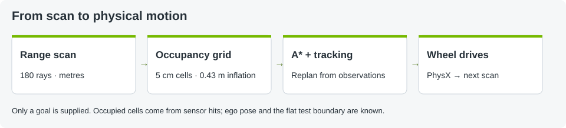
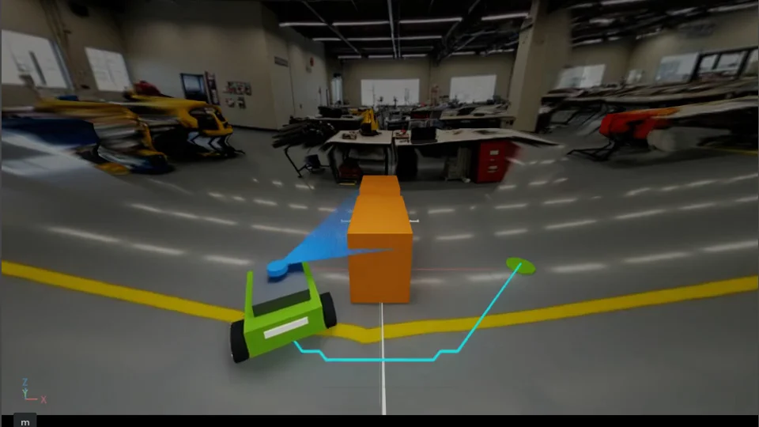
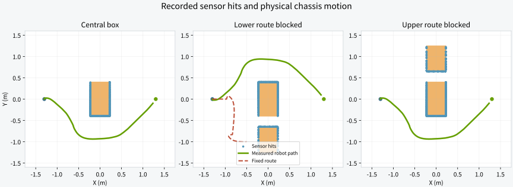

# Let range scans choose the robot's route

[한국어](../../ko/labs/worldgen-navigation.md) · [Import and collision checks](worldgen-isaac.md) · [Source](../../../labs/worldgen-navigation/)

## From a distance measurement to a wheel command

The previous robot followed a route we supplied. Here the **only destination is `[1.3, 0]`**. An Isaac Sim 6.2 Physics Raycast Sensor measures the surroundings. Our small Python planner turns those measurements into an occupancy grid, inflates obstacles to allow for the robot's width, and finds a route with A*. Wheel drives and PhysX produce the actual motion.



### 1. What does the sensor return?

A scanner sits 0.25 m above the chassis frame, approximately **0.48 m above the test floor**. It casts **180 horizontal rays across 360°**, 2° apart, with a 2.5 m maximum range. The sensor runs with the physics steps; the controller reads a complete frame every six steps, or **10 Hz** at 60 physics steps/s. This is an ideal, instantaneous physics-range model, not a rotating RTX LiDAR or a camera model.

The native `isaacsim.sensors.experimental.physics.RaycastSensor` produces per-ray depths and world-space hit positions. Our program does not supply obstacle locations to the planner. [NVIDIA Physics Raycast Sensor](https://docs.isaacsim.omniverse.nvidia.com/6.2.0/sensors/isaacsim_sensors_physics_raycast.html)

```text
angles:        float[180]       radians in the robot's horizontal frame
ranges:        float[180]       distance in metres; 2.5 means no nearer hit
hit_positions: float[180,3]     XYZ endpoints in the stage's world frame
pose:          [x, y, yaw]      current chassis position and heading
```

For a robot near `[-1.3, 0]`, the central ray points along +X. The recorded first scan in the central-box test contained approximately:

```json
{
  "ray_index": 90,
  "angle_degrees": 0,
  "range_m": 1.075,
  "hit_position_world": [-0.225, 0.0, 0.48]
}
```

This says that something intersects the beam 1.075 m away. It does **not** identify a box by name. The front face of the test box happens to lie at X=-0.225 m. Other rays see different parts of that face; a miss returns the configured maximum range and must not become an occupied cell.

[Inspect the recorded ray sample](../../../labs/worldgen-navigation/evidence/scan-example.json).



### 2. Why inflate an obstacle?

A* searches a **5 cm grid**. Measured endpoints mark occupied cells. The planner expands them by **0.43 m**, covering the robot's approximately 0.36 m circumscribed footprint plus tracking margin. A path for the robot's center must stay outside this expanded region. A line that a point can pass through may still be too narrow for the physical chassis and wheels.

We start without an obstacle map. Unknown cells are treated as traversable **inside the known 5×4 m flat test area**. Observations accumulate, and the planner recomputes a route at 10 Hz. This example uses static obstacles and does not erase old obstacle observations. It is not a dynamic-object tracker.

A* explores neighboring grid cells, comparing the cost already traveled with an estimate of the distance remaining to the goal. Our implementation checks eight neighbors and rejects diagonal moves that cut through blocked corners. When it reaches the goal cell, it traces the preceding cells back to the start.

```text
S . . # # # . . G
. . . # # # . . .
. . . # # # . . .
. . . . . . . . .
```

This schematic uses `S` for the robot, `G` for the goal, `#` for inflated obstacles and `.` for traversable cells. A route must go around the blocked cells. The output is a variable-length `float[N,2]` list of cell-center XY coordinates. The first recorded central-box plan had **53 points**, beginning `[[-1.30, 0.00], [-1.25, -0.05], …]`. These coordinates are calculated **after reading a scan**; they are not the route supplied to the old controller.

### 3. How does the route become motion?

The controller selects a short look-ahead point from the newly calculated path, measures its heading relative to the robot, and sends a forward velocity and yaw rate to the differential wheel drives. The cyan line in the viewport is a **live plan**, not a prerecorded trajectory. Blue lines show measured hits. Neither line moves the robot body directly.

```text
180 measured ranges + known ego pose
  → occupied endpoints → footprint inflation → A* route
  → nearby path point → forward speed v / turning rate ω
  → left and right wheel speeds → PhysX motion
  → a new sensor frame → a revised plan
```

The maximum forward speed remains 0.32 m/s. An additional forward-range guard suppresses forward motion below 0.46 m. A missing/stale scan or an unavailable route makes the robot stop. The guard is an educational fallback, not a certified safety function.

The ego pose comes directly from the simulator. **There is no SLAM or real wheel odometry**. The generated WorldGen room still supplies appearance; the floor and boxes are explicit colliders. Low objects below the horizontal sensing plane, stairs and arbitrary generated furniture are outside this exercise's coverage.

## Run the sensor and fixed-route comparison

### 1. Prepare the same generated room

Use the [NVIDIA Linux setup guide](../onboarding/nvidia-linux.md) and complete the [WorldGen import lab](worldgen-isaac.md) first. Run commands from the repository root on a compatible NVIDIA Linux workstation:

```bash
nvidia-smi
mkdir -p runs/worldgen-navigation
cp -R labs/worldgen-isaac/assets runs/worldgen-navigation/assets
export WORLDGEN_DATA_ROOT="$PWD/runs/worldgen-navigation"
```

The prepared assets need no FLUX weights or new generation. Accept the [NVIDIA Omniverse agreement](https://docs.omniverse.nvidia.com/isaacsim/latest/common/NVIDIA_Omniverse_License_Agreement.html) before declaring `ACCEPT_EULA=Y` yourself:

```bash
export ACCEPT_EULA=Y
bash labs/worldgen-navigation/run.sh sensor --layout center
```

The real Isaac Sim GUI opens, shows the measured beams and computed route, and closes after saving the run. Open `runs/worldgen-navigation/sensor/result.json` and `scans.json` afterwards. The saved `scene.usdc` is an initial scene; its waypoint-free controller runs through the Python script, not the USD Play button alone.

### 2. Obstruct the old route

The `lower` layout adds a second box on the old negative-Y detour. The old waypoint list remains unchanged. Both controllers receive the same start, goal, robot, colliders and speed limit. The sensor planner never receives the layout name or the boxes' transforms.

```bash
bash labs/worldgen-navigation/run.sh scripted --layout lower \
  --output /work/scripted-lower --max-seconds 20
bash labs/worldgen-navigation/run.sh sensor --layout lower \
  --output /work/sensor-lower
bash labs/worldgen-navigation/run.sh sensor --layout upper \
  --output /work/sensor-upper
```

`/work` maps to `WORLDGEN_DATA_ROOT` in the container. The upper layout mirrors the extra box, so a successful planner should choose the other side again. These are three controlled layouts, not a general navigation benchmark. Compare actual contact reports, measured poses and generated plans in the saved files.

### 3. Remove sensor data deliberately

```bash
bash labs/worldgen-navigation/run.sh sensor --sensor-off \
  --output /work/sensor-off --max-seconds 3
```

The robot should remain still. This checks that it cannot silently keep driving using a hidden, preloaded route when range frames are unavailable.

### 4. Record the native GUI

On an X11 desktop with `xwininfo` and ffmpeg's `x11grab` support, use a fresh recording directory:

```bash
mkdir -p runs/worldgen-navigation-film
cp -R labs/worldgen-isaac/assets runs/worldgen-navigation-film/assets
python3 labs/worldgen-navigation/record_gui.py \
  --work "$PWD/runs/worldgen-navigation-film" --scenario sensor \
  --layout lower --max-seconds 30 --ffmpeg /path/to/ffmpeg
```

The helper waits for a real viewport frame before starting control. Raw native-window footage, logs, range arrays and trajectory evidence stay together. `package.py` creates the viewport crops and comparison; its edit metadata records any speed adjustment. Wall-clock recording duration and simulation duration are reported separately.

## Inspect the evidence without an NVIDIA GPU



The plots use actual saved poses and scan endpoints. Green is the sensor-controlled trajectory; the dashed red path is the fixed controller that stalled. These are post-run data plots, separate from the native GUI footage.

| Run | Goal reached | Time to goal (simulation seconds) | Obstacle contact reports |
|---|---|---|---|
| Fixed route, lower passage blocked | No | — (20 s run) | 638 |
| Sensor, central box | Yes | 12.08 | 0 |
| Sensor, lower passage blocked | Yes | 12.08 | 0 |
| Sensor, upper passage blocked | Yes | 12.08 | 0 |
| Sensor data disabled | No; remains still | — (3 s check) | 0 |

638 counts reports during a persistent contact, not distinct impacts. Successful recordings include a further 3 s goal hold. Mirrored layouts produced almost identical travel times; these are individual runs, not averaged benchmark results.

[Download the lower-layout initial USD scene](https://james-joobs.github.io/awesome-nvidia-physical-ai/showcase/worldgen-navigation-scene.zip). Keep `assets/` beside `sensor/` when opening `sensor/scene.usdc`. The Python controller is provided separately in the source.


```bash
python3 labs/worldgen-navigation/test_navigation.py
python3 labs/worldgen-navigation/check.py
```

The first command tests planning behavior from observations and the stop conditions. The second checks the actual GPU workstation runs, range shapes and timestamps, route choices, contacts, endpoints and media hashes. To check your own complete run:

```bash
python3 labs/worldgen-navigation/check.py --run runs/worldgen-navigation/sensor-lower
```

[Return to scale and collider checks](worldgen-isaac.md) · [WorldGen generation](worldgen-scenes.md) · [Media provenance](../../../site/public/showcase/SPATIAL-CREDITS.md)


[Next: react to moving obstacles and clear old observations](worldgen-dynamic-navigation.md).
