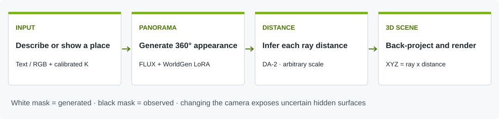
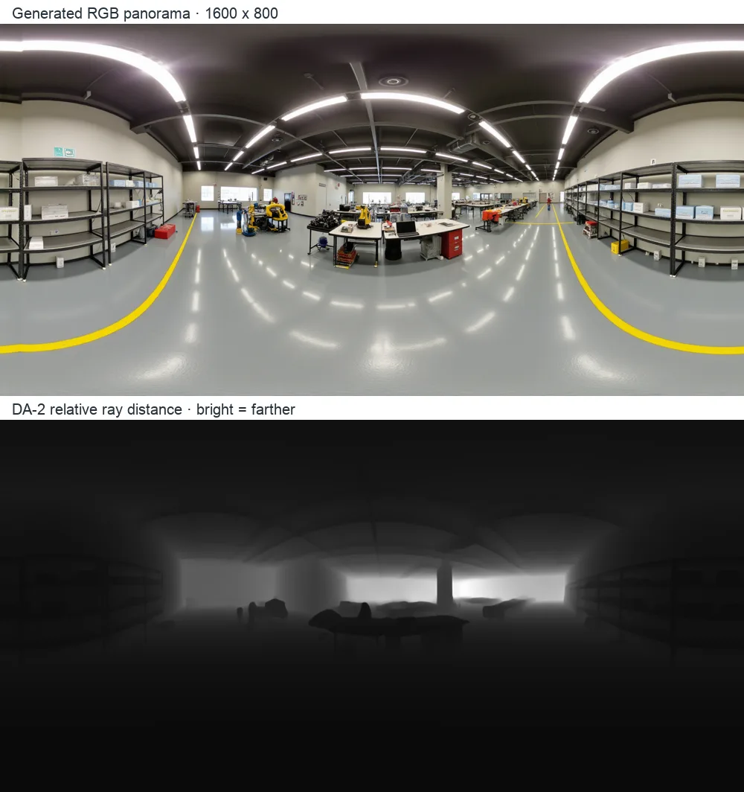
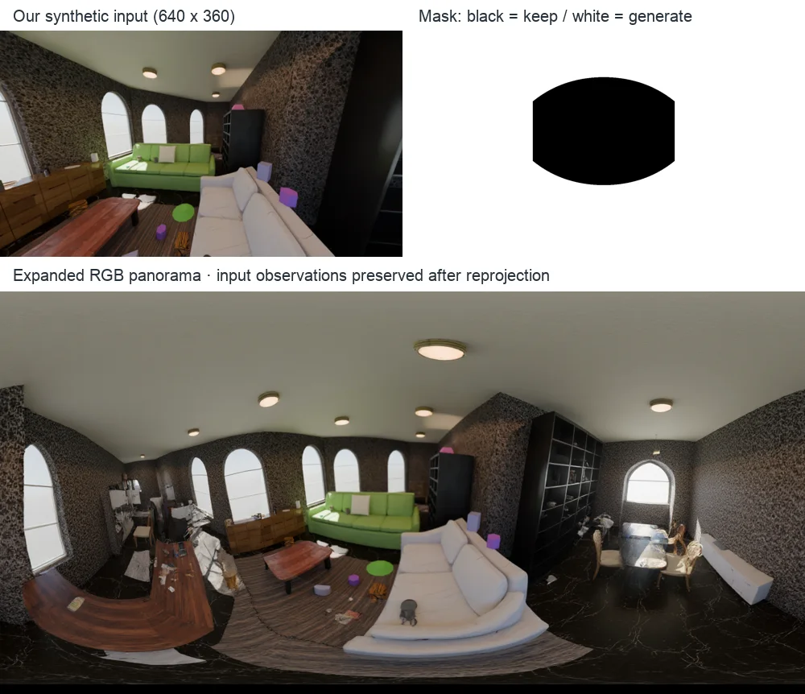

# Generate and explore a 3D world with WorldGen

[한국어](../../ko/labs/worldgen-scenes.md) · [Code and evidence](../../../labs/worldgen-scenes/) · [Compare 3D workflows](../spatial-worlds.md)

## How does a prompt become a place you can look around?

WorldGen first generates the **appearance of a 360° scene**, then estimates how far its surfaces are from the camera. Those two arrays become a persistent Gaussian scene and a colored mesh. A renderer can then move the camera through this saved geometry. In this lab, you will create a robotics laboratory from text, then expand an image into a surrounding room. An additional forest run shows what changes outdoors.



### 1. Generate appearance, then estimate geometry

For text input, FLUX.1-dev and WorldGen's panorama LoRA generate an **RGB array of shape `[800, 1600, 3]`**. The horizontal axis covers 360° and the vertical axis covers 180°. A panorama is still an image; it has no explicit 3D surface positions yet.

DA-2 reads that panorama and predicts a **distance array `[800, 1600]`**. Each value describes distance along the pixel's viewing ray, unlike camera-plane Z depth in the Replicator lab. WorldGen scales this estimate so its maximum is **20**. This is an arbitrary normalization of inferred geometry, **not a measurement in meters**.



Brighter pixels in the distance preview indicate farther predicted surfaces. Inspect object edges and shapes before exporting the scene.

### 2. Turn each ray into a Gaussian

For each panorama pixel, compute a unit direction `ray = [x, y, z]`. Multiply it by the predicted distance:

```text
XYZ = ray × distance
RGB pixel → Gaussian color
angular pixel footprint + distance → Gaussian scale
local surface frame → rotation quaternion [w, x, y, z]
```

The source camera is at `[0,0,0]`, with X right, Y down and Z forward. Each panorama pixel becomes one Gaussian with position, scale, rotation, opacity and color. The PLY stores log scale and logit opacity; the exporter decodes them and handles the panorama poles. The mesh connects neighboring back-projected pixels into triangles.

A real pixel from our generated laboratory follows below. Values are rounded; the audit retains full precision. The near-forward ray places this Gaussian mostly along +Z. Distance remains in normalized WorldGen units.

```json
{
  "pixel": [
    800,
    400
  ],
  "rgb": [
    179,
    175,
    163
  ],
  "ray": [
    0.001963,
    0.001963,
    0.999996
  ],
  "distance": 7.208282,
  "xyz": [
    0.014154,
    0.014153,
    7.208254
  ]
}
```

### 3. What changes when the input is an image?

We use our own **Infinigen synthetic render**, not a real photograph, and its known pinhole camera matrix:

```json
{
  "resolution": [640, 360],
  "K": [[160, 0, 320], [0, 160, 180], [0, 0, 1]]
}
```

`fx=fy=160` controls angular magnification; `(cx,cy)=(320,180)` is the principal point. Our calibrated adapter projects panorama rays into this source image. A **black mask pixel (`0`) preserves observed RGB**, while **white (`255`) requests generated content** from FLUX.1-Fill-dev plus WorldGen's image LoRA. We composite the observed pixels back exactly after generation. Preservation applies to the **reprojected, bilinearly sampled panorama pixels**, not lossless recovery of every original camera pixel.

In our run, **16.30%** of panorama pixels came from the calibrated image projection; the remaining **83.70%** was generated. The saved keep-region RGB error is zero.



The adapter preserves the observed panorama region and generates the surrounding scene. Inspect both the image and predicted distance before using the geometry.

## Create your own scene step by step

### 1. Prepare a separate Linux environment

Start at the root of this repository. Use an NVIDIA GPU with a working driver, Git and [uv](https://docs.astral.sh/uv/getting-started/installation/). Run `nvidia-smi` first: it should list the GPU without an error. This recipe was executed on **an RTX 5090 with 32 GB VRAM and 30 GiB system RAM**. Reserve about **100 GB of disk space** for environments, model downloads and output. The FP4 recipe is for Linux x86_64 and this Blackwell setup; other architectures need their own compatible Nunchaku build.

```bash
bash labs/worldgen-scenes/setup.sh runs/worldgen-runtime
runs/worldgen-runtime/.venv/bin/hf auth login
```

The first command creates Python 3.11 with PyTorch 2.7/cu128, Nunchaku 0.2 and fixed WorldGen/DA-2 source revisions. It does not install into Isaac Sim. The second saves your Hugging Face login locally; do not paste a token into a script or commit it. Before downloading, accept access terms for **both** [FLUX.1-dev](https://huggingface.co/black-forest-labs/FLUX.1-dev) and [FLUX.1-Fill-dev](https://huggingface.co/black-forest-labs/FLUX.1-Fill-dev) using the same account.

The runner uses Nunchaku FP4, CPU offload and compatible PyTorch attention to fit this GPU. [Pinned source and model versions](../../../labs/worldgen-scenes/model-pins.json).

### 2. Generate a place from text

Paste the complete block into a terminal at the repository root. The backslash joins the following line to the same command. Wait for the final JSON message before opening the output.

```bash
runs/worldgen-runtime/.venv/bin/python labs/worldgen-scenes/generate.py \
  --output runs/worldgen/robot-lab --seed 42 \
  --prompt "A spacious realistic robotics laboratory with collaborative robot arms on workbenches, yellow safety markings on a polished concrete floor, metal storage racks, large windows, natural daylight, no people, a coherent modern industrial interior"
```

The first run downloads the pinned models; later runs reuse the cache. Look for `panorama.png`, `distance.npy`, `scene.ply`, `scene-mesh.glb` and the final `result.json`.

### 3. Expand an image with known camera information

The repository includes the input and calibration used in our run. The camera file's resolution must match the image. An arbitrary photograph needs suitable intrinsics; do not reuse these numbers for another camera.

```bash
runs/worldgen-runtime/.venv/bin/python labs/worldgen-scenes/generate.py \
  --output runs/worldgen/livingroom \
  --image labs/worldgen-scenes/evidence/input.png \
  --intrinsics labs/worldgen-scenes/evidence/input-camera.json \
  --prompt "A coherent spacious living room continuing the input image, matching the pale walls, wooden furniture, indoor materials and natural window light, realistic interior, no people"
```

Open `generation-mask.png` and `conditioning.png` before judging the result. They identify which regions came from the input and which the model filled. To try the outdoor run, omit the image arguments and use seed `17` with the forest prompt in [recorded.json](../../../labs/worldgen-scenes/recorded.json).

### 4. Render genuinely different viewpoints

Use a **separate compatible [fVDB Reality Capture environment](spatial-reconstruction.md)** to run the renderer; do not add it to the WorldGen Torch 2.7 environment. The following path represents that separate interpreter. It must already import `fvdb_reality_capture` and have ffmpeg available.

```bash
runs/fvdb-runtime/bin/python labs/worldgen-scenes/render.py \
  --scene runs/worldgen/robot-lab/scene.ply \
  --output runs/worldgen/robot-lab/render --ffmpeg ffmpeg
```

The renderer saves a 20-second MP4 and `cameras.json`. It rotates and moves the camera near the source viewpoint. Use the interactive preview to compare the laboratory, room and forest.

## Check the data and understand the limits

You can watch the videos and inspect the bundled evidence without CUDA:

```bash
python3 labs/worldgen-scenes/check.py
```

This checks published media hashes, compressed scene headers, the image's generation mask, actual camera translation and saved numeric ray examples. To check a **new** result, use the generation environment on CPU:

```bash
runs/worldgen-runtime/.venv/bin/python labs/worldgen-scenes/audit.py \
  --folder runs/worldgen/robot-lab
```

It opens the real distance array and PLY, checks finite positive distances, normalized rotations and `XYZ = ray × distance`, and writes `geometry-audit.json`. For the image route it also verifies exact preservation of observed panorama pixels. A changed prompt or package version can change the output; compare the data checks, not just an expected filename.

The forest shows more gaps around leaves and occluded surfaces. Generated scenes need scale and collision checks before a robot simulation; continue with the next lab.

**Sources:** [WorldGen](https://github.com/ZiYang-xie/WorldGen), [DA-2](https://huggingface.co/haodongli/DA-2) and [FLUX model terms](https://huggingface.co/black-forest-labs/FLUX.1-dev). WorldGen/DA-2 list Apache-2.0; FLUX weights have separate non-commercial terms. [Media credits](../../../site/public/showcase/SPATIAL-CREDITS.md).


**Next: [import this laboratory into Isaac Sim, check scale and collisions, and drive a robot](worldgen-isaac.md).**
