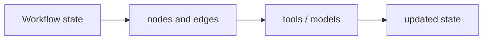

# LangGraph

[← All projects](../../README.md) · [한국어](../ko/langgraph.md) · [Official source](https://github.com/langchain-ai/langgraph) · [Documentation / related project](https://docs.langchain.com/oss/python/langgraph/overview)

An orchestration framework for stateful agent workflows.

**Availability and terms:** Review the repository license for the version used; hosted services, integrations and models have separate terms.

## Architecture and workflow

*Conceptual illustration for this guide; refer to official sources for supported implementations.*

Define graph state and nodes, connect transitions, run the graph, and inspect or resume supported execution.

## Use cases

Coordinate a video-processing workflow or an agent that selects tools and reviews results.

## Connections

It can orchestrate model or data-processing calls, but does not itself provide vision models.

## Official references

- [Project source](https://github.com/langchain-ai/langgraph)
- [Documentation / related project](https://docs.langchain.com/oss/python/langgraph/overview)
