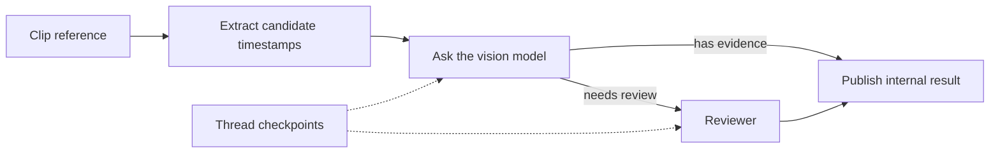

# LangGraph

[← Catalog](../../README.md) · [한국어](../ko/langgraph.md)

LangGraph runs stateful workflows whose next step can depend on the result of a prior node. A Physical AI application can use it to orchestrate offline video or dataset tools.

## How it works

A graph defines a state schema, nodes that return state updates, and edges or routing functions. Reducers define how concurrent updates merge. A checkpointer records state at execution boundaries and groups checkpoints by thread ID, allowing supported runs to resume. A tool call can write an external artifact, so replay requires an idempotency strategy.

*Guide diagram based on the official references below.*

## A practical workflow

Build a clip review graph. A node indexes candidate timestamps, another requests a model summary, and a conditional edge sends low-confidence clips to review. Persist source clip IDs and model versions in state so reruns can explain how an output was produced.

## What to verify

Test routing and recovery with a known clip. Use a stable thread ID for one job, separate jobs by thread, and avoid repeating side effects when resuming a failed node.

## License and availability

Review the repository license for the version used; hosted services, integrations and models have separate terms.

## Official references

- [Official technical reference](https://docs.langchain.com/oss/python/langgraph/persistence)
- [Graph API](https://docs.langchain.com/oss/python/langgraph/graph-api)
- [Related official resource · github.com](https://github.com/langchain-ai/langgraph)
- [Related official resource · docs.langchain.com](https://docs.langchain.com/oss/python/langgraph/overview)
