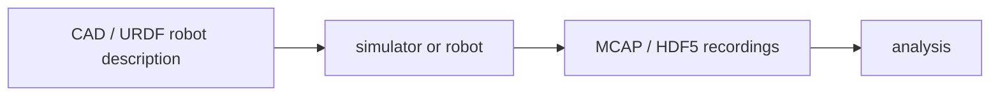

# MCAP / HDF5 / URDF / CAD

[← All projects](../../README.md) · [한국어](../ko/mcap-hdf5-urdf-cad.md) · [Official source](https://mcap.dev/) · [Documentation / related project](https://docs.ros.org/en/rolling/Tutorials/Intermediate/URDF/URDF-Main.html)

Common robotics and engineering data concepts: MCAP logs, HDF5 structured data, URDF robot descriptions, and CAD design assets.

**Availability and terms:** Formats and concepts are distinct from implementations. Check the licenses of each library, file, asset, conversion tool and dataset.

## Architecture and workflow

*Conceptual illustration for this guide; refer to official sources for supported implementations.*

Prepare geometry and a robot description, configure compatible software, record synchronized data, and inspect or transform it for analysis. Conversion between formats is not automatic.

## Use cases

Record sensor streams, store training arrays, or bring a robot model into a simulator.

## Connections

ROS 2 tooling may use MCAP and URDF; HDF5 stores structured datasets; CAD files may need explicit conversion before simulation.

## Official references

- [Project source](https://mcap.dev/)
- [Documentation / related project](https://docs.ros.org/en/rolling/Tutorials/Intermediate/URDF/URDF-Main.html)
- [MCAP](https://mcap.dev/)
- [HDF5](https://www.hdfgroup.org/solutions/hdf5/)
- [URDF](https://docs.ros.org/en/rolling/Tutorials/Intermediate/URDF/URDF-Main.html)
