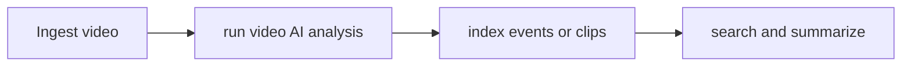

# Metropolis / VSS

[← All projects](../../README.md) · [한국어](../ko/metropolis-vss.md)

## Overview

Video AI platform / video search and summarization workflow.

## Conceptual workflow

## Workflow and use

Ingest video → run video AI analysis → index events or clips → search and summarize. This is a conceptual workflow; check the official source for version-specific prerequisites and supported configurations.

**Example use case:** searching footage for relevant events. Check applicability, supported inputs and model versions in the official source.

**Related technologies:** DeepStream, Cosmos Embed.

## Architecture and example

The Metropolis video search and summarization reference architecture combines vision-language models, language models and retrieval components to analyze and search live or recorded footage.

Search a warehouse camera archive for a described event and inspect the corresponding video segments.

[Official technical source](https://developer.nvidia.com/blog/?p=116772)

## Availability and terms

Platform and services; individual SDKs and models have separate terms. Verify the exact version and the terms of any models, datasets, binaries and dependencies before use.

## Official sources

[Metropolis](https://developer.nvidia.com/metropolis)
