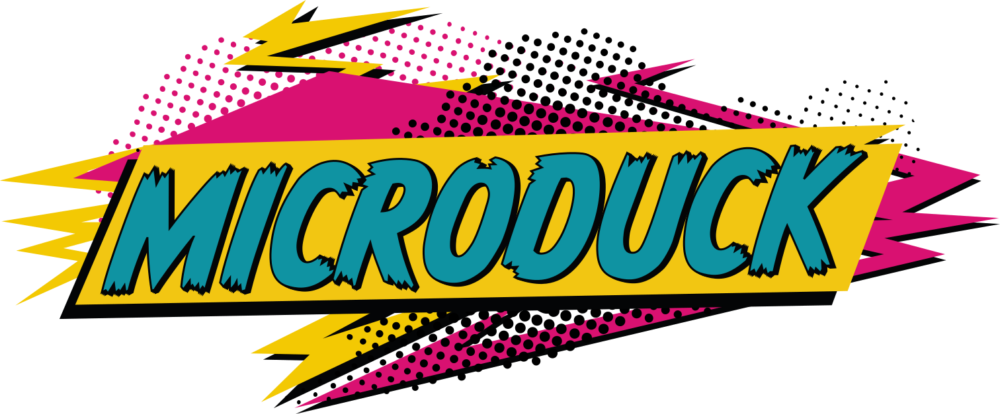

# Microduck

[← Catalog](../../README.md) · [한국어](../ko/microduck.md)

  

Microduck is a small biped built by Pollen Robotics, Hugging Face’s robotics team. NVIDIA’s Isaac Lab 3.0 walkthrough uses it to show how a walking policy goes from GPU-parallel simulation to ONNX evaluation and then to the robot’s onboard controller. [Pollen Robotics press kit and wordmark](https://pollen-robotics.com/microduck/press-kit/) · [NVIDIA walkthrough on Hugging Face](https://huggingface.co/blog/nvidia/microduck-isaac-lab-sim-to-real)

[Try it in your browser](https://huggingface.co/spaces/pollen-robotics/microduck-simulator) · [Evaluate a policy in Arena](https://huggingface.co/spaces/pollen-robotics/microduck-arena) · [Explore ONNX policies](https://huggingface.co/pollen-robotics/microduck-policies)

  

[Image source: Pollen Robotics robot repository](https://github.com/pollen-robotics/microduck)

## From training to the robot

| Stage | What each tool does |
|---|---|
| Set up the task | The Isaac Lab Microduck contribution defines the robot, observations, joint targets, rewards, and resets. The flat task is a starting point. The rough task adds uneven ground, slopes, and stairs. [Task source](https://github.com/isaac-sim/IsaacLab/tree/main/source/isaaclab_tasks/isaaclab_tasks/contrib/microduck) |
| Train in simulation | Isaac Lab runs parallel environments with Newton and the MJWarp solver. The backlash preset uses Better Actuator Models (BAM) to reproduce servo behavior, including gear play. Variation in friction, mass, and command latency exposes the policy to conditions it may encounter on the robot. [NVIDIA walkthrough](https://huggingface.co/blog/nvidia/microduck-isaac-lab-sim-to-real) |
| Replay and export | Train with RSL-RL, then replay a checkpoint in the Newton visualizer. Isaac Lab’s playback exports `policy.onnx`. The example maps 61 observations to 14 joint-position targets. Match the order, normalization, and action scaling when moving the policy between runtimes. [NVIDIA export instructions](https://huggingface.co/blog/nvidia/microduck-isaac-lab-sim-to-real#4-evaluate-the-microduck-walking-policy-and-export-it-to-onnx) |
| Evaluate and deploy | Submit a compatible ONNX file to Microduck Arena for server-side scoring on a common course. On configured hardware, the Rust runtime loads the ONNX policy and drives the servos. [Arena submission guide](https://github.com/pollen-robotics/microduck-arena/blob/main/docs/guides/train-a-policy.md) · [Onboard policy commands](https://github.com/pollen-robotics/microduck/blob/main/docs/robot/cheatsheet.md) |

Pollen Robotics also publishes [Microduck RL](https://github.com/pollen-robotics/microduck_rl), its original training stack. It runs on mjlab with MuJoCo Warp and uses PPO. Use its training instructions for the Hub’s mjlab checkpoints and NVIDIA’s walkthrough for the Isaac Lab tasks.

## Hugging Face resources

| Resource | Use it to | Availability and license |
|---|---|---|
| [Microduck Sandbox](https://huggingface.co/spaces/pollen-robotics/microduck-simulator) | Drive an existing policy with a keyboard or gamepad. MuJoCo physics and ONNX inference run in the browser. | Public Space. App code marked Apache-2.0. Bundled robot assets have separate terms. |
| [Microduck Arena](https://huggingface.co/spaces/pollen-robotics/microduck-arena) | Compare submitted policies in shared challenges. | Public Space and [source repository](https://github.com/pollen-robotics/microduck-arena). The hosted Space uses Hugging Face sign-in for submissions. A project-wide source license was unverified. |
| [Microduck ONNX policies](https://huggingface.co/pollen-robotics/microduck-policies) | Download deployable policies for tasks such as walking or standing up. | Public model repository, tagged Apache-2.0. |
| [Microduck training checkpoints](https://huggingface.co/pollen-robotics/microduck-training) | Resume or warm-start mjlab training from RSL-RL `.pt` bundles with optimizer and normalizer state. | Public model repository. License unverified. |
| [Duck detector model](https://huggingface.co/pollen-robotics/microduck-duck-detector) and [dataset](https://huggingface.co/datasets/pollen-robotics/microduck-duck-detector-dataset) | Explore a separate perception workflow. The dataset contains onboard camera frames and bounding boxes for other Microducks. Split data by capture session to keep near-identical frames together. | Public model and dataset, both tagged Apache-2.0. |

## License and scope

The [robot runtime code](https://github.com/pollen-robotics/microduck/blob/main/LICENSE) and [Microduck RL code](https://github.com/pollen-robotics/microduck_rl/blob/main/LICENSE) use Apache-2.0. The [listed simulation STL meshes](https://github.com/pollen-robotics/microduck_rl/blob/develop/LICENSE-MODELS.md) use CC BY-NC-SA 4.0. Pollen Robotics excludes the product’s mechanical and electronic design files from its open-source statement. [Official hardware scope](https://pollen-robotics.com/microduck/press-kit/)

## Related guides

[Isaac Lab](isaac-lab.md) · [Newton](newton.md) · [MuJoCo Warp](mujoco-warp.md)
