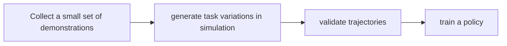

# MimicGen

[← All projects](../../README.md) · [한국어](../ko/mimicgen.md)

Image: official project source linked below.

## Overview

Generates varied robot demonstrations from existing demonstrations.

## Conceptual workflow

## Workflow and use

Collect a small set of demonstrations → generate task variations in simulation → validate trajectories → train a policy. This is a conceptual workflow; check the official source for version-specific prerequisites and supported configurations.

**Example use case:** varying object positions for manipulation training. Check applicability, supported inputs and model versions in the official source.

**Related technologies:** Isaac Lab, AutoData.

## Architecture and practical details

MimicGen parses a source dataset into segments using subtask termination signals, chooses source segments, and transforms and composes their waypoints into new trajectories. The official getting-started example generates a square-task dataset and records successful and failed trajectories separately; inspect success statistics before training.

[Official documentation](https://github.com/NVlabs/mimicgen/blob/main/docs/tutorials/getting_started.md)

## Availability and terms

Source available under NVIDIA Source Code License; do not assume unrestricted open-source use. Verify the exact version and the terms of any models, datasets, binaries and dependencies before use.

## Official sources

[Repository](https://github.com/NVlabs/mimicgen)
