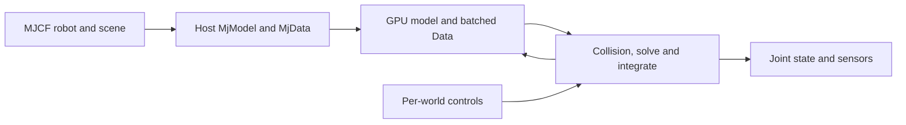

# MuJoCo Warp (MJWarp)

[← Catalog](../../README.md) · [한국어](../ko/mujoco-warp.md)

MuJoCo Warp brings MuJoCo-style dynamics to CUDA using NVIDIA Warp. Its batched layout targets workloads such as thousands of independent rollouts of the same robot and task.

## Architecture

| Component | Responsibility and data boundary |
|---|---|
| MJCF → `MjModel` / `MjData` | MuJoCo loads the robot and environment and compiles the model. The host objects are inputs to device conversion. |
| `mjw.put_model` / `mjw.put_data` | Create the GPU model and data. Many dynamic `Data` fields have a leading dimension of `nworld`; contact and constraint storage is sized up front. |
| `mjw.step` and graph capture | Warp kernels evaluate kinematics, collision, constraints, integration, and sensor data. Capture and replay can reduce launch overhead for a repeated GPU step. |
| Integration boundary | Native MuJoCo Warp and MJX with `impl="warp"` provide different interfaces to the Warp implementation. Newton exposes a MuJoCo-based solver through its own Model and State API. |

Guide diagram based on the official references below.

### Official figures and examples

Unitree G1 benchmark rollout on flat terrain. Use the benchmark configuration to compare controls and simulation settings. [Original figure and context](https://github.com/google-deepmind/mujoco_warp/tree/main/benchmarks/unitree_g1)

## Walkthrough

1. Run the Unitree G1 benchmark or a single-world version of your scene to check joint indexing, control mode and the observations expected by the locomotion policy.
2. Increase `nworld` and allocate contact and constraint capacity for the terrain. Write per-world controls into device arrays, step, then sample the joint and sensor state for the next policy action.
3. Measure total environment steps per second as well as single-step latency. A multi-world benchmark answers a different question from interactive single-robot control.

## Validation

- `njmax` bounds constraints per world. The contact pool is shared across worlds under the documented `nconmax` or `naconmax` allocation scheme. Watch overflow diagnostics during falls and multi-contact scenes.
- Check MuJoCo’s feature table for the target release and validate against CPU MuJoCo on small scenes. MJX-Warp does not support automatic differentiation.

## License and scope

Apache-2.0 for MuJoCo Warp. Check model and asset terms independently.

## Related guides

[Newton](newton.md) · [Warp](nvidia-warp.md) · [Isaac Lab](isaac-lab.md)

## Official references

- [MuJoCo Warp repository](https://github.com/google-deepmind/mujoco_warp)
- [Batched data, memory limits and tuning](https://mujoco.readthedocs.io/en/latest/mjwarp/)
- [MuJoCo Warp API](https://mujoco.readthedocs.io/en/latest/mjwarp/api.html)
- [MJX implementations](https://mujoco.readthedocs.io/en/latest/mjx.html)
