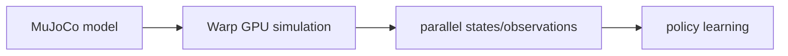

# MuJoCo Warp (MJWarp)

[← All projects](../../README.md) · [한국어](../ko/mujoco-warp.md) · [Official source](https://github.com/google-deepmind/mujoco_warp) · [Documentation](https://github.com/google-deepmind/mujoco/blob/main/doc/mjx.rst)

A GPU-optimized implementation of MuJoCo built with Warp, developed by Google DeepMind and NVIDIA.

**License:** Apache-2.0; dependencies have their own terms. Check the exact release, assets, models, and dependencies before use.

*Image: [official project repository](https://github.com/google-deepmind/mujoco_warp); see the source for attribution and reuse terms.*

## Architecture

MJWarp implements MuJoCo physics on NVIDIA GPUs and can be used through MJX. Consult the project for supported features and configuration.

*Conceptual workflow created for this guide; consult the official documentation for implementation details.*

## Workflow

Load a MuJoCo model; transfer model and simulation data to the GPU; step many worlds; consume states or rendered observations in a learning loop.

## Use cases

Parallel robot locomotion and manipulation training, contact-rich simulation, and visual policy experiments.

## Connections

Newton can use MuJoCo Warp as a solver, while Warp supplies its GPU programming infrastructure. MJX-Warp currently does not support automatic differentiation; verify the release documentation.

## Official references

- [Project repository](https://github.com/google-deepmind/mujoco_warp)
- [Documentation](https://github.com/google-deepmind/mujoco/blob/main/doc/mjx.rst)
