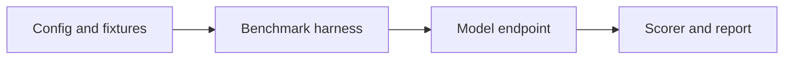

# NeMo Evaluator

[← Catalog](../../README.md) · [한국어](../ko/nemo-evaluator.md)

Reproducible model and agent benchmarks against configured endpoints.

## Architecture and data flow

The launcher resolves model endpoints, benchmarks, scoring and output settings. Harnesses run requests and store per-run results for comparison and reporting. Built-in text and agent benchmarks provide templates. A Physical AI team should explicitly select or integrate a task harness for its data.

Guide illustration based on the official sources below.

## Physical AI example

Evaluate two inspection report models on the same redacted fixtures with expected incident categories and source references. Store endpoint model IDs and the scoring configuration beside the report. Use Cosmos Evaluator separately when checking generated video quality.

## What to verify

Check benchmark coverage and grader reliability. An improvement on a text benchmark does not establish accuracy on sensor footage.

## License and availability

Apache-2.0 repository code. Model weights, external services and dependencies can have separate terms.

## Official sources

- [Repository](https://github.com/NVIDIA-NeMo/Evaluator)
- [Repository license](https://github.com/NVIDIA-NeMo/Evaluator/blob/HEAD/LICENSE)

## Related guides

[Cosmos Evaluator](cosmos-evaluator.md) · [NeMo Helix](nemo-helix.md)
