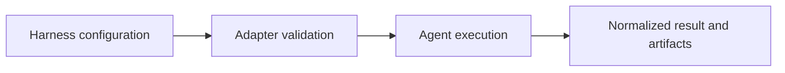

# NeMo Fabric

[← Catalog](../../README.md) · [한국어](../ko/nemo-fabric.md)

Adapter-based execution of supported agent harnesses.

## Architecture and data flow

An application declares its harness, models, tools and other resources. A Fabric adapter validates the configuration and maps it to the selected runtime. The result includes normalized outputs, errors and artifact references according to adapter capabilities.

Guide illustration based on the official sources below.

## Physical AI example

Run the same offline robot video triage fixture through two supported harnesses. Hold the model and tool contracts constant, then compare evidence references and completion behavior. Use a trace integration when comparing internal calls.

## What to verify

Check the adapter matrix for required capabilities such as tool configuration and telemetry. Record the adapter version and avoid assuming all harnesses expose equivalent actions.

## License and availability

Apache-2.0 repository code. Model weights, external services and dependencies can have separate terms.

## Official sources

- [Repository](https://github.com/NVIDIA/NeMo-Fabric)
- [Fabric installation and adapters](https://docs.nvidia.com/nemo/fabric/latest/getting-started/install)
- [Agent Toolkit migration map](https://docs.nvidia.com/nemo/agent-toolkit/1.9/resources/migration-guide.html)
- [Repository license](https://github.com/NVIDIA/NeMo-Fabric/blob/HEAD/LICENSE)

## Related guides

[NeMo Agent Toolkit](nemo-agent-toolkit.md) · [NeMo Helix](nemo-helix.md) · [NeMo Relay](nemo-relay.md)
