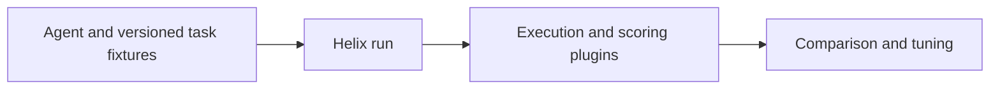

# NeMo Helix

[← Catalog](../../README.md) · [한국어](../ko/nemo-helix.md)

Control plane for agent evaluation, optimization and security testing.

## Architecture and data flow

Helix exposes repeatable agent improvement workflows through a CLI, REST APIs and a Python SDK. Plugins connect agent execution, sandboxing, storage and other infrastructure. Evaluation runs collect task outcomes that can guide prompt or configuration changes.

Guide illustration based on the official sources below.

## Physical AI example

Keep a fixed suite of workcell incident-review cases and compare an updated report workflow against the baseline. Score correct event IDs and citation completeness. Test malformed tool responses separately from ordinary examples.

## What to verify

Version the harness, prompts, graders and fixtures. Review the supported plugin and agent combinations for your release. Guardrail or red-team results describe the agent application rather than the physical system.

## License and availability

Apache-2.0 repository code. Model weights, external services and dependencies can have separate terms.

## Official sources

- [Repository](https://github.com/NVIDIA-NeMo/nemo-helix)
- [Agent Toolkit migration map](https://docs.nvidia.com/nemo/agent-toolkit/1.9/resources/migration-guide.html)
- [Repository license](https://github.com/NVIDIA-NeMo/nemo-helix/blob/HEAD/LICENSE)

## Related guides

[NeMo Evaluator](nemo-evaluator.md) · [NeMo Agent Toolkit](nemo-agent-toolkit.md) · [NeMo Fabric](nemo-fabric.md)
