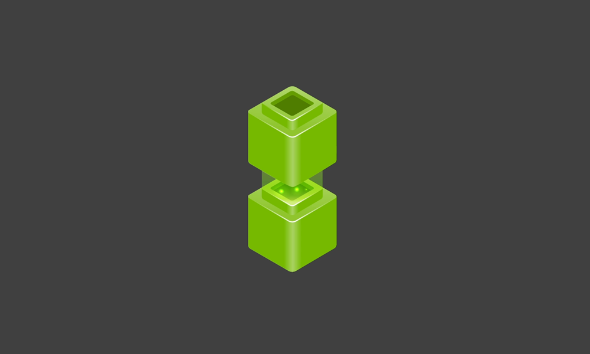

# NVIDIA NeMo Platform

[← Catalog](../../README.md) · [한국어](../ko/nemo-platform.md)

   
  <a href="https://developer.nvidia.com/blog/announcing-nemo-fast-development-of-speech-and-language-models/">Official NVIDIA NeMo launch artwork</a>

Infrastructure for model customization, evaluation, guardrails and inference.

The versioned architecture shows how customization, evaluation, storage and inference form a loop in the earlier microservices release. [Official figure source](https://docs.nvidia.com/nemo/microservices/25.4.0/about/index.html)

## Architecture and data flow

NeMo Platform provides services for preparing datasets, adapting and evaluating models and serving them through an inference gateway. Older NeMo Microservices documentation describes Kubernetes deployments of Customizer, Evaluator, Guardrails and storage services. Match components to the actual release and treat separately published libraries as independent artifacts.

## Physical AI example

For an industrial report agent, collect reviewed examples, customize a supported model, evaluate on frozen incident fixtures and compare the old and new routes through a staged endpoint. Keep operator-facing outputs tied to evidence and model version.

## What to verify

Check platform distribution and access terms separately from the Apache-licensed libraries in the catalog. Verify which model and runtime the deployment supports.

## License and availability

NVIDIA platform or service. Check the product, deployment and model terms.

## Official sources

- [Official documentation](https://docs.nvidia.com/nemo/microservices/latest/about/core-concepts/platform.html)
- [Versioned microservices architecture](https://docs.nvidia.com/nemo/microservices/25.4.0/about/index.html)

## Related guides

[NeMo Guardrails](nemo-guardrails.md) · [NeMo Evaluator](nemo-evaluator.md) · [NVIDIA NIM](nvidia-nim.md)
