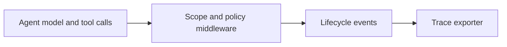

# NeMo Relay

[← Catalog](../../README.md) · [한국어](../ko/nemo-relay.md)

Agent call tracing, middleware and governance.

## Architecture and data flow

Relay instruments supported harnesses or SDK calls. Scopes and lifecycle events capture tool and model activity as a run. Plugins can enforce middleware policies and export traces to observability tools. Switchyard documents a Relay plugin for model routing.

Guide illustration based on the official sources below.

## Physical AI example

Trace a video incident agent from clip search to report generation. Compare tool retries, evidence retrieval and model time against a known fixture. Export a redacted trace for repeatable investigation.

## What to verify

Check the harness integration and event coverage. Use stable run IDs and avoid including sensitive frames or provider secrets in traces. Verify Relay and routing plugin compatibility.

## License and availability

Apache-2.0 repository code. Model weights, external services and dependencies can have separate terms.

## Official sources

- [Repository](https://github.com/NVIDIA/NeMo-Relay)
- [Relay documentation](https://docs.nvidia.com/nemo/relay/latest/getting-started/about)
- [Agent Toolkit migration map](https://docs.nvidia.com/nemo/agent-toolkit/1.9/resources/migration-guide.html)
- [Repository license](https://github.com/NVIDIA/NeMo-Relay/blob/HEAD/LICENSE)

## Related guides

[NeMo Switchyard](nemo-switchyard.md) · [NeMo Agent Toolkit](nemo-agent-toolkit.md) · [NeMo Fabric](nemo-fabric.md)
