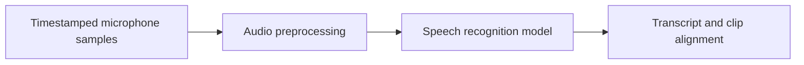

# NeMo Speech

[← Catalog](../../README.md) · [한국어](../ko/nemo-speech.md)

Speech model training and inference, including ASR and TTS.

## Architecture and data flow

The original NeMo repository now focuses on speech. Audio preprocessing and a speech model yield transcripts or generated speech depending on the selected task. Model-specific checkpoints and configuration define languages, streaming behavior and input audio requirements.

Guide illustration based on the official sources below.

## Physical AI example

Transcribe operator narration from an egocentric recording and align utterances to the clip manifest before curation. Keep utterance timestamps and label uncertainty. For voice interfaces, evaluate command recognition separately from any robot action authorization.

## What to verify

Measure word or command error rate in the target noise and microphone conditions. Check streaming latency and language coverage. Review checkpoint terms independently of the code.

## License and availability

Apache-2.0 repository code. Model weights, external services and dependencies can have separate terms.

## Official sources

- [Repository](https://github.com/NVIDIA/NeMo)
- [NeMo framework repository roles](https://github.com/NVIDIA-NeMo)
- [Repository license](https://github.com/NVIDIA/NeMo/blob/HEAD/LICENSE)

## Related guides

[NeMo Curator](nemo-curator.md) · [Isaac Capture](isaac-capture.md)
