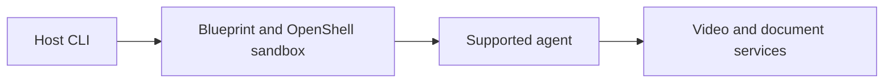

# NemoClaw

[← Catalog](../../README.md) · [한국어](../ko/nemoclaw.md)

OpenShell-based reference stack for running supported agents.

## Architecture and data flow

The host CLI onboards and manages an agent. A blueprint configures the agent integration and its OpenShell sandbox. Inference, network policy and persistent state are managed as separate concerns. NVIDIA’s VSS and RAG case demonstrates video evidence plus enterprise document context in a downstream agent workflow.

Guide illustration based on the official sources below.

## Physical AI example

Have an agent request a timestamped clip summary and read a maintenance procedure. Combine both sources into a draft incident report. Test network permissions using a read-only fixture before enabling any ticket integration.

## What to verify

Review agent compatibility, sandbox policy, network destinations and inference provider access. Keep evidence citations and application authorization distinct from the sandbox configuration.

## License and availability

Apache-2.0 repository code. Model weights, external services and dependencies can have separate terms.

## Official sources

- [Repository](https://github.com/NVIDIA/NemoClaw)
- [NemoClaw architecture](https://docs.nvidia.com/nemoclaw/latest/user-guide/openclaw/about/how-it-works)
- [Documented VSS and RAG case](https://developer.nvidia.com/blog/?p=120054)
- [OpenShell source](https://github.com/NVIDIA/OpenShell)
- [Repository license](https://github.com/NVIDIA/NemoClaw/blob/HEAD/LICENSE)

## Related guides

[Metropolis / VSS](metropolis-vss.md) · [NeMo Retriever Library](nemo-retriever.md)
