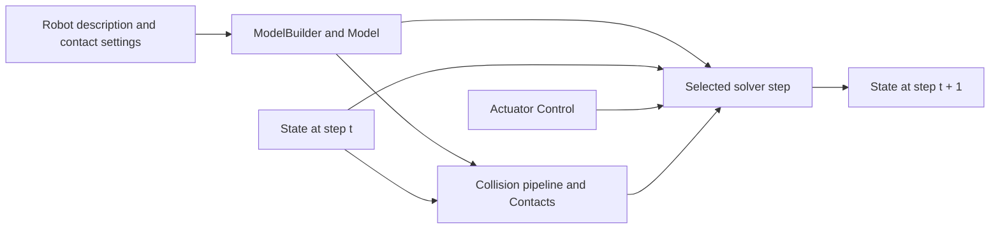

# Newton

[← Catalog](../../README.md) · [한국어](../ko/newton.md)

Newton is a Warp-based physics engine for robotics. It owns the numerical world state and advances it through a selected solver. In a robot learning stack, the environment still defines observations, actions, rewards, and episode resets.

## Architecture

| Component | Responsibility and data boundary |
|---|---|
| `ModelBuilder` → `Model` | The builder defines bodies, joints, shapes, and contact parameters, then finalizes the topology and model arrays on the target device. |
| `State` / `Control` | State holds changing quantities such as positions and velocities. Control carries actuator inputs such as joint targets or efforts. This separation lets the same topology be reused across simulation steps. |
| `Contacts` / `SolverBase.step` | Contact buffers carry collision data when the chosen solver consumes Newton-generated contacts. SolverMuJoCo, Featherstone, and XPBD have different supported features and contact modes. |
| Warp | Device arrays and kernels back the computation. A policy can consume selected state data through the surrounding simulation or training framework. |

Guide diagram based on the official references below.

### Official figures and examples

NVIDIA’s official architecture situates Newton over Warp and OpenUSD and shows its solver and simulator integration boundaries. [Original figure and context](https://developer.nvidia.com/blog/newton-adds-contact-rich-manipulation-and-locomotion-capabilities-for-industrial-robotics/)

Newton’s URDF example visualizes an articulated model after importing its description. Use it to check orientation and joint behavior before scripting a task. [Original figure and context](https://github.com/newton-physics/newton/blob/main/newton/examples/basic/example_basic_urdf.py)

## Walkthrough

1. Start with the official URDF example and inspect the robot pose and collision geometry. Define joint drives, floor and object materials, and the integration timestep before selecting a solver.
2. For a grasp experiment, apply finger targets through `Control`. Compute contacts if the solver uses Newton contacts, then step into the output state and repeat for the physics substeps. Compare object motion across trial variants.
3. Log joint trajectories, contacts and object pose for policy observations or analysis. Wrap the same model in Isaac Lab only after the standalone model behaves as expected.

## Validation

- Check the solver feature matrix for articulation, deformables, and contact modes. Contact parameters can have solver-dependent interpretations.
- On a fixed initial condition, reduce the timestep and compare penetration, resting stability and actuator effort before collecting training rollouts.

## License and scope

Apache-2.0 for the Newton repository. Inspect dependency and robot asset terms separately.

## Related guides

[Warp](nvidia-warp.md) · [Isaac Lab](isaac-lab.md) · [MuJoCo Warp](mujoco-warp.md)

## Official references

- [Newton repository and examples](https://github.com/newton-physics/newton)
- [Solver support and stepping contract](https://newton-physics.github.io/newton/latest/solvers/index.html)
- [ModelBuilder API](https://newton-physics.github.io/newton/latest/api/_generated/newton.ModelBuilder.html)
- [Newton backend in Isaac Lab](https://docs.nvidia.com/isaaclab/concepts/newton)
