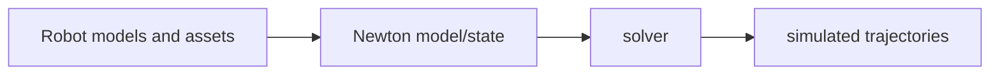

# Newton

[← All projects](../../README.md) · [한국어](../ko/newton.md) · [Official source](https://github.com/newton-physics/newton) · [Documentation](https://newton-physics.github.io/newton/stable/faq.html)

An extensible GPU-accelerated physics engine for robotics, built on NVIDIA Warp by a community that includes Disney Research, Google DeepMind, and NVIDIA.

**License:** Apache-2.0. Check the exact release, assets, models, and dependencies before use.

*Image: [official project repository](https://github.com/newton-physics/newton); see the source for attribution and reuse terms.*

## Architecture

Its architecture separates models, simulation state, solvers and asset importers. It supports URDF, MJCF and OpenUSD, with multiple solver backends; solver features and differentiability vary.

*Conceptual workflow created for this guide; consult the official documentation for implementation details.*

## Workflow

Import robot and scene assets; construct a model and state; select a solver; step the simulation; inspect or use the resulting trajectories for learning.

## Use cases

Train locomotion or manipulation policies; prototype contact-rich robot simulations; compare solver behavior.

## Connections

Warp provides the kernel infrastructure; MuJoCo Warp is an important solver; Isaac Lab has an experimental integration. Integration status and supported features depend on version.

## Official references

- [Project repository](https://github.com/newton-physics/newton)
- [Documentation](https://newton-physics.github.io/newton/stable/faq.html)
