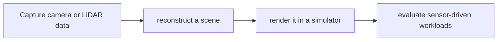

# NuRec

[← All projects](../../README.md) · [한국어](../ko/nurec.md)

## Overview

Neural reconstruction and rendering of real environments.

## Conceptual workflow

## Workflow and use

Capture camera or LiDAR data → reconstruct a scene → render it in a simulator → evaluate sensor-driven workloads. This is a conceptual workflow; check the official source for version-specific prerequisites and supported configurations.

**Example use case:** replaying reconstructed road scenes. Check applicability, supported inputs and model versions in the official source.

**Related technologies:** OpenUSD, Isaac Sim, AlpaSim.

## Architecture and example

NuRec reconstructs camera or lidar captures as USD scenes with metadata, then renders neural reconstructions using Gaussian splatting. Simulators commonly connect to the rendering service over gRPC.

Reconstruct a captured road scene and render sensor viewpoints in AlpaSim to test a driving policy.

[Official technical source](https://developer.nvidia.com/omniverse/nurec)

## Availability and terms

Product/technology; complete source and license scope unverified. Verify the exact version and the terms of any models, datasets, binaries and dependencies before use.

## Official sources

[Official page](https://developer.nvidia.com/omniverse/nurec)
