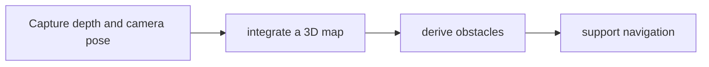

# nvblox

[← All projects](../../README.md) · [한국어](../ko/nvblox.md)

Image: official project source linked below.

## Overview

3D mapping and obstacle representation.

## Conceptual workflow

## Workflow and use

Capture depth and camera pose → integrate a 3D map → derive obstacles → support navigation. This is a conceptual workflow; check the official source for version-specific prerequisites and supported configurations.

**Example use case:** building an obstacle map for a mobile robot. Check applicability, supported inputs and model versions in the official source.

**Related technologies:** Isaac ROS Nvblox.

## Architecture and practical details

Depth images and camera pose are integrated into a GPU-based 3D representation; TSDF and ESDF layers support geometry and distance queries. A mobile robot can use these maps for obstacle-aware navigation, often through the separate Isaac ROS integration.

[Official documentation](https://github.com/nvidia-isaac/nvblox)

*Image source: [Official repository](https://github.com/nvidia-isaac/nvblox)*

## Availability and terms

Source is public; scope of mixed repository licenses unverified. Verify the exact version and the terms of any models, datasets, binaries and dependencies before use.

## Official sources

[Repository](https://github.com/nvidia-isaac/nvblox)
