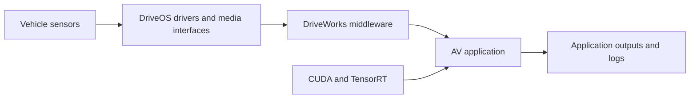

# NVIDIA DRIVE

[← Catalog](../../README.md) · [한국어](../ko/nvidia-drive.md)

DRIVE spans automotive compute and software. DRIVE AGX is the target compute platform, DriveOS supplies its operating system and runtime stack, and DriveWorks provides automotive middleware and development modules.

## How it works

Sensors enter through platform drivers and media interfaces. DriveWorks helps integrate sensor streams and accelerated application components. CUDA and TensorRT provide compute and inference, while application code owns perception, planning and control decisions. The developer kit enables software integration and testing on representative compute.

## A practical workflow

Replay a recorded camera or sensor sequence with a reference application on the intended DRIVE AGX kit. Compare timestamp handling and inference results with development logs, then evaluate missed deadlines and recovery when a feed stops.

## What to verify

Confirm the exact DRIVE platform and SDK version, access conditions and supported sensors. Validate timing, fault behavior and target hardware before vehicle-level testing. The DriveOS guide includes a version-specific software stack diagram.

## License and availability

Product/platform; check component terms. Verify the exact version and the terms of any models, datasets, binaries and dependencies before use.

## Official references

- [Architecture and workflow documentation](https://developer.nvidia.com/drive/faq)
- [DriveOS 6.0.7 Linux SDK guide and stack diagram](https://developer.nvidia.com/docs/drive/drive-os/6.0.7/public/drive-os-linux-sdk/drive_os_v5l_sdk_dev_guide.pdf)
- [Related official resource · developer.nvidia.com](https://developer.nvidia.com/DRIVE)
- [Related official resource · developer.nvidia.com](https://developer.nvidia.com/drive)
