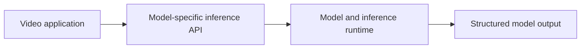

# NVIDIA NIM

[← Catalog](../../README.md) · [한국어](../ko/nvidia-nim.md)

Model-specific inference services for use by agents and pipelines.

## Architecture and data flow

A NIM deployment packages a supported model with inference software and an API. Inputs and outputs depend on the model. A physical-world reasoner can accept supported images or video, while embedding or reranking endpoints produce scores or vectors for retrieval. The orchestration layer invokes the endpoint and records results.

Guide illustration based on the official sources below.

## Physical AI example

Serve or call a compatible Cosmos reasoner for an inspection clip. Capture model ID, video sampling parameters and inference result before handing text to a report agent. Compare local and hosted endpoint input limits before migrating.

## What to verify

Check model-specific modality support, serving profiles, hardware and endpoint terms. NIM distribution and model rights are distinct from the license of a client library.

## License and availability

NVIDIA platform or service. Check the product, deployment and model terms.

## Official sources

- [Official documentation](https://docs.nvidia.com/nim/)
- [Cosmos 3 Nano Reasoner system card](https://build.nvidia.com/nvidia/cosmos3-nano-reasoner/systemcard)

## Related guides

[Cosmos Framework](cosmos-framework.md) · [Metropolis / VSS](metropolis-vss.md) · [NVIDIA NeMo Platform](nemo-platform.md)
