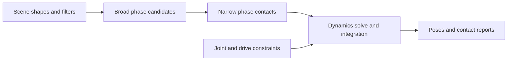

# NVIDIA PhysX

[← Catalog](../../README.md) · [한국어](../ko/nvidia-physx.md)

PhysX provides scene queries and physical simulation for collision shapes, rigid bodies, and articulated mechanisms. In Isaac Sim, authored USD physics settings become objects managed by the physics backend.

## Architecture

| Component | Responsibility and data boundary |
|---|---|
| `PxScene` and actors | The scene groups static and dynamic actors, shapes, materials, filters, and solver settings. Broad phase identifies likely overlapping pairs before narrow phase constructs contacts. |
| Constraints and articulations | Contacts and joints constrain rigid-body motion. A reduced-coordinate articulation models connected links through joint coordinates and exposes drives for robot control. |
| GPU dynamics and broad phase | The scene can enable GPU rigid-body dynamics and GPU broad phase independently. The supported shapes and feature behavior are version specific. |
| `simulate` / `fetchResults` | The simulation advances actor state and collects results and callbacks for the application. Geometry queries such as raycasts read the scene through a separate interface. |

Guide diagram based on the official references below.

### Official figures and examples

PhysX’s articulation guide shows example assemblies that can be represented as jointed link trees. [Original figure and context](https://nvidia-omniverse.github.io/PhysX/physx/5.4.0/docs/Articulations.html)

The free-body diagram helps interpret the incoming joint force reported on an articulation link. [Original figure and context](https://nvidia-omniverse.github.io/PhysX/physx/5.4.0/docs/Articulations.html)

## Walkthrough

1. Build a two-finger gripper articulation and place a rigid workpiece on a static table. Define link mass and inertia, collider geometry, drive limits and friction materials.
2. Advance the scene with a fixed timestep and a joint-position target. Record workpiece pose and contact reports while closing and lifting the gripper.
3. Vary friction and the collider approximation independently to identify whether grip failure is dominated by materials or the contact shape.

## Validation

- Start with simple colliders and check center of mass, joint axes and drive units. A correct-looking mesh can still have an unsuitable physical representation.
- Check the GPU buffer and collision support notes for your SDK version before scaling to many environments or heavy contact workloads.

## License and scope

PhysX SDK code is BSD-3-Clause. The surrounding application and extra components have separate terms.

## Related guides

[Isaac Sim](isaac-sim.md) · [Isaac Lab](isaac-lab.md) · [Newton](newton.md)

## Official references

- [PhysX source repository](https://github.com/NVIDIA-Omniverse/PhysX)
- [Reduced-coordinate articulations and drives](https://nvidia-omniverse.github.io/PhysX/physx/5.4.0/docs/Articulations.html)
- [GPU scene configuration](https://nvidia-omniverse.github.io/PhysX/physx/5.4.0/docs/GPURigidBodies.html)
- [Simulation control and results](https://nvidia-omniverse.github.io/PhysX/physx/5.4.0/docs/Simulation.html)
