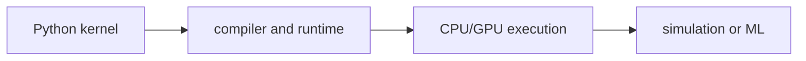

# NVIDIA Warp

[← All projects](../../README.md) · [한국어](../ko/nvidia-warp.md) · [Official source](https://github.com/NVIDIA/warp) · [Documentation](https://nvidia.github.io/warp/stable/user_guide/faq.html)

A Python framework for writing high-performance kernels for simulation, geometry, robotics, and machine learning on CPUs and NVIDIA GPUs.

**License:** Apache-2.0. Check the exact release, assets, models, and dependencies before use.

*Image: [official project repository](https://github.com/NVIDIA/warp); see the source for attribution and reuse terms.*

## Architecture

Warp compiles supported Python kernel code into native CPU or CUDA code. It provides geometry primitives and automatic differentiation for supported operations; it is not itself a complete turnkey physics engine.

*Conceptual workflow created for this guide; consult the official documentation for implementation details.*

## Workflow

Define typed kernels in Python; compile and launch on the target device; process arrays or geometry; integrate results with a simulation or learning workflow.

## Use cases

Build custom fluid or geometry algorithms, accelerate simulation components, or experiment with differentiable computation.

## Connections

Newton uses Warp as its computational foundation; MuJoCo Warp also uses Warp. PyTorch and other frameworks can participate in larger pipelines.

## Official references

- [Project repository](https://github.com/NVIDIA/warp)
- [Documentation](https://nvidia.github.io/warp/stable/user_guide/faq.html)
