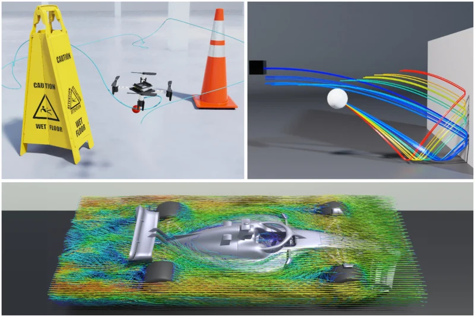
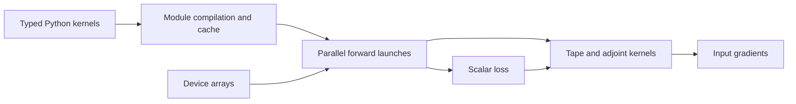

# NVIDIA Warp

[← Catalog](../../README.md) · [한국어](../ko/nvidia-warp.md)

   
  <a href="https://github.com/NVIDIA/warp/blob/416577971d0c39e8ea2fbe6d0894229b749125cd/README.md">Representative simulation image from the official NVIDIA Warp repository</a>

Warp compiles numerical Python kernels to code that runs in parallel on CPUs or CUDA GPUs. It supplies arrays, geometric operations and automatic differentiation that simulation projects can use to implement their own computations.

## Architecture

| Component | Responsibility and data boundary |
|---|---|
| `@wp.kernel` / `wp.launch` | A kernel defines work for a logical thread. The launch sets the iteration dimensions and passes typed arrays and parameters. |
| Compilation and cache | Warp lowers a Python module’s kernels and functions to native code for the selected target. Its module cache avoids repeating the same compilation. |
| `wp.array` / interop | Host code allocates the arrays and chooses placement. The Warp/PyTorch bridge can share compatible memory, so device placement and synchronization matter when one framework hands off a buffer. |
| `wp.Tape` | Tape records differentiable kernel launches and references to arrays. Backward launches use the required forward values and accumulate gradients in gradient buffers. |

Guide diagram based on the official references below.

### Official figures and examples

Warp’s compiler pipeline shows how kernel declarations become device code. The Python application controls allocation and launch. [Original figure and context](https://nvidia.github.io/warp/latest/user_guide/programming_model.html)

The Tape diagram distinguishes forward kernel launches and the reverse pass used to propagate gradients. [Original figure and context](https://nvidia.github.io/warp/latest/user_guide/differentiability.html)

## Walkthrough

1. For a spring parameter fit, allocate arrays for initial positions, velocities, and stiffness. Write one kernel to advance the state and another to compare the predicted endpoint with an observed endpoint.
2. Run the launch sequence inside a `wp.Tape`, keep the state values required by backward launches, and call `backward` on the loss. Feed the stiffness gradient to the optimizer.
3. Benchmark steady-state execution after a warmup that includes first-use compilation. For repeated launch graphs, evaluate the graph capture and replay API once data flow and device placement are stable.

## Validation

- Tape references arrays rather than storing every value they held. Keep separate states or use checkpointing when an iterative kernel overwrites values needed for backward computation.
- On a small problem, compare the computed gradient with finite differences before increasing rollout length or using a GPU graph.

## License and scope

Apache-2.0 for Warp. Runtime and GPU requirements depend on the release.

## Related guides

[Newton](newton.md) · [MuJoCo Warp](mujoco-warp.md)

## Official references

- [Warp source and examples](https://github.com/NVIDIA/warp)
- [Programming model and compiler](https://nvidia.github.io/warp/latest/user_guide/programming_model.html)
- [Differentiation and array lifetimes](https://nvidia.github.io/warp/latest/user_guide/differentiability.html)
