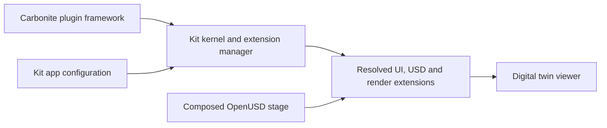

# NVIDIA Omniverse

[← Catalog](../../README.md) · [한국어](../ko/omniverse.md)

Omniverse provides tools for building OpenUSD applications. Omniverse Kit runs an application assembled from extensions, which can provide UI, scene tools, rendering and other capabilities through declared dependencies.

## Architecture

| Component | Responsibility and data boundary |
|---|---|
| Carbonite and Kit kernel | The Carbonite framework supplies core plugin infrastructure. The Kit kernel starts the application and provides extension management and foundational interfaces. |
| App configuration and extensions | A Kit application selects extensions and settings through configuration. Extensions declare other dependencies. Kit resolves and starts the dependency graph. |
| USD scene and consuming features | Application extensions can author or inspect a USD stage and pass the composed scene to visualization or domain-specific features. The stage and extension configuration are distinct inputs. |

Guide diagram based on the official references below.

### Official figures and examples

NVIDIA’s Kit-based USD Viewer example shows the composed stage loaded in the application. [Original figure and context](https://docs.omniverse.nvidia.com/xr/omniverse-spatial-docs/latest/server/02-build-and-launch.html)

## Walkthrough

1. Start with a Kit application template that can display USD. Enable only the features required for a factory layout viewer. Add a custom extension for checking equipment clearances or reading scene metadata.
2. Reference equipment assets in an OpenUSD stage and open it through the app. Separate reusable asset data from application-specific UI and controls.
3. Build and launch the app with the same configuration in a clean environment. Inspect extension resolution logs and confirm assets and materials are available.

## Validation

- Pin app and extension versions together. A working USD asset does not validate the extension dependency graph.
- Keep digital twin data and interface code separable so you can validate composition without bringing up the entire UI.

## License and scope

Omniverse is a platform and SDK family. Check the terms of the chosen Kit runtime, extensions and services individually.

## Related guides

[OpenUSD](openusd.md) · [Isaac Sim](isaac-sim.md) · [SimReady](simready.md)

## Official references

- [Omniverse platform](https://developer.nvidia.com/omniverse)
- [Kit kernel and extension architecture](https://docs.omniverse.nvidia.com/kit/docs/kit-manual/latest/guide/kit_architecture.html)
- [Build an OpenUSD application](https://docs.omniverse.nvidia.com/composer/latest/how-to-build.html)
