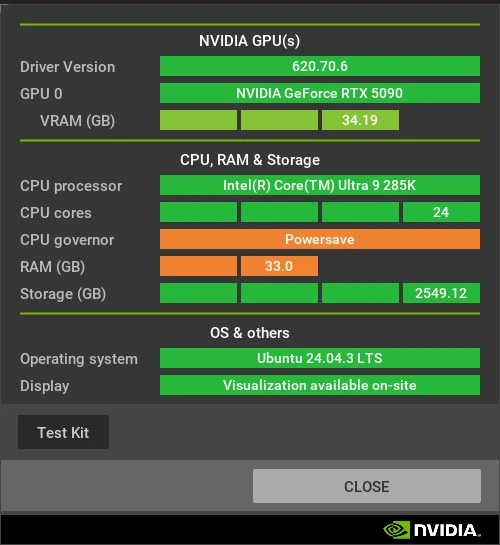
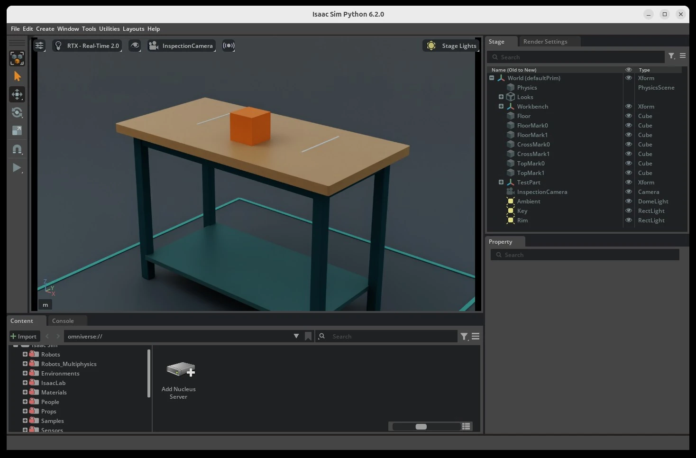
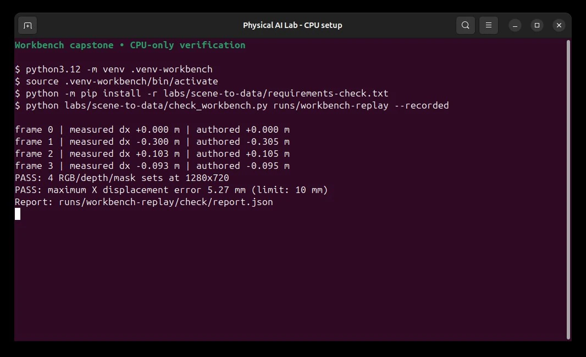

# First steps in Isaac Sim, from the GUI to the terminal

Start by opening a USD scene and inspecting it. Then launch the same workflow from a script so you can reproduce the scene, outputs, and checks. The workbench examples on this page use Isaac Sim 6.2.

## Choose an installation for the job

| You want to | Start here |
| --- | --- |
| Inspect a scene, edit physics, and use the viewport | The [Workstation package](https://docs.isaacsim.omniverse.nvidia.com/6.2.0/installation/install_workstation.html) on a supported RTX desktop. |
| Launch from a project Python environment | The [Isaac Sim 6.2 Python package](https://docs.isaacsim.omniverse.nvidia.com/6.2.0/installation/install_python.html) in a Python 3.12 environment. |
| Generate data on a remote GPU | A supported installation in headless mode or the [Isaac Sim container](https://docs.isaacsim.omniverse.nvidia.com/6.2.0/installation/install_container.html). For remote interactive use, follow NVIDIA's WebRTC setup. |
| Check a recorded dataset | The [CPU portion of the workbench lab](../labs/workbench-capstone.md), which uses Python and OpenUSD. |

Check [your driver and GPU](nvidia-linux.md) before downloading. For Linux x86-64, download the 6.2 Workstation ZIP from the [release download page](https://docs.isaacsim.omniverse.nvidia.com/6.2.0/installation/download.html). In a desktop terminal, run the following after saving the ZIP in `~/Downloads`.

```sh
mkdir -p "$HOME/isaacsim-6.2.0"
unzip "$HOME/Downloads/isaac-sim-standalone-6.2.0-linux-x86_64.zip" -d "$HOME/isaacsim-6.2.0"
cd "$HOME/isaacsim-6.2.0"
./post_install.sh
./isaac-sim.compatibility_check.sh
./isaac-sim.sh
```

Review the license prompts and give the first launch time to populate its shader cache. The compatibility app checks hardware, driver and display. If a dependency check fails, fix that layer and repeat it before changing project code. Use a different download on `aarch64`, and check the release notes for that platform.



This check ran in the Isaac Sim 6.2 container with a display attached. The OS field describes the container. The NVIDIA GPU and driver fields describe the hardware and driver it could access.

For pip, use the official install command in a separate environment. The two methods have different entry points. Choose the one you will use for the course.

```sh
python3.12 -m venv .venv-isaacsim
source .venv-isaacsim/bin/activate
python -m pip install 'isaacsim[all,extscache]==6.2.0.0' --extra-index-url https://pypi.nvidia.com
isaacsim
```

## Open and inspect the workbench in the GUI

1. Use **File → Open** and select [`workbench_scene.usda`](../../../labs/scene-to-data/workbench_scene.usda) from your checkout.
2. In the **Stage** panel, expand `/World`. Select **Workbench → Tabletop** to inspect the mesh and its collider in **Property**. **TestPart** is the rigid body. Its **Geometry** child has the cube mesh and collider.
3. In the **Viewport** camera selector, choose **InspectionCamera** to see the angle used for the data. Use the **Play** control to drop the cube and **Stop** to return to the authored starting state. If you want to experiment with deleting a collider, first save a new copy with **File → Save As**.
4. Use the **Console** to inspect warnings, and **Window → Script Editor** to query the current stage with Python. Press **Run** in the editor with this code.

```python
import omni.usd
from pxr import UsdGeom, UsdPhysics

stage = omni.usd.get_context().get_stage()
tabletop = stage.GetPrimAtPath("/World/Workbench/Tabletop")
print("Meters per unit:", UsdGeom.GetStageMetersPerUnit(stage))
print("Tabletop collider:", tabletop.HasAPI(UsdPhysics.CollisionAPI))
```

Expect `1.0` for meters per unit and `True` for the collider. The editor uses the running Kit session and its current stage. [GUI reference](https://docs.isaacsim.omniverse.nvidia.com/6.2.0/gui/index.html) · [Script Editor](https://docs.isaacsim.omniverse.nvidia.com/6.2.0/development_tools/omniverse_script_editor.html)



## Run and check the same pipeline from the CLI

In the [workbench project](../labs/workbench-capstone.md), CadQuery makes the STEP mesh input and `workbench_final_take.py` creates a fresh simulation stage. The Workstation launcher `python.sh` sets up Kit and Isaac Sim's Python paths. In a pip install, run the capture with the active Isaac Sim environment instead.

```sh
# From the repository root, after the CAD step:
"$HOME/isaacsim-6.2.0/python.sh" labs/scene-to-data/workbench_final_take.py \
  runs/workbench-live/cad_meshes.json runs/workbench-live

# Back in the CPU check environment:
.venv-workbench/bin/python labs/scene-to-data/check_workbench.py runs/workbench-live
```

Use `--headless` on the capture command when you only need output files. Use a terminal on the GPU host for capture, then read the generated `check/report.json` on any machine. With repeating jobs, keep each run in its own directory and capture the simulator log with `2>&1 | tee capture.log` in Bash. Use `set -o pipefail` so the pipeline reports a simulator failure too.



## Know which tool to open next

| Task | Tool |
| --- | --- |
| Inspect one camera, collider, rigid body, or joint | Isaac Sim GUI. Use **Stage**, **Property**, **Viewport**, and **Play**. |
| Query or modify the open stage with a few lines | Isaac Sim **Script Editor**. Use standalone Python when you want the script to create its own app and run repeatedly. |
| Author or inspect a scene independently of Isaac Sim | OpenUSD Python API. A full OpenUSD tools install also supplies [`usdview`, `usdcat`, and `usdchecker`](https://openusd.org/release/toolset.html). The CPU lab only needs the `usd-core` Python wheel and has no `usdview` requirement. |
| Produce camera data with known labels | Replicator. Attach RGB, depth and semantic annotators to the same camera render product. [Replicator examples](https://docs.isaacsim.omniverse.nvidia.com/6.2.0/replicator_tutorials/tutorial_replicator_getting_started.html) |
| Train a policy across many copies of a task | Isaac Lab. Match the Isaac Lab release and physics backend to your [Isaac Sim compatibility matrix](https://docs.isaacsim.omniverse.nvidia.com/6.2.0/installation/compatibility.html). [Microduck training lab](../labs/microduck.md) |

If the GUI scene opens and the CLI fails, check which Python is active and whether the standalone script starts `SimulationApp` before loading Kit modules. If the scene works but outputs are missing, inspect the render product, semantic labels, output path and simulator log before changing the driver. [Official standalone examples](https://docs.isaacsim.omniverse.nvidia.com/6.2.0/introduction/quickstart_isaacsim_robot.html)
