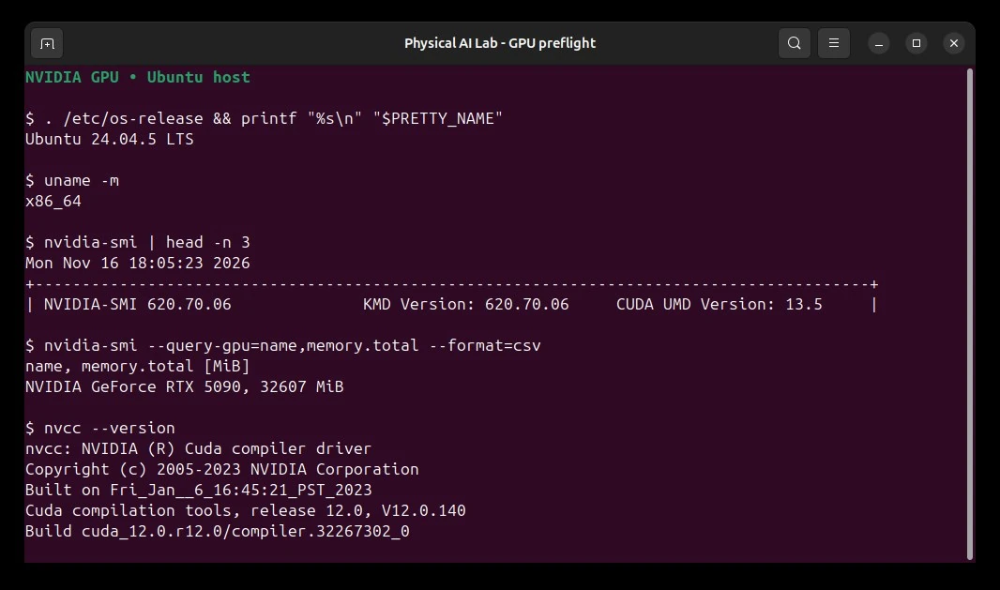

# Set up an NVIDIA Linux machine for Physical AI

Use this guide to check an Ubuntu 24.04 RTX workstation or server before installing Isaac Sim. If you are using a Mac as your main computer, run the GPU commands on the Linux machine over SSH. The [workbench recording](../labs/workbench-capstone.md) can be checked on a CPU.

## Identify the machine and driver

```sh
. /etc/os-release && printf '%s\n' "$PRETTY_NAME"
uname -m
nvidia-smi
nvidia-smi --query-gpu=index,name,driver_version,memory.used,memory.total,utilization.gpu --format=csv
```

Look for the expected GPU and driver, then note the VRAM already in use. `x86_64` and `aarch64` need different packages. Check the exact OS, GPU, driver, and DGX Spark notes for your [Isaac Sim release](https://docs.isaacsim.omniverse.nvidia.com/6.2.0/installation/requirements.html).



### What layer does each command check?

Application libraries reach the GPU through the host driver. Docker adds a step that exposes the GPU device to the container.

| Check | What it establishes |
| --- | --- |
| Host `nvidia-smi` | The driver sees the GPU. Its CUDA field describes driver support. |
| `nvcc --version` | The CUDA compiler version available in this shell. |
| Container `nvidia-smi` | The container can access the device and driver. |
| Run a lab with its own Python | The installed runtime and packages can start the actual workload. |

If the host sees the GPU and the container does not, start with how the GPU is passed into the container. [CUDA Linux installation guide](https://docs.nvidia.com/cuda/cuda-installation-guide-linux/) · [NVIDIA Container Toolkit sample](https://docs.nvidia.com/datacenter/cloud-native/container-toolkit/latest/sample-workload.html)

## Install only the layers your workflow needs

| Layer | What it does | How to check it |
| --- | --- | --- |
| NVIDIA host driver | Gives Linux access to the GPU. Isaac Sim also needs supported graphics and RTX capabilities. | `nvidia-smi`, then the Isaac Sim Compatibility Checker |
| CUDA runtime in an app or wheel | Runs that application’s CUDA code with a compatible host driver. | Check the application's own GPU test or framework runtime version. |
| CUDA Toolkit | Provides `nvcc`, headers, and development tools for building CUDA code. | `nvcc --version` |
| NVIDIA Container Toolkit | Exposes the host GPU and driver libraries to compatible containers. | Run `nvidia-smi` inside a GPU-enabled container. |

The **CUDA UMD Version** field in the screenshot (called **CUDA Version** by older releases) reports the newest CUDA version the driver supports. This machine shows 13.5 there and 12.0 in `nvcc --version`, which reports the toolkit on PATH. A valid driver and application runtime can work without a system-wide toolkit. [NVIDIA SMI field reference](https://docs.nvidia.com/deploy/nvidia-smi/index.html#gpu-attributes) · [CUDA compatibility matrix](https://docs.nvidia.com/datacenter/tesla/drivers/latest/cuda-toolkit-driver-and-architecture-matrix.html)

On a fresh Ubuntu workstation with no working driver, start with the distro's driver selection. Choose a branch supported by the GPU and the Isaac Sim release. On an existing shared machine, have its administrator handle driver changes and reboots.

```sh
sudo apt update
sudo apt install ubuntu-drivers-common
sudo ubuntu-drivers list
sudo ubuntu-drivers install
# After rebooting the workstation:
nvidia-smi
```

A workstation running Isaac Sim should use the graphics-capable driver setup. A compute-only server has a separate path in the [Ubuntu driver guide](https://ubuntu.com/server/docs/nvidia-drivers-installation/) and [NVIDIA driver guide](https://docs.nvidia.com/datacenter/tesla/driver-installation-guide/latest/compute-only-and-desktop-installation.html).

If your project compiles CUDA code, use the [CUDA Linux install guide](https://docs.nvidia.com/cuda/cuda-installation-guide-linux/) to add the repo for your distro and architecture, then install the `cuda-toolkit-X-Y` package for the version the project requires. Versions in NVIDIA's package repo, the host driver, and prebuilt apps have separate lifecycles. Verify the compiler that the shell finds.

```sh
command -v nvcc
nvcc --version
```

For PyTorch, run this inside the project's own environment. Follow its [platform installer](https://pytorch.org/get-started/locally/) when choosing a wheel.

```sh
python -c 'import torch; print("Build CUDA:", torch.version.cuda); print("CUDA usable:", torch.cuda.is_available())'
```

## Use the machine over SSH

Connect to a host where you have an account. Replace `gpu-lab` with its address or SSH alias. Use one terminal to run the experiment and another to monitor it.

```sh
ssh gpu-lab
tmux new -s isaac-lab
# In a second SSH terminal:
watch -n 2 nvidia-smi
df -h .
```

Detach from tmux with **Ctrl+B**, then **D**. Use `tmux attach -t isaac-lab` after reconnecting. Plain SSH works for CLI and headless runs. For the Isaac Sim viewport use a desktop session or the [NVIDIA WebRTC client](https://docs.isaacsim.omniverse.nvidia.com/6.2.0/installation/manual_livestream_clients.html) on a network you control.

Copy the small verification report back from your laptop terminal. Replace the remote path with your clone's location.

```sh
scp gpu-lab:awesome-nvidia-physical-ai/runs/workbench-live/check/report.json .
```

## Check a GPU container

With Docker and the host driver working, add the [NVIDIA Container Toolkit](https://docs.nvidia.com/datacenter/cloud-native/container-toolkit/latest/install-guide.html). For rootful Docker on a machine you administer, configuring the runtime writes to the Docker configuration. Restarting Docker can interrupt workloads. The official guide has a separate rootless setup.

```sh
sudo nvidia-ctk runtime configure --runtime=docker
sudo systemctl restart docker
sudo docker run --rm --runtime=nvidia --gpus all ubuntu nvidia-smi
```

If the host sees the GPU and the [sample container](https://docs.nvidia.com/datacenter/cloud-native/container-toolkit/latest/sample-workload.html) does not, check Docker's runtime and the toolkit before changing the CUDA version inside the image. For the simulator image and license setup, follow the [Isaac Sim container guide](https://docs.isaacsim.omniverse.nvidia.com/6.2.0/installation/install_container.html).

## Diagnose the first failed check

| Observation | What to check next |
| --- | --- |
| `nvidia-smi` does not communicate with the driver | Confirm this is the Linux GPU host. Check your distro's driver install, kernel module, Secure Boot, and pending reboot. |
| `nvidia-smi` works and `nvcc` is missing | Install or locate the toolkit only when compiling CUDA. Isaac Sim has its own application prerequisites. |
| PyTorch reports `CUDA usable: False` | Check the active interpreter, wheel build, driver compatibility, and whether the GPU is visible to that process or container. |
| Simulator starts but the viewport is blank or crashes | Run the Compatibility Checker for RTX, graphics driver, display, and available VRAM. For remote use check how you launched the window or stream. |
| A course asks for NGC or Hugging Face access | Sign in through the provider's instructions and check the specific artifact's permissions. Keep tokens out of shell history and public logs. [NGC Catalog guide](https://docs.nvidia.com/ngc/latest/ngc-catalog-user-guide.html) |

[Continue to the Isaac Sim GUI and CLI](isaac-sim-tools.md) · [Try the workbench project](../labs/workbench-capstone.md)
