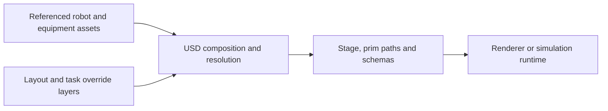

# OpenUSD

[← Catalog](../../README.md) · [한국어](../ko/openusd.md)

   
  <a href="https://openusd.org/release/index.html">Official OpenUSD documentation logo</a>

OpenUSD defines a scene description and composition system. A stage presents the composed scene as prims while opinions about each prim can remain in independent files or in-memory layers.

## Architecture

| Component | Responsibility and data boundary |
|---|---|
| Layer, spec and edit target | A layer stores authored prim and property specs. The stage edit target determines where edits are written, so a task layer can override a source asset without editing the asset file. |
| Composition arcs | Sublayers combine opinions into a layer stack. References bring content into a namespace and payloads provide loadable content. Variant sets expose named alternatives such as equipment configurations. |
| Stage, prim and schema | The composed stage resolves opinions to yield prims and properties. Applied schemas add domain-specific attributes such as physics properties, which a compatible runtime interprets. |

Guide diagram based on the official references below.

### Official figures and examples

Independent layers contribute geometry and other opinions to the composed scene. [Original figure and context](https://docs.nvidia.com/learn-openusd/latest/composition-basics/layers.html)

The sublayer example shows how a parent layer incorporates a set of layers. Order affects which overlapping opinions win. [Original figure and context](https://docs.nvidia.com/learn-openusd/latest/composition-basics/layers.html)

## Walkthrough

1. Reference a reusable robot asset at `/World/Robot`. Keep equipment placement in a layout layer, and configure the test scene’s sensor poses and task targets in a separate edit layer.
2. Compose a stage with both layers. Query the resolved prims in `pxr.Usd` or inspect them in Isaac Sim. Try changing a task-layer opinion and identify which layer supplies the value.
3. Use payloads for heavy environment detail when consumers need selective loading. Package or resolve textures and other dependencies so the stage opens on another machine.

## Validation

- Inspect unresolved paths, up-axis, `metersPerUnit`, prim namespaces and the composition result before importing into a simulator.
- Confirm the runtime supports the applied schemas used for your task. OpenUSD describes content that the runtime consumes.

## License and scope

Pixar’s OpenUSD implementation uses TOST 1.0, based on Apache-2.0 with a modified trademark clause. Asset and specification terms are separate. [OpenUSD LICENSE](https://github.com/PixarAnimationStudios/OpenUSD/blob/39c5ce8fa2255956c18c6ea34c33733980708acd/LICENSE.txt)

## Related guides

[SimReady](simready.md) · [Omniverse](omniverse.md) · [Isaac Sim](isaac-sim.md)

## Official references

- [Pixar OpenUSD introduction](https://openusd.org/release/intro.html)
- [Layer authoring and ordering](https://docs.nvidia.com/learn-openusd/latest/composition-basics/layers.html)
- [Composition arcs](https://docs.nvidia.com/learn-openusd/latest/creating-composition-arcs/index.html)
- [OpenUSD source](https://github.com/PixarAnimationStudios/OpenUSD)
