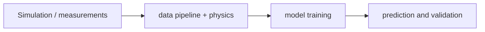

# NVIDIA PhysicsNeMo

[← All projects](../../README.md) · [한국어](../ko/physicsnemo.md) · [Official source](https://github.com/NVIDIA/physicsnemo) · [Documentation](https://docs.nvidia.com/physicsnemo/latest/overview.html)

A deep-learning framework for building and training physics-informed and data-driven scientific machine-learning models.

**License:** Apache-2.0; pretrained models and data can have separate terms. Check the exact release, assets, models, and dependencies before use.

*Image: [official project repository](https://github.com/NVIDIA/physicsnemo); see the source for attribution and reuse terms.*

## Architecture

It provides model architectures, scientific data pipelines and distributed training utilities, with optional physics-informed residual tools. It complements, rather than automatically replaces, a validated numerical solver.

*Conceptual workflow created for this guide; consult the official documentation for implementation details.*

## Workflow

Prepare simulation or measurement data; select a model and physics constraints; train and validate; run inference for a target engineering problem.

## Use cases

Develop aerodynamic flow surrogates, study structural mechanics, or predict physical fields from engineering data.

## Connections

Built on PyTorch; outputs can inform engineering and digital-twin workflows. Model suitability and prediction accuracy must be validated for the target domain.

## Official references

- [Project repository](https://github.com/NVIDIA/physicsnemo)
- [Documentation](https://docs.nvidia.com/physicsnemo/latest/overview.html)
