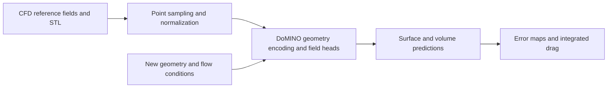

# NVIDIA PhysicsNeMo

[← Catalog](../../README.md) · [한국어](../ko/physicsnemo.md)

PhysicsNeMo is a framework for building and evaluating learned models of physical systems. Its CFD recipes illustrate how a trained surrogate predicts quantities such as pressure or velocity for a new geometry from prior simulations.

## Architecture

| Component | Responsibility and data boundary |
|---|---|
| Training data and datapipe | The DoMINO external aerodynamics recipe ingests geometry, surface fields and volumetric fields. It preprocesses and samples points and can include conditions such as inlet velocity. |
| Geometry representation and local queries | DoMINO constructs a multiscale representation from the geometry and uses local neighborhoods and query coordinates to predict fields at surface or volume points. |
| Training, checkpoint and inference | The model learns from simulation fields. Inference reuses the checkpoint and normalization data with the target STL and conditions, returning surface or volume predictions for analysis. |
| Analysis and solver comparison | Point-wise fields and integrated quantities such as drag offer complementary evaluations. The recipe also includes parallel execution options for large point sets. |

Guide diagram based on the official references below.

### Official figures and examples

The official DoMINO result visualizes predicted fields from the reference aerodynamics workflow. Inspect local field behavior alongside any aggregate score. [Original figure and context](https://archive.docs.nvidia.com/physicsnemo/26.03/physicsnemo/examples/cfd/external_aerodynamics/domino/README.html)

The drag comparison pairs surrogate predictions with CFD-derived values for the reference experiment. [Original figure and context](https://archive.docs.nvidia.com/physicsnemo/26.03/physicsnemo/examples/cfd/external_aerodynamics/domino/README.html)

## Walkthrough

1. Build train and test splits by vehicle geometry. Preprocess CFD samples into geometry points and surface or volume target arrays. Keep the same units, reference velocity and normalization at inference.
2. Train the DoMINO recipe and run the checkpoint on a held-out STL with a specified inlet velocity. Visualize pressure on the body and a velocity slice through the wake.
3. Compare the estimated drag and high-error flow regions with a reference CFD run before using the surrogate to rank design variants.

## Validation

- Integrated drag agreement can conceal local errors. Compare surface pressure, the wake and force estimates separately.
- Track the geometry family and flow-condition range in training. Validate accuracy again if the mesh density or input conditions change.

## License and scope

Framework code is Apache-2.0. Checkpoint and dataset terms depend on the distribution.

## Related guides

[Warp](nvidia-warp.md) · [OSMO](osmo.md)

## Official references

- [PhysicsNeMo repository](https://github.com/NVIDIA/physicsnemo)
- [Framework overview](https://docs.nvidia.com/physicsnemo/latest/overview.html)
- [DoMINO training and evaluation recipe](https://archive.docs.nvidia.com/physicsnemo/26.03/physicsnemo/examples/cfd/external_aerodynamics/domino/README.html)
