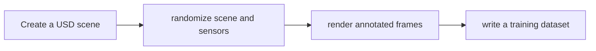

# Replicator

[← All projects](../../README.md) · [한국어](../ko/replicator.md)

## Overview

Synthetic data generation tool within Omniverse/Isaac Sim.

## Conceptual workflow

## Workflow and use

Create a USD scene → randomize scene and sensors → render annotated frames → write a training dataset. This is a conceptual workflow; check the official source for version-specific prerequisites and supported configurations.

**Example use case:** annotated images for object detection. Check applicability, supported inputs and model versions in the official source.

**Related technologies:** Isaac Sim, OpenUSD, TAO Toolkit.

## Architecture and example

A typical Replicator script authors a USD scene, randomizes its conditions, advances simulation, captures annotator outputs and uses a writer to save annotated data.

Generate labeled images of randomly positioned objects for a detection model; inspect labels and coverage before training.

[Official technical source](https://docs.isaacsim.omniverse.nvidia.com/latest/replicator_tutorials/tutorial_replicator_sdg_workflows.html)

## Availability and terms

Product component; complete source availability and independent license unverified. Verify the exact version and the terms of any models, datasets, binaries and dependencies before use.

## Official sources

[Isaac Sim documentation](https://docs.isaacsim.omniverse.nvidia.com/latest/replicator_tutorials/index.html)
