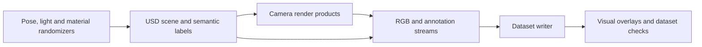

# Replicator

[← Catalog](../../README.md) · [한국어](../ko/replicator.md)

Replicator generates labeled synthetic datasets from simulated scenes. The application defines what changes between captures, which cameras render the scene, which labels to compute and how to write the records.

## Architecture

| Component | Responsibility and data boundary |
|---|---|
| USD stage and semantic labels | Objects, materials and cameras live on the stage. Semantic labels map objects to the classes used by annotators. Physics can settle scattered or dropped assets before capture. |
| Randomizers and orchestrator | The tutorial mixes direct pose/scatter updates with event-triggered graph randomizers. Orchestrator stepping controls when the renderer captures the modified scene. |
| Render product and annotator | A render product connects a camera to the capture pipeline. Annotators obtain data such as RGB, boxes or segmentation from render products and scene metadata. |
| Writer | The writer attaches to render products and serializes selected streams in the chosen format. Multiple cameras can produce synchronized views for each capture step. |

Guide diagram based on the official references below.

### Official figures and examples

The scene-based tutorial shows the warehouse capture workflow and its rendered data. [Original figure and context](https://docs.isaacsim.omniverse.nvidia.com/latest/replicator_tutorials/tutorial_replicator_scene_based_sdg.html)

The palletizing example shows data captured for the randomized UR10 scene. [Original figure and context](https://docs.isaacsim.omniverse.nvidia.com/latest/replicator_tutorials/tutorial_replicator_ur10_palletizing.html)

## Walkthrough

1. Follow the scene-based warehouse tutorial with a forklift, pallet, boxes and several cameras. Assign semantic classes and place objects within task-relevant camera bounds.
2. Seed the randomizer and vary pose, lighting and materials. Advance physics for newly placed objects, trigger a capture, then write RGB and box labels.
3. Overlay labels on a small sample before generating a larger dataset. Split by scene or configuration to reduce correlation between training and evaluation.

## Validation

- Check missing labels, fully occluded targets, camera coverage and writer output format. The warehouse example’s KITTI annotations may require conversion for the chosen trainer.
- Record random seeds and capture timing. Compare a synthetic validation set and real images when measuring a detector’s deployment behavior.

## License and scope

Replicator is distributed as an Omniverse/Isaac Sim component. Check extension, renderer, asset and output terms for the exact distribution.

## Related guides

[Isaac Sim](isaac-sim.md) · [SimReady](simready.md) · [CDF Simulation](cdf-simulation.md) · [TAO Toolkit](tao-toolkit.md)

## Official references

- [Scene-based synthetic dataset generation](https://docs.isaacsim.omniverse.nvidia.com/latest/replicator_tutorials/tutorial_replicator_scene_based_sdg.html)
- [UR10 palletizing randomization](https://docs.isaacsim.omniverse.nvidia.com/latest/replicator_tutorials/tutorial_replicator_ur10_palletizing.html)
- [Persistent and rebuilt SDG scenes](https://docs.isaacsim.omniverse.nvidia.com/latest/replicator_tutorials/tutorial_replicator_sdg_workflows.html)
