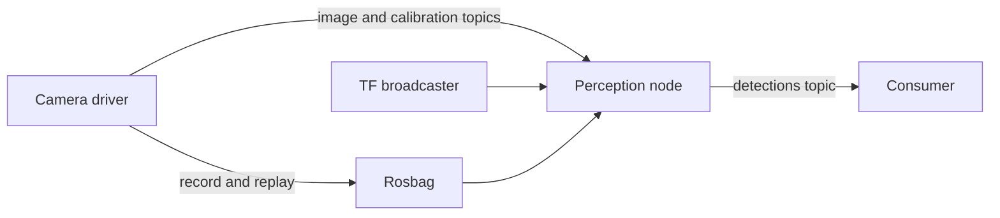

# ROS 2

[← Catalog](../../README.md) · [한국어](../ko/ros-2.md)

ROS 2 provides the application communication layer for robot nodes, including the Isaac ROS packages. Nodes exchange typed messages over middleware.

## How it works

A publisher writes data to a named topic and subscribers consume compatible messages. Services support request/reply; actions support longer operations with feedback and cancellation. QoS policies determine compatibility and delivery behavior. TF connects coordinate frames, and a rosbag records messages for replay.

*Guide diagram based on the official references below.*

## A practical workflow

Record a camera topic and matching camera info and transforms. Replay the bag and connect an Isaac ROS perception node. Inspect the topic graph and measure whether time-aligned messages reach the node under load.

## What to verify

Check ROS distribution, message definitions, QoS compatibility, clock and TF. Separate missing messages due to QoS from valid messages a consumer rejects due to timestamps or transforms.

## License and availability

ROS 2 package and distribution licenses vary; check each dependency and any binary runtime.

## Official references

- [Official technical reference](https://github.com/ros2/ros2_documentation/blob/rolling/source/ROS-Framework/interfaces/About-Topics.rst)
- [ROS 2 QoS concepts](https://github.com/ros2/ros2_documentation/blob/rolling/source/ROS-Framework/interfaces/topics/About-Quality-of-Service-Settings.rst)
- [Related official resource · docs.ros.org](https://docs.ros.org/en/rolling/)
