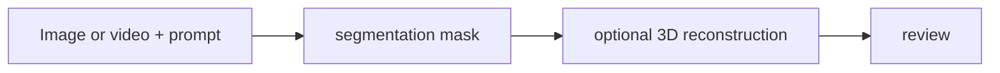

# SAM 2 / SAM 3D Objects

[← All projects](../../README.md) · [한국어](../ko/sam-2-sam-3d.md) · [Official source](https://github.com/facebookresearch/sam2) · [Documentation / related project](https://github.com/facebookresearch/sam-3d-objects)

Meta models for promptable image/video segmentation (SAM 2) and 3D object reconstruction (SAM 3D Objects).

**Availability and terms:** SAM 2 code and model terms must be checked independently. SAM 3D Objects code and checkpoints are governed by the SAM License; review its terms and dependencies.

*Illustration: [official project repository](https://github.com/facebookresearch/sam2); check source reuse terms.*

## Architecture and workflow

*Conceptual illustration for this guide; refer to official sources for supported implementations.*

Select an object using a point, box or other supported prompt; produce and review a mask. A separate SAM 3D Objects workflow can use an image and mask to reconstruct an object.

## Use cases

Segment objects across video frames or reconstruct a 3D object for scene understanding.

## Connections

Grounding DINO may supply boxes; 3D output can support downstream reconstruction workflows. These are separate models, not one automatic pipeline.

## Official references

- [Project source](https://github.com/facebookresearch/sam2)
- [Documentation / related project](https://github.com/facebookresearch/sam-3d-objects)
